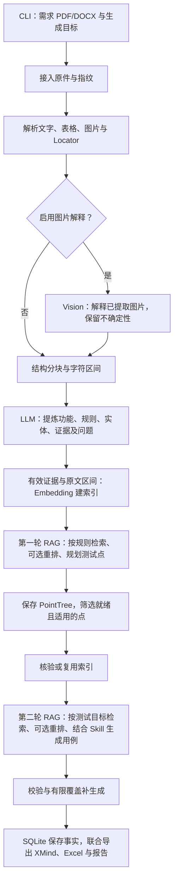

# tc_rag

将 PDF/DOCX 需求文档转为有原文依据的测试点和测试用例的 Python RAG 框架。
一次命令连续完成图文解析、规则提炼、两轮检索增强、Skill 用例生成、校验与联合导出。

[文档导航](docs/README.md) · [完整运行说明](docs/reference/full_run_walkthrough.md) · [架构图集](docs/diagrams/README.md) · [当前质量评估](docs/reviews/quality_review_20261101.md)

当前只保留需求文档输入与 RAG 主线。没有代码仓库输入、独立 OCR 扫描、无检索生成分支、中间人工审批或 XMind 回读。
工程检查通过不代表业务语义、召回完整性或桌面客户端已经验收。

## 快速开始

要求 Python 3.11+，从项目根目录执行。首次使用 uv：

```powershell
uv sync --extra dev
# 已有配置请保留，只在首次使用时复制。
if (-not (Test-Path -LiteralPath workdir/local.yaml)) {
    Copy-Item -LiteralPath workdir/local.example.yaml -Destination workdir/local.yaml
}
# 编辑 local.yaml，填写模型配置后启动。
uv run rag
```

使用 pip 安装：

```powershell
python -m pip install -r requirements/requirements-dev.txt
python -m pip install -e . --no-deps
```

**已经激活虚拟环境时，启动只需：**

```powershell
rag
```

终端只询问需求文档路径，可粘贴带成对引号的 PDF/DOCX 地址。确认后自动使用目标：
“根据需求文档生成功能测试点和测试用例，保留原文依据”。

需要自定义目标时：

```powershell
$doc = 'D:\需求资料\需求文档.docx'
rag run $doc -i '覆盖正常、异常、权限、状态及有明确依据的边界，缺失规则列为待确认' --config workdir/local.yaml --output-dir workdir/output
```

`rag` 与 `tc-rag` 等价；找不到命令时可用 `python -m tc_rag.interfaces.cli start`。
非交互环境不带子命令只显示帮助。`run` 是子命令，不能在 PowerShell 中单独执行；
`rag run 文件路径` **省略 `-i` 时仅预览，不生成用例**。

## 实际运行流程与模型

主线无视觉解释时有 10 个可见阶段，启用视觉解释增加 1 个。两次索引准备分别服务于两轮 RAG；
符合条件时复用索引与向量缓存，不代表把全部资料重新向量化。

| 阶段 | 工作与结果 | 模型角色 |
|---|---|---|
| 接入 | 保存原件、内容指纹和运行记录 | 无 |
| 解析 | 分离文字、表格与图片，保留 Locator 来源定位 | 无 |
| 图片解释（可选） | 解释已提取图片，带来源、不确定性与缓存 | `models.vision` |
| 分块 | 按章节范围组织完整段落、表格行，保存字符区间 | 无 |
| 提炼规则 | 生成 Feature、Rule、Entity、Evidence、Issue，核验引文和引用 | `models.llm` |
| 准备索引 | 有效证据和 Chunk 原文区间向量化、建索引 | `models.embedding` |
| 第一轮 RAG：规划 | 程序基础点 + 按规则查询 + 可选重排，补充测试意图并保存 PointTree | Embedding / 可选 Rerank / LLM |
| 再次准备索引 | 核验第二轮所需索引，满足条件时复用 | 缺失向量才请求 Embedding |
| 第二轮 RAG：生成 | 筛选 `ready + applicable` 点，按目标检索，结合直接证据、规则与 Skill 生成用例 | Embedding / 可选 Rerank / LLM |
| 校验 | 结构、引用、依据风险、重复与覆盖；必要时对覆盖缺口有限补生成 | 通常本地；补生成会再次检索并调用模型 |
| 联合导出 | 保存事实，输出测试点 XMind、实际用例 Excel 与报告 | 无 |



直接证据按规则 ID 加载，不依赖检索是否命中；检索提供补充资料，不能擅自新增可引用规则。
两轮均限定当前需求文档版本，不自动搜索全部历史需求。Rerank 重排前 `rerank_top_n` 个候选，
剩余候选接在后面，**不是只保留 N 条**；失败记录降级并沿用召回顺序。
索引或检索失败会停止，不绕过 RAG。

当前提示词由 [bootstrap.py](src/tc_rag/bootstrap.py) 装配：
`extract/plan_points/generate` 用 v2，`rag_context/vision/case_skill` 用 v1。
默认 Skill 参与生成，可用 `--skill-file '规范.md'` 追加 UTF-8 Markdown 表达规范；
Skill 不能覆盖需求事实、Schema 或引用约束，也不直接生成 Excel。
[候选 v3](prompts/candidates/v3/README.md) 尚未启用，版本说明见 [prompts](prompts/README.md)。

## 配置要改哪份

日常只维护 **`workdir/local.yaml`**；它包含本机模型和密钥，不应提交 Git。

| 位置 | 用途 |
|---|---|
| `pyproject.toml` / `uv.lock` | 项目依赖、安装入口与检查工具；uv 锁定解析结果 |
| `config/defaults.yaml` | 公共默认模板；不是本地文件的自动补充层 |
| `config/example.yaml` | 不自动加载的配置示例，部分策略有意不同 |
| `workdir/local.example.yaml` | 首次复制使用的无密钥模板 |
| `workdir/local.yaml` | 实际模型、检索、并发及导出参数 |

CLI 先选一份文件：`--config` → `workdir/local.yaml` → `config/defaults.yaml` → 内置默认。
随后按“默认值 → 该 YAML → 环境变量 → CLI 覆盖”合并并经 Pydantic 校验，不依次加载全部 YAML。
各角色非空 `api_key` 优先，否则读取 `api_key_env`；密钥不进入配置快照或导出。

正式生成必须配置 `models.llm`、`models.embedding`；`retrieval.embedding_dimension` 必须匹配模型真实返回维度。
图片解释由 `parsing.vision_enabled` 控制并配置 `models.vision`；重排在 `models.rerank.enabled` 开启并填写端点。
不同角色可接不同厂商或私有部署的兼容服务，具体以已实现适配器为准。

几个容易误解的默认项：

```yaml
chunking:
  strategy: structural       # 当前仅实现此策略，不是任意字符硬切
  target_tokens: 900         # 近似预算；超长完整段落可能超出并告警
planning:
  ui_display_policy: merge   # 同功能纯图片界面展示点合并
  vision_policy: aggregate   # 普通纯图片点汇总为待补充问题，存在展示汇总/边界例外
export:
  point_tree_layout: module  # module / feature / chapter
```

`vision_policy` 的 `downgrade` 保留普通纯图片点并降为待补上下文，`keep` 保留原点；
展示汇总点保留，`aggregate` 下的纯图片边界点保留但降为待补上下文。
这些策略会改变就绪点和用例数量，应结合来源核对，不能将图片解释直接认作已确认事实。
公共 `config/example.yaml` 显式使用 `downgrade + feature`，与默认值不同。
修改策略、模型、解析或目录布局后建议新建运行，不强行复用旧配置快照。

## 输出怎么看

默认目录是 `workdir/output/运行ID/`：

| 文件 | 内容 |
|---|---|
| `testpoints_需求名.xmind` | 策略处理后保存的全部测试点；默认按模块/章节 → 业务维度 → 功能 → 目标组织，点上保留方法和待补充/待澄清等状态标签 |
| `testcases_需求名.xlsx` | 实际保留的用例；十一列“模版”主表及阅读说明、测试点、规则、覆盖矩阵、问题清单、未解析范围、用例追溯、质量说明附表 |
| `testcases.json` / `report.md` | 由 `export.formats` 控制的结构化/可读派生产物 |
| `manifest.json` | 去密钥配置、提示词/Skill 指纹、运行统计 |
| `reports/quality.md` / `reports/metrics.json` | 质量提示、计数和耗时 |

`feature` 布局按状态 → 业务维度 → 功能；`chapter` 在其功能层之前增加章节。
`module` 默认布局以原文章节为先，无定位时回退功能，跨模块单列，不再以状态作为根分组。
XMind 不包含完整步骤和预期，不作为后续生成输入。
Excel 只展示实际用例，客户端打开和测试管理平台导入仍需单独验证。

**测试点数、就绪点数、已覆盖点数与用例数是不同指标。** 没有就绪点时也可能输出仅表头的用例表。
存在未关闭 warning/error 时运行可标记 `partial_failed`；仅有 info 问题不必然触发它。
文件已生成、引用合法或 `succeeded` 都不等于业务验收通过。

## 常用命令（已激活虚拟环境）

```powershell
rag --help
rag start --config workdir/local.yaml --output-dir workdir/output
rag run $doc --preview                       # 离线预览
rag estimate $doc                            # 本地解析与分块，估算抽取调用量
rag doctor                                  # 离线配置检查
rag status                                  # 最近 20 次运行

$runId = '替换为实际运行ID'
rag status $runId
rag inspect $runId --stage issues
rag inspect $runId --stage failure
rag inspect $runId --stage retrieval         # 两轮查询、候选、重排与上下文审计
rag inspect $runId --stage invocations       # 调用与安全结构修复诊断
rag quality $runId                           # 只读快照质检，输出 quality_check.json/md

# 从已保存测试点重做用例阶段：仍调用模型，要求原配置/Skill 兼容。
rag cases $runId --config workdir/local.yaml
# 仅离线重导已有 cases，不调用模型，不重新验证业务质量。
rag inspect $runId --stage cases --format xlsx --output workdir/output/$runId/reexport.xlsx
```

`quality` 的 fail 返回退出码 2；加 `--strict` 时 warn 也返回 2。
`evaluate` 使用人工金标，不调用模型，参数见 `rag evaluate --help`。
有限恢复仅支持 `run --resume $runId --from-stage extract|plan_points`，还需提供原文档、相同目标和兼容配置；
不是任意失败节点继续执行。详细命令见 [完整运行说明](docs/reference/full_run_walkthrough.md)。
`doctor --live` 会调用真实服务，最多 8 次请求，仅检查虚构材料首轮 RAG，不能当作完整验收。

三种度量比较可分别运行下列命令；都会真实生成并产生费用，输出目录相互独立：

```powershell
rag run $doc -i '根据需求生成测试点和用例，保留原文依据' --metric cosine --normalize --output-dir workdir/output/compare/cosine
rag run $doc -i '根据需求生成测试点和用例，保留原文依据' --metric euclidean --normalize --output-dir workdir/output/compare/euclidean
rag run $doc -i '根据需求生成测试点和用例，保留原文依据' --metric dot --normalize --output-dir workdir/output/compare/dot
```

当前 `euclidean` 使用平方 L2，越小越近；cosine/dot 越大越近。
非零单位向量下三者理想排序等价；取消归一化不会恢复已单位化缓存的原始模长。
严格的算法/重排效果实验须固定同一语料、查询与标注，使用 [eval 指南](eval/README.md)，不要直接比较多轮随机生成的用例。

## 目录与开发验证

```text
config/          公共配置模板
prompts/         生效阶段提示词；candidates/ 放未启用候选
src/tc_rag/      interfaces → application → domain；infrastructure 实现端口
tests/          离线单元/集成测试及显式启用的 live 测试
eval/           实验入口；templates/ 为本地标注页模板
docs/           design 设计 / learn 学习 / reference 参考 / diagrams 图集 / reviews 评审记录
scripts/        可复用开发脚本
workdir/        本地配置与运行数据；dev/ 为测试、评估、临时工具等开发资料
```

SQLite 是结构化业务事实来源；JSON、XMind、Excel、Markdown 和向量索引为派生产物。
不要移动 `data.sqlite`、资产、索引或被快照引用的产物路径。
完整职责及清理边界见 [目录说明](docs/reference/directory_structure.md)。

```powershell
python -m pytest -q
python -m ruff check .
python -m mypy src
```

2026-11-01 改动前后离线检查均为 **628 passed、2 skipped**，Ruff 通过，Mypy 严格检查通过（57 个源文件）。
跳过项为可选 jieba 适配测试和显式启用的真实模型测试；本轮没有发起真实模型请求。
这不代表全项目测试覆盖率、真实模型成功率、完整召回率或业务可用率。
当前优先补齐业务语义验收、完整相关性标注、固定条件的性能对照；详细证据、风险和建议见 [质量评估](docs/reviews/quality_review_20261101.md)。
