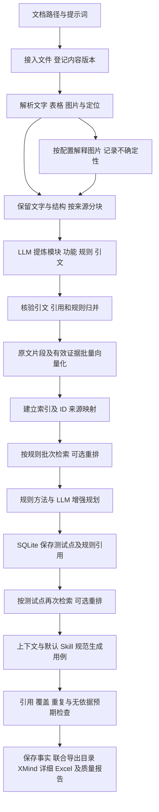
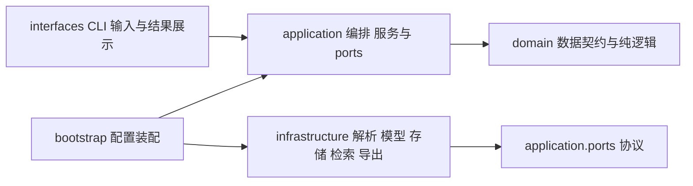

# tc_rag 架构设计

更新日期：2026-10-29。本文描述当前唯一的 RAG 流程；后续能力集中列在文末，开发顺序见 [开发指南](dev_guide.md)。

## 1. 框架要完成什么

用户在 CLI 输入 PDF/DOCX 路径和提示词，连续完成测试点规划和用例生成，在同一目录得到 XMind 测试点目录、Excel 详细用例、覆盖报告和问题清单。已移除中间人工审核与批准记录依赖。

规划和生成都使用 RAG。生成模型和 embedding 是必需能力；图片解释、关键词召回、rerank 和 FAISS 按配置启用，仍服务于同一条流程。索引或检索失败时停止生成。

输入范围仅为需求 PDF/DOCX 及其派生文字、表格和图片解释。已移除代码仓库读取、源码扫描和独立代码索引；上下文只围绕需求证据构建，Skill 仅约束用例表达。

框架的核心交付是可替换、可配置、可观察的检索增强流程。测试用例是该流程的应用场景。功能提炼、测试点规则绑定和自动校验共同约束结果；不明确规则保留为问题，不能被 Skill 或检索相似度补造。

## 2. 总体数据流

图片未启用识别、扫描页无法读取或规则不明确时，必须报告未解析范围及待确认问题。图片转换结果保留来源和不确定性，不能直接当作已核对的原文。

## 3. 分层与代码边界

| 位置（相对 `src/tc_rag/`） | 职责 |
|---|---|
| `interfaces/cli.py`、`interfaces/workflow.py` | 注册命令、收集输入和 Skill 路径、诊断、显示联合产物 |
| `interfaces/progress.py` | 中文阶段进度、批次与等待心跳 |
| `application/orchestration/pipeline.py` | `generate()` 连续调用内部 `points()` 和 `cases()`，保留预算、快照和检索增强 |
| `application/ports/contracts.py` | LLM、Embedder、Parser、Repository、RetrievalContext 等替换边界 |
| `application/services/` | 接入、分块、引文校验、规则归并、测试设计、质量评估 |
| `domain/models.py`、`pipeline.py`、`review.py`、`rag.py` | 原文、规则、用例、测试点树、向量空间及检索记录；旧审核模型只兼容历史数据 |
| `infrastructure/parsing/` | DOCX、PDF 图文与结构读取 |
| `infrastructure/providers/` | 生成、embedding、vision、rerank 和离线替身 |
| `infrastructure/retrieval/` | 度量、NumPy/FAISS 索引、范围、缓存、关键词与上下文 |
| `infrastructure/storage/`、`exporters/` | SQLite、资产、XMind、Excel、JSON/Markdown |
| `core/config.py`、`bootstrap.py` | 配置校验、凭据引用、适配器装配；检索器必须注入 |

依赖方向为 interfaces → application → domain；infrastructure 实现端口。领域层不导入 SDK、不访问数据库、不执行文件 I/O。CLI 状态查询与计划预览不创建真实模型客户端。

## 4. 领域对象与证据链

| 对象 | 含义与必须保留的信息 |
|---|---|
| Asset / Document | 文件路径、校验和、内容版本；改名不等于内容变化 |
| DocumentBlock | 原文段落、标题、表格或图片；保留顺序、定位和处理来源 |
| Chunk / ChunkSource | 模型处理单位；记录 Block 内 `[start_char, end_char)` 区间 |
| EvidenceSpan | 可回到 Block 核验的引文；视觉来源带模型、版本、不确定性 |
| Feature / RequirementRule | 功能分组及独立业务要求；规则引用功能和证据 |
| TestPoint | 检查目标、设计方法、规则引用、适用性和技术状态 |
| PointTree | 模块及测试点目录，保留运行、文档版本和 point_id；XMind 不是生成输入 |
| TestCase / TestStep | 操作与预期；每步带规则和证据引用 |
| CoverageLink / Issue | 步骤级关联及缺漏、冲突、无依据预期等问题 |
| Run / StageSnapshot / ModelInvocation | 配置与阶段事实、模型消耗、耗时和失败位置 |

约束详见 [领域契约](../reference/contracts.md)。所有领域契约拒绝未知字段；结构校验与引用存在性检查不证明业务语义正确。

例如需求明确“每次最多 300 个，数量为整数”，边界方法可产生 299/300/301。若没有错误文案，就不能把自行编写的精确提示列为预期；若单位或精度不明，应保留待确认。

## 5. 文档、图片与提炼

接入校验文件路径、格式、大小及文件包，按内容指纹管理原件。DOCX 保留主文档顺序、段落/表格位置；PDF 保留页码与坐标。复杂版式、合并单元格、文本框、低质量页面等局限写入 Issue。

原始 Block 不随清洗被覆盖。分块按标题、段落及完整表格行组织，来源区间可回查；核验引文时才使用受限的空白/全半角归一化。不能删掉否定词、条件、单位或例外。

图片解释在配置启用后处理已提取的图片资产。结果作为带 `origin=vision` 的文字来源参与分块与提炼，记录模型/版本并保持不确定。图片统一通过 Vision 处理，不设独立 OCR 扫描路线；低文字量或扫描页报告未解析，当前不自动渲染整页图片，需提供可读取文字的 PDF/DOCX。

提炼请求受 `models.llm.concurrency` 限制并发执行；先检查完整请求预算，结果按原文顺序归并，一批失败会取消并收尾其他任务。模型给出的证据必须属于输入原文范围，随后核验跨对象引用、归并重复规则并暴露冲突。

## 6. RAG 核心设计

### 6.1 索引的是什么

`Pipeline._retrieval_evidence()` 汇总有效引文和 ChunkSource 对应的原文区间，保留证据 ID、Block、定位和来源。这样既能检索已提炼依据，也能召回提炼时遗漏的背景。

功能通过规则和证据引用追溯到索引项；当前不单独持久化一套“功能向量事实库”，也不把召回相似项自动升级为功能依赖关系。SQLite 保存事实，索引及 ID 清单为可重建的派生数据。

### 6.2 向量空间、批量与缓存

空间由服务地址、模型、实际维度、归一化设置和输入模板版本决定。文本指纹与空间 ID 共同约束缓存；换空间不能复用旧向量。批量调用按 `batch_size`、`concurrency` 执行，响应按 index 恢复顺序，拒绝缺失、重复、维度错误和非有限数。

业务字符串 ID 经 SQLite 映射为唯一 int64，不能截断 UUID 充当索引 ID。构建、文件校验、manifest 和来源映射完成后才发布活动索引；失败不把半成品设为可查询状态。

### 6.3 度量与后端

| 度量 | 实现及含义 | 排序方向 |
|---|---|---|
| cosine | math 逐条基准与 NumPy 批量余弦；拒绝零向量 | 大到小 |
| euclidean | 平方 L2 距离，不开方 | 小到大 |
| dot | 内积，是否归一化由空间配置决定 | 大到小 |

默认 NumPy 精确搜索，可选 FAISS Flat 精确索引。需校验同一空间、相同数据下的映射与排序一致性；分数不能跨模型/度量直接比较。当前不设置通用绝对阈值，也不声称已支持近似索引。

### 6.4 查询、重排与上下文

`RagContext.prepare()` 绑定本次文档版本和证据集合；当前 RequirementSet 只含一份文档。`retrieve()` 将规则批次或测试点批次的问题向量化，在此范围检索，必要时执行关键词召回/RRF 和 HTTP rerank。

规则绑定的原文证据始终进入核心上下文，检索只补充相关条件和例外。预算不足时按记录顺序减少补充材料，并保存采用/省略的 ID；不能为容纳补充材料静默裁掉核心依据。补充内容与原文冲突时应暴露问题。

检索记录包含查询、scope、space_id、index_version、原始分数、排名、重排状态、采用/省略项、缓存命中和分段耗时。`direct_ids` 仅指规则绑定的原文证据 ID。

索引/查询故障停止生成；rerank 故障保留已有召回排名并记录降级。开启 rerank 不等于语义效果已经改善，需人工相关性标注验证。

## 7. 连续生成与联合导出

`Pipeline.generate()` 先由 `points(publish=False)` 完成提炼、索引和 RAG 增强规划，将测试点保存为 SQLite 事实；随后直接调用 `cases()`，不回读脑图或创建批准记录。

`cases()` 校验运行、配置、文档指纹和测试点规则引用，从同一运行快照重新准备索引并检索。
不适用或待澄清测试点不生成确定用例，仍写入测试点表与问题清单。用例阶段失败后可用 `cases RUN_ID` 重试。

默认加载 `prompts/case_skill/v1.md` 约束命名、优先级和表达粒度。可用 `generation.skill_file` 或 `--skill-file` 追加自包含 Markdown，内容只进入生成提示词，不成为需求证据。内置和自定义规范的指纹进入快照与缓存依赖。

生成后检查 Schema、引用闭包、步骤关联、规则覆盖、重复与可疑预期。`validated` 仅表示自动检查通过。
同一目录始终输出测试点 XMind 和用例 Excel，文件名带需求名称后缀，以 CLI 展示的路径为准。
XMind 展示全部测试点，按“状态 → 业务维度 → 功能 → 目标”分层，包含待澄清点，无步骤、预期或完整用例。
Excel 展示实际生成的用例，保留十一列模板、所有测试点及质量附表；没有就绪点时可只有表头并记录缺口，不能将文件存在视为有效覆盖。
首次交付在运行目录；已有交付后重生成使用新批次目录。历史审核表及模型保留以兼容已有数据库，新流程不读写批准记录。客户端兼容性及真实业务效果仍需实际验收。

## 8. 配置、模型和运行控制

个人配置位于 `workdir/local.yaml`，模板位于 `config/defaults.yaml`、`config/example.yaml`。CLI 先选择显式 `--config`，否则 local，再 defaults；选定后按内置默认 → YAML → 环境变量 → CLI 覆盖校验。

| 配置 | 控制内容 |
|---|---|
| `models.llm` | 生成模型、协议、输出格式、并发及 max_output_tokens 单次输出上限 |
| `models.embedding`、`retrieval.embedding_dimension` | 向量服务、批量并发及真实维度 |
| `retrieval` | NumPy/FAISS、度量、归一化、top-k、关键词、重排候选数 |
| `parsing.vision_enabled`、`models.vision` | 视觉解释与模型能力声明 |
| `models.rerank` | 可选 HTTP 重排端点与模型 |
| `runtime`、`generation` | 输入预算、超时、有界重试、结构修复和用例批次 |
| `export` | 导出格式、问题/覆盖信息与 Excel 字段映射 |

OpenAI SDK 的兼容协议适配器已实现，可接配置兼容的生成服务；DeepSeek Chat 使用 `response_format: json_object` 并继续进行本地严格校验。`thinking_mode` 仅用于明确支持该扩展参数的 Chat 服务。LangChain 和 Claude SDK 目前只有配置/可选依赖声明，无可用适配器。

用户可在被 Git 忽略的 `workdir/local.yaml` 直接填写 `models.<role>.api_key`；非空值优先，留空时回退 `api_key_env` 环境变量。四类模型使用同一凭据读取函数；密钥用 SecretStr 保存并从序列化中排除，不进入运行快照、终端和导出，也不参与业务配置指纹。公共模板不含真实密钥。

输入预算包含提示词、正文、定位元数据和 Schema；不能把本地预算当远端模型容量。
`max_output_tokens` 与输入预算分开：留空使用服务商默认，配置后按 Chat/Responses 协议
分别发送 max_tokens/max_output_tokens；模型返回截断结果时停止，不保存为有效业务结果。

视觉请求使用 runtime.max_attempts 有界重试临时故障，鉴权失败不重试。
`runtime.vision_min_interval_seconds` 控制视觉请求启动间隔；连续 429 的退避跨图片生效，
成功后重置。智谱已知账户/额度限制会阻止本轮后续未缓存图片请求；
仅保存 HTTP 状态及经过校验的业务码，不输出供应商异常正文。细节见
[图片证据](../learn/P2/07_图片证据.md)。
终端显示图片处理进度、缓存及失败汇总；失败图片保留为待确认，不能视为已理解。

`max_calls` 约束 LLM、embedding、vision、rerank 的实际请求，重试和修复也消耗预算。缓存命中不新增请求。usage 未知使用 null；`max_cost` 尚无定价实现，显式配置会被拒绝，不能给出虚假费用估算。

## 9. 存储、观察与失败恢复

SQLite 为结构化业务事实来源；顺序迁移维护文档、规则、用例、审核、阶段、向量空间、缓存及索引记录。新版本新增迁移，不能修改已应用 SQL。事务保护事实和引用，网络请求不占用长数据库事务。

`workdir/` 保存真实资料、资产、数据库、索引及默认产物；不得纳入 Git。首轮产物默认在 `workdir/output/运行ID/`，用例输出在独立批次目录，CLI 支持指定输出根目录。

`workdir/dev/` 集中管理测试临时文件、构建/安装验证、工具依赖、缓存、性能结果、
私有演示及旧配置备份；不参与默认配置选择。运行文件路径可能被资产、审核及快照引用，
目录整理保留其原位置。完整目录约定见 [目录结构与文件用途](../reference/directory_structure.md)。

`@timed` 支持同步/异步函数，使用单调时钟和上下文隔离。通用 Timer 保持内存收集；实际编排另外持久化阶段/调用耗时，检索保存每次匹配的向量化、搜索、重排、组装耗时。三者含义见 [计时参考](../reference/timing.md)。

终端显示中文阶段、批次、耗时和 10 秒等待心跳，进度到 stderr，结果到 stdout。失败保存阶段和异常类型，避免输出原始需求、模型响应及凭据。

现有恢复只支持 extract/plan_points 的有限恢复，要求配置、指令、文档一致，并创建新运行。尚无完整持久化任务 DAG 与任意节点续跑；旧配置快照不符合当前契约时需要重新生成。历史运行仍可用 status/inspect 查看，已有用例可离线 export，不自动改写旧快照。

## 10. 验证边界与后续范围

默认测试用虚构文件、模型替身与真实离线索引验证完整流程，网络模拟验证供应商协议失败路径。`doctor` 仅离线检查配置；显式 `doctor --live` 使用独立虚构需求，最多 8 次 LLM/embedding 请求验证首轮 RAG 和 XMind，不覆盖业务质量、vision、rerank 与用例阶段。

真实验收需人工检查规则语义、条件/例外召回、无依据预期、重复、覆盖、耗时/token 以及客户端往返。评估读取已完成运行和人工金标，不发起模型调用；缺失标注的指标为 null。

| 后续范围 | 当前边界 |
|---|---|
| P3 可靠运行 | 任务/attempt 持久化、完整 DAG 续跑、失效传播、精细预算与故障恢复待实现 |
| P4 复杂需求 | 低质量图文与复杂版式、多文档、业务关系确认与流程用例待实现 |
| P5 规模与复用 | 真实评估后调优重排、近似索引、历史用例复用、HTTP API 待实现 |

后续只扩展这条 RAG 流程，不增加平行生成路线。详细实现目标、验收和审核顺序以 [开发指南](dev_guide.md) 为准。
