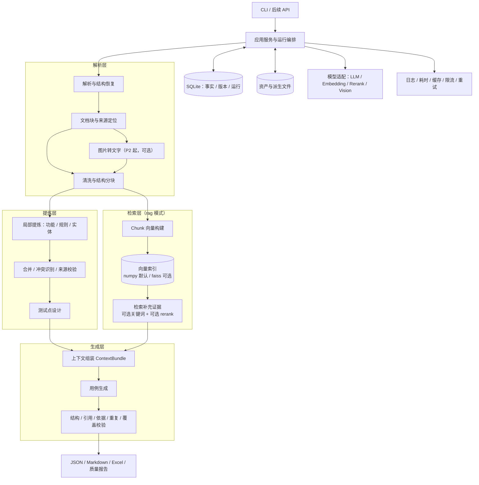

# tc_rag 框架设计说明书

版本：v1.0　日期：2026-10-22
状态：设计提案。项目尚无业务实现，本文定义开发目标，不代表功能已完成。
配套文档：《tc_rag 分阶段开发指南》（`tc_rag_dev_guide.md`）

---

## 1. 项目定位与边界

### 1.1 定位

面向测试工程师的需求驱动测试设计工具：输入需求文档（PDF / Word），输出**可追溯、可评审**的功能测试用例，以及需求缺口、证据引用和覆盖报告。

核心链路：

> 原始文档 → 结构化证据 → 功能与规则 → 测试点 → 测试用例 → 校验与覆盖报告

原则：**RAG 负责发现和补充证据；模型负责理解和表达；程序负责约束、追踪和校验。** 生成结果不等同于已通过人工验收的正式用例。

### 1.2 首版边界

| 范围内 | 范围外（首版不做） |
|---|---|
| 本地 CLI、模块化单体、单人单机 | 自动执行测试、浏览器操作 |
| 文本 PDF、DOCX、单个需求集 | 性能压测、安全渗透 |
| direct / rag 两种模式 | 测试管理平台双向同步 |
| JSON / Markdown 输出（Excel 在 P2） | 多人权限系统、微服务集群 |
| 缺口、冲突、覆盖矩阵报告 | 自动判定业务冲突的最终答案 |

扫描 PDF、复杂流程图理解、多文档联合需求集、跨功能流程、历史用例复用，逐阶段加入。
用例中的权限检查属于功能测试，不因出现"安全"字样就扩展为安全专项。

---

## 2. 需求追溯：原始需求与功能点如何落地

### 2.1 四条原始需求

| 原始需求 | 设计落点 |
|---|---|
| 用 vibe coding 开发 RAG 框架 | 模块边界清晰、接口先行、每步可独立验证；配套《开发指南》分步驱动 Claude Code |
| 实现不同相似度算法 | `SimilarityMetric` 接口：cosine_math / cosine_numpy / euclidean / dot；检索后端 numpy / faiss 可切换（§11） |
| 框架化、配置化 | 分层架构 + 端口适配器 + 注册表 + `config/*.yaml`（§5、§17） |
| 自动计算每次匹配耗时 | `@timed` 装饰器 + Timer 收集器 + 检索分段计时 + 运行报告（§18） |

### 2.2 十三个功能点与阶段

| 编号 | 功能点 | 设计章节 | 交付阶段 |
|---|---|---|---|
| F1 | PDF / Word 按路径读取 | §8 | P1 |
| F2 | 文字与图片分离 | §8 | P1（分离）/ P2（图片转文字） |
| F3 | 图片经视觉模型转文字（去噪） | §8、§16 | **P2 基础版**，P4 完整版 |
| F4 | 清洗、去噪、分块 | §8 | P1 |
| F5 | 通用对话 LLM 提炼 | §9、§16 | P1 |
| F6 | 向量模型批量调用 + 并发 | §16 | P2 |
| F7 | 向量存储与索引 | §11、§14 | P2 |
| F8 | 多种相似度算法 | §11 | P2 |
| F9 | 关联功能点检索 | §12（证据补充）、§13（关系） | 证据补充 P2，关系确认 **P4** |
| F10 | rerank 调用 | §11、§16 | **P2 接口 + HTTP 适配器，默认关闭**，P5 评估后启用 |
| F11 | LLM 增强生成测试用例 | §10、§13 | P1 |
| F12 | 框架化、配置化 | §5、§17 | P0 |
| F13 | 通用耗时装饰器 | §18 | P0 |

### 2.3 相对初版方案（Codex 流程图）的关键调整

| 初版问题 | 本方案处理 |
|---|---|
| 只向量化功能点，丢失原文上下文 | 以 **Chunk** 向量为主；功能点必须挂回 `evidence`，可追溯原文 |
| "找关联功能点"无产出定义 | 关系作为带方向、带证据、带状态的 `Relation`；**候选检索与证据确认分开** |
| 固定"每功能 × 4 类用例" | 引入 **TestPoint** 层；类型由测试设计方法与适用性决定 |
| rerank 位置不清 | 限定候选数、可关闭、需评估收益后启用 |
| 缺工程项 | 版本、缓存、重试限流、幂等、评估集、校验与覆盖报告 |
| jsonl 与 faiss 双份易不一致 | **SQLite 为唯一事实来源**，向量索引为可重建派生产物 |

---

## 3. 关键设计决策

| 决策 | 方案 | 理由 |
|---|---|---|
| 系统形态 | Python 模块化单体，CLI 为首个入口 | 降低部署与调试成本 |
| 主数据 | SQLite（结构化事实 + 运行状态） | 事务、关联查询、恢复 |
| 文件产物 | 原文件、图片、向量矩阵、报告为受管理文件，库中登记 checksum | 大对象不入业务表 |
| 数据交换 | JSON 规范交换；JSONL 为快照；Excel / MD 为视图 | 机器可读与人工可读一致 |
| 向量检索 | `VectorIndex` 接口；**numpy 精确检索为默认，faiss Flat 为可选后端** | 单需求集通常只有数百到数千向量，numpy 足够；faiss 安装有平台风险；范围过滤 numpy 更简单 |
| 相似度 | 度量与后端分离；cosine_math 作对照实现 | 满足"不同算法"并可做基准 |
| 模型接入 | `openai` SDK 异步客户端（覆盖 DeepSeek / OpenAI / 智谱兼容端点）；LangChain、Claude SDK 仅作**可选适配器**，不进入核心依赖 | 核心不被框架绑死 |
| rerank | 独立 `Reranker` 端口；智谱等走 HTTP 适配器；默认关闭 | 无跨厂商统一 SDK，需评估再启用 |
| 编排 | P1 顺序阶段 + 阶段产物落盘；P3 升级为显式 DAG + 持久任务状态 | 避免首版过重 |
| 输出质量 | 确定性校验优先，模型评审补充 | 避免模型自评成为唯一标准 |
| 业务关系 | 候选检索与证据确认分开 | 语义相似 ≠ 业务依赖 |
| 版本 | 不可变需求集快照 + 独立运行记录 | 防止新旧需求混用 |
| 依赖控制 | 只抽象已知替换点，不建设通用插件平台 | 控制首版复杂度 |

> SQLite 是结构化数据的唯一事实来源。JSONL、Excel、向量索引不能独立更新业务真相。

---

## 4. 总体架构图

### 4.1 架构图（Mermaid）



### 4.2 数据流（文本图）

```
需求文档 (PDF / DOCX)
   │
   ▼
① 解析：文字块(+标题路径/页码/表格) ＋ 图片(+位置)
   │                         └─(P2)→ 视觉模型 → 图片描述(origin=vision)
   ▼
② 清洗 + 结构分块 ──→ Chunk (+ 到 Block 的来源映射)
   │
   ├────────────────────────────┐
   ▼                            ▼
③a 局部提炼（LLM）           ③b Embedding（rag 模式）
   → 合并/冲突识别              → 向量索引(快照发布)
   → Feature / Rule / Entity           │
   → TestPoint                         │
   │                                   │
   └──────────────┬────────────────────┘
                  ▼
④ 上下文组装：直接证据(按ID加载) → 关联证据 → 检索补充(可选rerank)
                  ▼
⑤ 用例生成（按测试点批次）
                  ▼
⑥ 校验：结构 → 引用 → 可执行性 → 依据 → 重复 → 覆盖
                  ▼
⑦ 导出：JSON / MD / Excel + 缺口·冲突·覆盖矩阵报告

底座：配置 │ @timed 耗时 │ 缓存 · 重试 · 限流 │ 指纹与失效 │ 运行清单
```

---

## 5. 分层与依赖方向

| 层 | 内容 | 约束 |
|---|---|---|
| 领域层 `domain` | 业务对象、状态枚举、不变量 | 不调用模型和数据库，不导入任何供应商 SDK |
| 应用层 `application` | 阶段服务、运行编排、上下文组装；通过 `ports` 使用外部能力 | 不直接执行 SQL |
| 基础设施层 `infrastructure` | SQLite、文件、解析库、模型 API、向量后端、导出 | 实现 ports |
| 入口层 `interfaces` | CLI；后续 API 复用应用服务 | `bootstrap.py` 负责装配具体实现 |

依赖方向：`interfaces → application → domain`，`infrastructure → application.ports + domain`。
模块不等于进程：初期同一进程运行，解析与批量计算按需使用工作线程/进程。

---

## 6. 端到端流程与状态

| 阶段 | 输入 | 输出 | 失败处理 |
|---|---|---|---|
| ingest | 文件路径 | Asset、Document（hash 去重） | 格式/大小校验失败即停止 |
| parse | Asset | DocumentBlock（含 locator） | 未解析范围记入 Issue |
| chunk | Block | Chunk + 来源映射 | — |
| extract | Chunk | 候选功能/规则/实体 | 结构校验失败有限次修复 |
| reconcile | 候选 | 合并后的 Feature/Rule；冲突 Issue | 冲突不自动覆盖 |
| plan_points | Rule | TestPoint（含适用性） | 证据不足标记 needs_clarification |
| embed / index | Chunk | 向量 + 索引快照 | 维度不符快速失败 |
| context | TestPoint | ContextBundle | 超预算拆批，不静默截断 |
| generate | ContextBundle | TestCase 草稿 | 超时/限流重试，截断缩批 |
| validate | TestCase | 状态 + Issue + 覆盖矩阵 | 问题保留，有效用例继续导出 |
| export | 全部 | JSON/MD/Excel/报告 | — |

Run 状态：`queued / running / succeeded / partial_failed / failed / cancelled`。
**技术失败与质量问题分别统计**：成功导出附待确认报告，不等于需求已全部澄清。

---

## 7. 核心领域模型

对象标识（ID，用于引用）与内容指纹（fingerprint，用于缓存/比较/去重）分开。所有业务对象带 `schema_version`。

| 对象 | 核心字段 | 职责 | 阶段 |
|---|---|---|---|
| Document | document_id, name, content_hash, asset_id | 文档身份与版本（P1 以 hash 区分版本） | P1 |
| Asset | asset_id, relative_path, checksum, mime_type | 文件登记 | P1 |
| DocumentBlock | block_id, document_id, kind, heading_path, order, content, locator | 保留结构的解析单元 | P1 |
| Chunk | chunk_id, text, token_estimate, fingerprint, sources[(block_id, 起止字符)] | 检索与提炼单元；来源映射多对多 | P1 |
| EvidenceSpan | evidence_id, block_id, locator, quote, origin | 可校验证据；origin ∈ text / ocr / vision | P1 |
| Feature | feature_id, name, description, evidence_ids | 功能组织单元 | P1 |
| RequirementRule | rule_id, feature_id, kind, statement, structured_constraint, evidence_ids, status | 可测试规则 | P1 |
| TestPoint | point_id, rule_ids, technique, objective, applicability, status | 测试意图与覆盖义务 | P1 |
| TestCase | case_id, point_ids, preconditions, data, steps[], priority, status | 可执行用例（steps 内含 rule_ids/evidence_ids） | P1 |
| CoverageLink | case_id, step_no, rule_id, point_id, validation_status | 断言级覆盖映射 | P1 |
| Issue | issue_id, kind, object_ids, severity, resolution | 缺口、冲突、校验问题 | P1 |
| Run | run_id, config_snapshot, status, timing | 一次运行 | P1 |
| ModelInvocation | invocation_id, run_id, stage, provider, model, usage, timing, error | 外部调用记录 | P1 |
| RequirementSet | set_id, document_ids, fingerprint | 本次分析采用的明确文档版本集合 | P2 |
| EmbeddingSpace | space_id, provider, model, dimension, normalize, template_version | 向量空间定义，禁止混用 | P2 |
| ContextBundle | bundle_id, point_ids, evidence_ids, retrieval_hits, omitted_items | 生成实际采用的上下文快照 | P2 |
| Task / Attempt | scope, fingerprint, status, attempts, timing | 编排与恢复 | P3 |
| Relation | from/to_feature_id, kind, evidence_ids, status, confidence | 业务关系 | P4 |
| BusinessEntity | entity_id, kind, name, attributes, evidence_ids | 字段/角色/状态/动作 | P1 简化 / P4 完整 |

### 7.1 证据与转换的区别

- `EvidenceSpan` 保存来源与定位；原文、OCR、视觉描述的 `origin` 必须不同，后两者记录处理模型与版本。
- 规则、测试点、用例是**转换结果**，不因带了 evidence_id 就成为事实。程序检查：ID 存在、引文匹配（先做文本规范化：空白、全半角、换行）、位置有效；语义是否被证据支持靠抽样人工评审或辅助模型。
- Chunk 与 Block 多对多，保存字符区间，不能只留分块后文本。

### 7.2 规则结构

`Rule.kind`：`field_constraint / business_condition / permission / state_transition / error_behavior / workflow / other`

`structured_constraint` 按类型存字段路径、操作符、边界、精度、单位、适用条件。**模型无法可靠结构化时，保留原文并建 Issue，不强行填充数值。**

`Rule.status`：`supported / ambiguous / conflicting / needs_review`。人工决议作为独立记录，不覆盖历史原文。

### 7.3 用例结构示意（虚构示例）

```json
{
  "case_id": "tc_demo_001",
  "point_ids": ["tp_demo_001"],
  "title": "金额为零时拒绝提交",
  "preconditions": ["用户已进入提交页面"],
  "data": {"amount": "0.00"},
  "steps": [
    {
      "action": "输入金额 0.00 并提交",
      "expected": "提交失败",
      "rule_ids": ["rule_demo_positive_amount"],
      "evidence_ids": ["ev_demo_001"]
    }
  ],
  "priority": "P1",
  "status": "draft"
}
```

原文只规定"金额大于 0"而未规定提示文案时，预期只能断言"拒绝行为"，精确文案记为待确认。

---

## 8. 文档解析与结构分块

### 8.1 处理流程

1. 校验路径、格式、大小，计算内容 hash，保存原始资产。
2. 同一文件可被多次运行引用（hash 去重）。
3. PDF：文字块 + 坐标 + 页码 + 表格候选 + 图片；DOCX：按文档顺序解析段落、表格、图片锚点。
4. 恢复标题路径、阅读顺序、表头、图片说明。
5. 检测文本缺失/低质量页面：配置 `scan_policy`，未启用 OCR/视觉时**明确报告未解析范围**。
6. 清洗重复页眉页脚；**保留**单位、比较符、否定词、脚注。
7. 按标题、段落、表格、token 预算分块，保存来源映射。

首版优先**可追溯解析**，不承诺自动恢复所有复杂排版；跨页表格、合并单元格、图中小字输出解析问题记录。

### 8.2 分块策略

- 小表格整体保留；大表格按行组拆分，复制表头语义与表格引用。
- 不把"条件"与紧邻的"例外/说明"分离。
- 大章节允许少量重叠，后续提炼必须处理重复规则。
- 同时生成可搜索文本，保留表格行列结构。
- **token 计数**：中文文档需明确估算方式（tiktoken 近似或按字符数折算），token 预算为模型相关配置，示例值须在真实文档上验证。

---

## 9. 功能与规则提炼

两步法：**局部提炼 → 范围合并**，避免全部 chunk 一次塞入，也避免每个 chunk 生成互相矛盾的独立规则。

### 9.1 局部提炼

输入：chunk、标题路径、必要相邻块、允许引用的 evidence ID。输出：候选功能、规则、实体、缺口。

要求：
- 规则必须带证据定位与适用条件；
- 区分"文档规定 / 推断 / 缺失信息"；
- 需求文本作为**待分析数据**，文档中的命令不得改变系统任务；
- 原文没有的错误码、提示文案、权限角色，不得补造；
- 使用结构化输出并**本地再次校验**，供应商差异由适配器处理。

### 9.2 合并与冲突

通过章节路径、实体名、规则类型、指纹形成候选组，再判断合并；避免全量两两调用模型。

- 相同规则：合并证据；
- 条件不同：保留差异；
- 互相冲突：创建 Issue，**不按最后出现者覆盖**；
- 保留"候选 → 最终对象"映射，便于追查遗漏。

---

## 10. 测试点设计与用例生成

### 10.1 测试点是规则与用例之间的稳定接口

| 规则内容 | 优先设计方法 |
|---|---|
| 可量化字段约束 | 等价类、边界值 |
| 多条件业务判断 | 决策表 |
| 状态与动作 | 状态转换、非法转换 |
| 角色与资源访问 | 权限矩阵 |
| 明确前后置流程 | 流程路径、中断恢复 |
| 错误行为 | 错误触发与可观察结果 |

规则明确时，**程序先产生边界候选**，模型补足业务上下文；程序不猜测缺失的精度、单位、最小步长。

### 10.2 适用性与状态

不强制每个功能都有"正向/边界/异常/鉴权"四类。测试点状态：`ready / needs_context / needs_clarification / not_applicable`。
未明确的超时、错误码、权限策略进入待确认项；探索性建议与有依据的正式测试点**分开计数**。

### 10.3 生成单元

- 以一个或一组上下文相容的测试点为单位，按方法选择提示词；
- 请求包含：目标测试点、规则、ContextBundle、输出 schema、禁止推断的字段；
- 单批数量设上限，避免为凑数量而重复。

### 10.4 校验顺序

1. 结构校验（字段、枚举、类型、步骤完整性）
2. 引用校验（规则/测试点/证据属于当前需求集）
3. 可执行性（前置条件、输入、动作、可观察预期是否明确）
4. 依据检查（预期是否有对应规则；精确文案/数值/状态有无支持）
5. 重复检查（结构化指纹先筛，相似度只标记"疑似重复"）
6. 覆盖检查（规则 — 测试点 — 用例断言矩阵，列出缺口）

确定性检查无法证明语义正确；辅助模型评审只给建议，**人工抽查是质量基准**。

### 10.5 修复与状态

- 结构错误：携带明确错误有限次修复；证据不足**不得**让模型编造来修复。
- `TestCase.status`：`draft / validated / needs_review / superseded`。`validated` 仅表示通过当前自动检查，不等于人工批准。
- 自动合并重复用例仅限业务签名一致的高确定性场景，并合并覆盖引用。

---

## 11. 检索、相似度与向量索引

### 11.1 上下文优先级

1. 测试点对应规则的**直接证据**（按 ID 从 SQLite 加载，不经向量阈值）
2. 所属功能、章节、被引用的表格/条件/例外
3. 必要的角色、字段、状态及已确认关系的证据
4. 关键词 + 向量检索得到的补充证据
5. （后续）历史用例，明确标记**非当前规则来源**

### 11.2 检索流程

按需求集、向量空间、对象类型选择已发布索引 → 候选检索 → （可选）关键词召回分别排序后**融合（如 RRF，不直接相加不可比分数）** → （可选）rerank 限定候选数。

- 首版以 Chunk 检索为主；Feature/Rule 向量按需建设。
- 不能"对一次 top-k 事后过滤"就声称得到范围内完整 top-k；范围限定用掩码精确计算（numpy）或临时精确索引（faiss）。
- 检索不足允许扩展一次查询，仍不足则输出缺口，不无限检索。
- 召回数、阈值、rerank 数由评估集调优；阈值默认 `disabled`。
- **中文关键词召回**需分词（如 jieba）；SQLite FTS5 默认分词对中文效果差。首版可不做关键词召回。

### 11.3 相似度与索引接口

```text
SimilarityMetric.score(query, matrix) -> scores
VectorIndex.search(query, scope, top_k) -> SearchHit[]
SearchHit = object_id + raw_score + metric + score_kind + rank + index_version
```

| 度量 | 实现 | 分数语义 |
|---|---|---|
| cosine（默认） | 向量 L2 归一化后内积 | 越大越相关 |
| euclidean | 平方 L2 | 越小越相关，`score_kind=l2_squared` |
| dot | 未归一化内积 | 越大越相关，**不与 cosine 混用** |

- `cosine_math`（逐个，对照）与 `cosine_numpy`（批量矩阵）作为正确性与基准参考；
- 过滤逻辑知道各度量的排序方向，**不共用裸阈值**；
- 度量在建索引时固定，查询与 manifest 不一致即报错；
- 归一化非零向量满足 `d² = 2 − 2·cosine`，可用于两种度量互相验证；
- 零向量处理、距离输出约定须显式定义；余弦模式拒绝零向量并记录问题。

### 11.4 后端选型

| 后端 | 定位 | 说明 |
|---|---|---|
| `NumpyIndex` | **默认** | 精确检索；掩码范围过滤；零额外依赖 |
| `FaissIndex` | 可选（extras） | `IndexIDMap2(IndexFlatIP / IndexFlatL2)`；封装在适配器内；安装与平台兼容性在初始化时验证 |

共同约束：
- 向量 float32 连续二维矩阵，校验维度、数量、有限值；
- 使用显式唯一 `int64 vector_id`，由 SQLite `embedding_records` 映射业务 UUID（**不截断/哈希 UUID 当整数**）；
- 查回 id 后从 SQLite 取 Chunk、证据、元数据，**索引不保存业务真相**；
- 候选不足时返回实际条数；空索引返回空；
- 只加载本应用管理且通过校验的索引文件；
- 是否引入 IVF/HNSW/GPU 由规模、内存、延迟目标及相对 Flat 的 recall@k 决定，不预设阈值。

### 11.5 EmbeddingSpace

记录供应商、模型标识、维度、归一化方式、输入模板版本。**不同空间向量禁止混合检索**；模型变化需重建索引。

### 11.6 索引快照更新

文档变化 → 新建需求集 → 复用未变文本的 embedding 缓存 → 重新组装有效向量 → 发布新 generation。旧运行仍读取旧快照；**首版不承诺原位增删**。

发布流程：写临时文件 → 校验维度/行数/ID 映射/checksum → 写 manifest → 提交数据库中的活动索引指针。读取只认已发布 generation。

---

## 12. 上下文组装

`ContextBundle` 保存：实际采用证据、选择原因、检索分数、被省略项、生成参数。

- 优先保留直接证据与例外条件；超预算时**拆分测试点批次**，不静默截断核心规则；
- 原始分数不解释为概率；
- 图片识别内容带来源类型与不确定性标记，不与原文直接引文混淆。

---

## 13. 业务关系与流程用例（P4）

- 关系类型限定：`depends_on / precedes / shares_entity / state_transition` 等少量明确类型；`shares_entity` 不自动成为流程边。
- 候选来源：显式文档引用、共享实体、状态输入输出、可选语义召回。**候选判定需要原文证据**。
- `Relation.status`：`candidate / confirmed / rejected / needs_review`；`confirmed` 表示通过配置的证据校验，记录判定方法，不代表人工批准。
- 只有经校验、方向明确的关系参与流程构建；流程生成检查前置条件、状态一致性、可达性；合法循环通过最大步数与路径数量控制，不简单判错。
- 首版用 SQLite 边表，不引入图数据库；关系构建不阻塞单功能用例生成。

---

## 14. 存储与文件布局

### 14.1 SQLite

P1 约 12 张表（相对完整设计的约 35 张已裁剪）：

`documents, document_blocks, chunks, evidence_spans, features, requirement_rules, test_points, test_cases, coverage_links, issues, runs, model_invocations`

后续追加：
- P2：`requirement_sets, requirement_set_documents, embedding_spaces, embedding_records, index_manifests, context_bundles`
- P3：`tasks, task_dependencies, attempts, cache_entries, artifact_manifests`
- P4：`relations, business_entities, entity_mentions, review_decisions`

规则：多对多关系用关联表显式保存；结构化约束、模型原始输出等存带 `schema_version` 的 JSON 列；启用外键与迁移；**不跨模型网络请求持有写事务**；通过写入协调器串行提交短事务。

### 14.2 文件布局

```text
workdir/
├── data.sqlite
├── assets/<content_hash>/original.pdf
├── assets/<content_hash>/images/...
├── derived/<artifact_fingerprint>/...
├── indexes/<set_id>/<embedding_space_id>/<generation_id>/
│   ├── vectors.npy          # 可重建的原始向量
│   ├── ids.json
│   ├── chunks.faiss         # 仅 faiss 后端
│   └── manifest.json
└── runs/<run_id>/
    ├── resolved_config.redacted.yaml
    ├── manifest.json
    ├── logs/events.jsonl
    ├── reports/quality.md
    ├── reports/metrics.json
    └── exports/testcases.json | md | xlsx
```

数据库与文件无共同事务：崩溃后按 manifest 检测孤立/不完整文件，忽略未发布版本，支持重建。备份需包含数据库与被引用资产的一致性快照。

---

## 15. 编排、幂等与增量

### 15.1 阶段 DAG（P3 起显式化）

```text
ingest → parse → chunk ┬→ extract → reconcile → plan_points ────────┐
                       └→ embed_chunks → publish_index ────────────┤
                          reconcile → relate（可选，P4）────────────┤
                                                                   ↓
                                                         context → generate
                                                                   ↓
                                                         validate → export
```

direct 模式不依赖索引；rag 模式等待所需索引就绪。P1 按此顺序**串行执行**，每阶段产物落盘，失败可手动从指定阶段重跑。

### 15.2 任务与恢复（P3）

- 任务粒度：解析按页/文档，提炼按 chunk，生成按测试点批次，embedding 按受限批次；
- 任务状态：`pending → running → succeeded`；失败进入 `retry_wait / failed`；前置失败可 `skipped`；
- 首版以**项目级运行锁**防止恢复竞争；owner/lease/heartbeat 在确需并发时再引入；
- 输出与 `succeeded` 状态在同一数据库事务提交；
- 外部模型调用**不承诺 exactly-once**：超时后重试可能重复计费；记录每次 attempt。

### 15.3 指纹与缓存

任务指纹 = 输入产物指纹 + 阶段实现版本 + 提示词版本 + schema 版本 + 模型空间/标识 + 影响结果的参数。
视觉识别还包含图片预处理参数；embedding 包含文本模板与维度。**不能只按文件 hash 或模型显示名命中。**

### 15.4 变更失效矩阵

| 变更 | 最小重算范围 |
|---|---|
| 导出样式 | 导出 |
| 生成提示词 | 对应上下文的生成、校验、导出 |
| 检索参数 | 上下文、生成、校验、导出 |
| embedding 模型或维度 | 向量与索引及下游 |
| 规则提炼提示词 | 提炼与合并及所有依赖规则的下游 |
| 解析器或分块策略 | 对应阶段及下游 |
| 文档变化 | 新建版本与需求集；复用指纹相同的安全中间产物 |

跨版本稳定 ID 不凭模型保证；通过来源、内容、结构做候选匹配，保存新旧 lineage，无法可靠匹配时保守重算。

---

## 16. 模型适配

### 16.1 端口

```text
DocumentParser.parse(asset) -> ParsedDocument
StructuredLLM.generate(request, output_schema) -> ModelResult
Embedder.embed_batch(texts, embedding_space) -> EmbeddingBatch
Reranker.rank(query, candidates) -> RankedCandidate[]
VisionReader.read(image, context) -> VisionResult
Repository / ArtifactStore / VectorIndex / Exporter
```

`ModelResult` 含业务输出、usage、request_id、finish_reason；适配器声明能力（结构化输出、图片、批处理、输入长度），**启动时校验配置兼容性**。

### 16.2 适配器清单

| 端口 | 默认实现 | 可选实现 |
|---|---|---|
| LLM | `OpenAICompatLLM`（AsyncOpenAI，DeepSeek/OpenAI/智谱等兼容端点） | LangChain 适配器、Claude SDK 适配器（extras） |
| Embedding | `OpenAICompatEmbedder`（如智谱 embedding-3 的兼容端点） | 本地 sentence-transformers |
| Vision | `OpenAICompatVision`（独立配置模型并校验能力） | — |
| Reranker | `HttpReranker`（智谱等 REST，默认关闭） | 本地 bge-reranker |

要点：
- LLM 与 embedding 各自配置 `base_url / api_key_env / model / timeout`，可用不同服务商；
- **聊天服务不支持 embeddings 时，必须为 embedding 单独选兼容端点**（如 DeepSeek 无 embedding）；
- OpenAI 可选 Responses API；仅支持 Chat Completions 的服务显式配置 `api_mode: chat_completions`，**不静默回退**；
- 结构化输出、图片、usage、维度参数按端点能力配置，小样本核验，不把"兼容"当"等价"；
- embedding 响应按返回 `index` 对齐输入，校验条数与维度，不盲信顺序；
- SDK 显式 `max_retries=0`，重试统一由应用层管理；客户端在运行内复用、退出时关闭；
- 提供 `FakeLLM / FakeEmbedder` 作为测试与离线开发依据。

### 16.3 限流与重试

- 有界队列，限制在途任务，不为整库一次创建无界协程；
- 按供应商/模型组管理并发、请求速率、token 预算；
- 限流/临时错误：带抖动退避，尊重 `retry-after`；
- 鉴权失败、非法配置、维度不匹配：**快速失败**；
- 输出截断：缩小批次或上下文，不无限重试同一请求；
- 单次超时、阶段预算、最大尝试次数、可选费用上限；
- 取消时停止投递新任务，处理在途任务，保存已完成结果。

---

## 17. 配置设计

加载顺序：**内置默认值 → 配置文件 → 环境覆盖 → CLI 参数**，最终经 pydantic schema 校验。密钥来自环境变量，不写入 YAML 与运行快照。示例中的数值仅作结构示意，非经验保证。

```yaml
project:
  name: demo
  workdir: ./workdir

storage:
  backend: sqlite
  database: ./workdir/data.sqlite

parsing:
  formats: [pdf, docx]
  scan_policy: report_unsupported     # report_unsupported | ocr
  vision_enabled: false

chunking:
  strategy: structural
  target_tokens: 900
  overlap_tokens: 100
  token_counter: tiktoken_approx      # 中文需实测

models:
  llm:
    adapter: openai_sdk               # openai_sdk | langchain | claude_sdk
    api_mode: chat_completions
    base_url: ${TC_RAG_LLM_BASE_URL}
    model: ${TC_RAG_LLM_MODEL}
    api_key_env: TC_RAG_LLM_API_KEY
    concurrency: 3
  embedding:
    adapter: openai_sdk
    base_url: ${TC_RAG_EMBEDDING_BASE_URL}
    model: ${TC_RAG_EMBEDDING_MODEL}
    api_key_env: TC_RAG_EMBEDDING_API_KEY
    batch_size: 16
    concurrency: 2
  vision:
    enabled: false
  rerank:
    enabled: false
    adapter: http

retrieval:
  mode: direct                        # direct | rag
  scope: requirement_set
  backend: numpy                      # numpy | faiss
  metric: cosine                      # cosine | euclidean | dot
  normalize: true
  vector_top_k: 20
  keyword_enabled: false
  rerank_top_n: 6
  threshold_policy: disabled          # 评估后按 metric 配置

planning:
  methods: [equivalence, boundary, decision_table, state, permission]
  relation_enabled: false

generation:
  batch_point_limit: 5
  schema_repair_attempts: 1
  unsupported_expectation_policy: flag

runtime:
  max_attempts: 3
  request_timeout_seconds: 90
  cache_enabled: true
  budget:
    max_calls: null
    max_cost: null

observability:
  metrics_enabled: true
  save_raw_model_payloads: false

export:
  formats: [json, markdown]           # P2 起加 xlsx
  include_issues: true
  include_coverage: true
```

环境变量展开由配置加载器显式实现；未设置的必填变量**启动即报错**。

---

## 18. 耗时、日志与基准

- 每条事件带 `run_id / task_id / attempt_id / stage` 与对象引用；耗时用**单调时钟**，展示用带时区时间戳。
- 区分：排队、限流等待、单次调用、重试退避、任务总耗时、阶段墙钟、端到端。**并发任务耗时相加不当作整体用时**。
- `@timed`：同时支持同步与 `async`（`inspect.iscoroutinefunction`），写入统一 `Timer` 收集器。
- 检索分段：`query_embedding_ms / candidate_search_ms / rerank_ms / context_build_ms`；缓存命中明确标注。
- 报告含：任务数、成功/失败/重试数、缓存命中率、p50/p95（标样本量）、token 用量、成本估算。无法获取的 usage 记录 `unknown`，**不填 0**；价格表版本化，估算不等于账单。
- **P1 起输出"调用量预估"**：运行前按 chunk 数、批次数估算 LLM/embedding 调用次数与 token。
- 相似度基准：固定同一向量矩阵与查询集，记录维度、条数、硬件/线程、预热、批大小、重复次数；分别比较纯计算、索引构建、查询耗时与结果一致性；评估近似索引时增加 recall@k；远程 embedding/rerank 耗时单列。

---

## 19. 评估与测试

### 19.1 评估集（轻量起步）

先标注 **1 份文档、约 20 条规则、对应关键测试点**，够用来比较 direct 与 rag 即可，再逐步扩充（字段表、条件规则、权限、状态、跨页内容），并保留独立测试文档避免过拟合提示词。标准用例按**测试意图与断言**匹配，不用向量阈值判断正误。

### 19.2 指标

| 指标 | 说明 |
|---|---|
| 解析质量 | 关键块/表格单元保留率、来源定位正确率（抽样） |
| 规则 precision / recall | 对照人工标注，处理一对多/多对一 |
| 证据 recall@k | 已标注相关证据在前 k 项中的召回 |
| 规则覆盖率 | 有有效断言覆盖的适用规则 / 明确且适用的规则 |
| 测试点覆盖率 | 有有效用例覆盖的 ready 测试点 / ready 测试点 |
| 无依据预期比例 | 无证据支持的预期 / 抽检预期 |
| 重复率 | 确认重复的用例 / 输出用例 |
| 缺口与冲突 | 数量与原因单列，不通过排除分母隐藏 |
| 效率 | 用时、调用量、token、估算成本 |

自动覆盖率（工具检查）与人工标注覆盖率（评估结果）分别展示。

### 19.3 必要对照

- `direct`：直接证据 + 显式上下文，不用向量检索；
- `rag`：相同模型、提示词、输入范围，加检索补充；
- `rag + rerank`：检验质量增益与耗时成本。

记录全部配置、模型标识、提示词版本；预算允许时重复运行观察模型波动，不用一次结果宣布提升。

### 19.4 自动化测试重点

- 单元：来源映射、规则约束解析、相似度数学边界、指纹失效、配置校验、引文规范化；
- 集成：固定假模型输出跑完整链路，验证引用、覆盖、导出一致；
- 故障：限流、超时、截断、损坏索引、中断、部分失败、重试幂等；
- 向量后端：numpy 与 faiss 在固定小矩阵上对照（cosine/内积/平方 L2、ID 映射、空索引、候选不足、保存加载、并列分数排序差异）；
- 回归：新增/修改/删除规则后，新运行不使用失效用例；
- 真实模型烟测：小样本、显式预算，不作为普通单元测试的必需依赖。

---

## 20. 输入、凭据与数据安全

- 原始文件与模型输出均为**不可信输入**；限制文件大小、归档展开体积、输出路径；文档不得触发任意命令或文件读取。
- 模型只执行分析请求，不授予不必要的工具调用权限。
- 日志默认隐藏密钥与全文模型载荷；外部发送范围由配置控制并可审计。
- Excel 导出将来源文本按文本写入，防公式注入（以 `= + - @` 开头的单元格加前缀处理）。
- 需求资料是否允许发送外部供应商由部署环境决定；架构预留本地 provider，不在首版建设审批系统。

---

## 21. 项目目录结构

```text
tc_rag/
├── pyproject.toml
├── README.md
├── CLAUDE.md                     # 给 Claude Code 的项目规则（见开发指南）
├── docs/
│   ├── design_spec.md            # 本文
│   └── dev_guide.md              # 开发指南
├── config/
│   ├── defaults.yaml
│   └── example.yaml
├── prompts/<stage>/<version>.md  # extract / plan / gen_* / vision 等，版本化
├── src/tc_rag/
│   ├── domain/                   # models、states、invariants
│   ├── application/
│   │   ├── ports/                # parser、llm、embedder、reranker、vision、repo、index、exporter
│   │   ├── services/             # parse、chunk、extract、plan、retrieve、context、generate、validate
│   │   └── orchestration/        # runner、stages、(P3) dag、resume、fingerprints
│   ├── infrastructure/
│   │   ├── parsing/              # pdf、docx、(P4) ocr
│   │   ├── providers/            # openai_client、openai_llm、openai_embedding、openai_vision、http_rerank
│   │   ├── storage/              # sqlite、migrations、files
│   │   ├── retrieval/            # metrics、numpy_index、faiss_index、index_builder
│   │   ├── exporters/            # json、markdown、excel
│   │   └── runtime/              # retry、limits、cache、telemetry、timer
│   ├── interfaces/cli.py
│   └── bootstrap.py              # 装配具体实现
├── eval/
│   ├── datasets/                 # 文档 + 人工标注
│   └── run_eval.py
├── scripts/bench_similarity.py
├── tests/                        # unit、integration、fixtures、recovery
└── workdir/                      # 运行数据（gitignore）
```

CLI（目标设计）：

```text
tc-rag run <doc> --config config/example.yaml --mode direct|rag
tc-rag status <run_id>
tc-rag resume <run_id>            # P3
tc-rag inspect <run_id> --stage rules
tc-rag export <run_id> --format xlsx
tc-rag evaluate <run_id> --dataset eval/datasets/demo
tc-rag bench-similarity --dataset <embedding_dataset>
tc-rag estimate <doc>             # 调用量预估
```

---

## 22. 技术栈与依赖

| 维度 | 选择 |
|---|---|
| 语言 | Python 3.11+ |
| 并发 | asyncio（I/O 密集）；解析与批量计算按需线程/进程池 |
| 模型与配置校验 | Pydantic v2、pydantic-settings、PyYAML |
| 存储 | 标准库 `sqlite3` 起步 + 显式迁移；文件产物受管理 |
| 模型 SDK | `openai`（唯一默认 SDK） |
| 向量 | `numpy`（默认）；`faiss-cpu`（可选 extras） |
| CLI / 展示 | Typer、Rich |
| 导出 | `openpyxl` |
| 测试 / 质量 | pytest、pytest-asyncio、respx、ruff、mypy |

### 按用途的库

| 用途 | 库 | 说明 |
|---|---|---|
| PDF 文字/图片/坐标 | `pymupdf` | 取页码、位置、图片字节 |
| PDF 表格 | `pdfplumber` | 字段表、状态表较多 |
| Word | `python-docx` + 标准库 `zipfile` | 段落/表格/标题层级；`word/media/` 取图片 |
| 图片处理 | `Pillow` | 压缩转格式后送视觉模型 |
| 智谱 embedding/rerank | `httpx` 直接调用，或 `zhipuai` | embedding 优先用 OpenAI 兼容端点 |
| 重试 / 限流 | `tenacity`、`aiolimiter` | 配合信号量 |
| 缓存 | SQLite 表（`cache_entries`）或 `diskcache` | key = 任务指纹 |
| 日志 | `loguru` | |
| token 估算 | `tiktoken`（近似） | 中文需实测 |
| 中文分词（可选） | `jieba` | 仅关键词召回需要 |
| 可选适配器 | `langchain-core`、`claude-agent-sdk`、`sentence-transformers` | 全部放 extras |

```toml
[project]
dependencies = [
  "pydantic>=2", "pydantic-settings", "pyyaml",
  "openai", "httpx", "tenacity", "aiolimiter",
  "pymupdf", "pdfplumber", "python-docx", "pillow",
  "numpy", "openpyxl", "loguru", "typer", "rich", "tiktoken",
]

[project.optional-dependencies]
faiss     = ["faiss-cpu"]
keyword   = ["jieba"]
langchain = ["langchain-core"]
claude    = ["claude-agent-sdk"]
local     = ["sentence-transformers"]
dev       = ["pytest", "pytest-asyncio", "respx", "ruff", "mypy"]
```

初始化时**锁定依赖版本**，并验证目标机器上 faiss 的安装与运行兼容性。

---

## 23. 分阶段路线与验收

| 阶段 | 实现范围 | 验收标准 |
|---|---|---|
| **P0 样例与契约** | 仓库骨架、配置加载、领域模型、`@timed`、标注样例、CLI 骨架 | 能明确描述"一条规则如何变成一条可检查用例"；配置/计时单测通过 |
| **P1 直接证据闭环** | PDF/DOCX 解析、分块与来源映射、LLM 提炼、测试点、生成、校验与覆盖、SQLite、JSON/MD 导出、基础指标、调用量预估 | 单文档跑通；引用可定位；无依据精确预期被标记；含一次真实模型小样本核验；超时/有限重试/输入校验/引用校验已就位 |
| **P2 RAG 与扩展** | embedding、相似度四算法、numpy/faiss 后端、上下文快照、关键词（可选）、rerank 适配器、基础图片转文字、Excel、评估对照 | 与 direct 对比；两后端结果一致；ID 映射与版本隔离正确；bench 报告产出 |
| **P3 可靠运行** | 显式 DAG、任务/attempt、缓存、续跑、指纹失效、精细限流、预算控制 | 注入超时与中断后可恢复；已完成结果不重复提交；变更只影响正确下游 |
| **P4 复杂需求** | OCR/完整视觉、多文档需求集、关系确认、流程用例 | 流程关系有依据；图片保留定位；跨文档冲突显式输出 |
| **P5 规模与复用** | rerank 评估后启用、ANN 评估、历史用例、HTTP API | 评估证明收益后引入；历史用例不污染当前事实 |

> 阶段表示交付重点，不表示基础质量能力延后：P1 就必须有模型超时、有限重试、输入校验、引用校验与基本失败记录。
> 每阶段交付：可运行命令、固定样例产物、验证结果、已知限制。数值质量门槛在 P0 标注后建立，不预先承诺 95% 覆盖或零幻觉。

### 首个可交付版本（P1）完成定义

用户提供一份受支持需求文档，在配置模型与预算内完成运行，输出：

1. 规范 JSON 用例集 + Markdown 评审视图；
2. 功能、规则、测试点清单，每项可追溯原文；
3. 规则—测试点—用例断言覆盖矩阵；
4. 缺失条件、需求冲突、未解析范围、无依据预期列表；
5. 记录配置、提示词、模型标识、输入版本的运行清单；
6. 阶段与调用耗时、失败信息、可获得的 token 用量。

---

## 24. 风险与待决策项

| 风险/决策 | 建议 |
|---|---|
| 首版范围膨胀 | 严格按阶段交付；P1 只做 direct 模式与约 12 张表 |
| 提炼质量决定上限 | P1 末期人工审阅 20 条规则，集中调提示词 |
| LLM 调用次数多 | P1 提供调用量预估与预算上限 |
| 结构化输出在不同服务商表现不一 | 本地二次校验 + 有限次修复；先小样本核验 |
| PDF 复杂排版 | 以"可追溯 + 报告未解析范围"为底线，不承诺完美 |
| 中文场景细节 | 引文规范化、token 估算、关键词分词需实测 |
| rerank 收益未知 | 接口与适配器 P2 备好，默认关闭，评估后再启用 |
| faiss 安装失败 | 作为可选 extras，不影响默认 numpy 路径 |
| 评估集成本 | 先 1 份文档 / 20 条规则起步 |
| 外部发送需求资料的合规 | 由部署环境决定；保留本地 provider 扩展位 |

### 需要你尽早确认的决定

1. 默认 LLM 与 embedding 供应商（DeepSeek + 智谱，或其他）；
2. 首份样例需求文档（建议含字段表、条件规则、权限各一些）；
3. 用例输出字段是否需要对齐团队现有模板（Excel 列）；
4. 是否需要保留 LangChain / Claude SDK 适配器（不影响核心，仅决定是否在 P2 后补充）。
