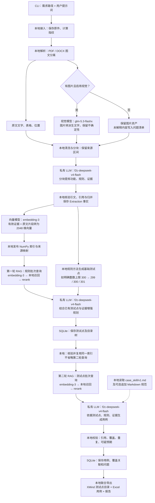
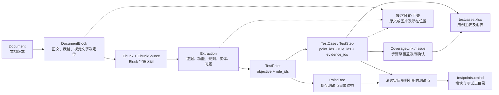
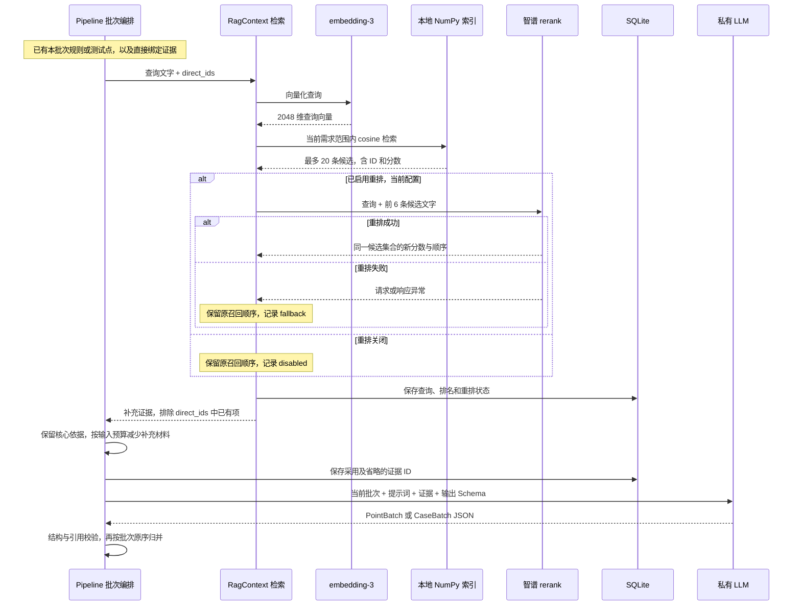
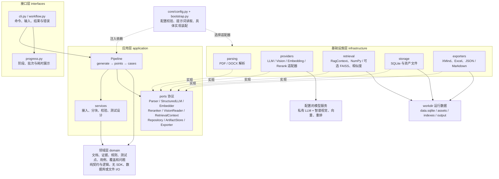
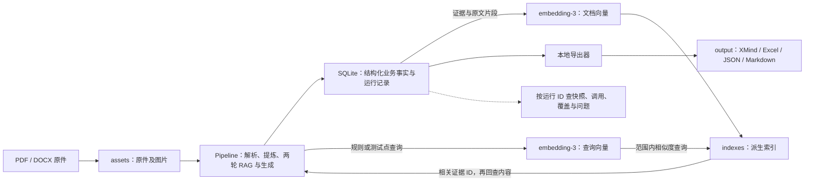

# 完整运行过程：从需求文档到 XMind、Excel

[文档入口](README.md) · [架构与学习总览](learn/P2/README.md) · [计时与指标](reference/timing.md)

本文说明如何启动、每个阶段调用什么模型、架构如何分层、数据如何流转，
以及 2026-10-27 历史真实运行和离线恢复的实际结果。
只记录操作、结构和统计，不复制真实需求正文、模型原始响应或密钥。
第 1～6 节描述当前实现和本地配置；第 7～12 节保留历史实测，历史模型组合与当前配置不同。

| 想了解什么                       | 从哪里读                  |
| -------------------------------- | ------------------------- |
| 如何启动、终端怎么看             | 第 2 节                   |
| 一次命令完整经过哪些步骤         | 第 3 节：全流程图         |
| 每一步调用哪个模型、产生什么数据 | 第 4 节：阶段与数据流     |
| 为什么需要两轮 RAG、重排在哪里   | 第 5 节：检索细节与时序图 |
| 架构分层、代码从哪里进入         | 第 6 节：架构图与代码入口 |
| 历史耗时、产物及失败恢复         | 第 7～12 节               |

本文模型名称是 2026-10-27 的本地配置快照；修改配置后，以实际运行 manifest 为准。
图中的“本地”表示由 Python 程序执行，不消耗模型请求，不表示所有数据都只在本机处理。

## 1. 先明确输入、输出与事实来源

输入是 PDF/DOCX 文件路径和用户提示词。框架自动完成解析、规则提炼、两轮 RAG、用例生成、校验和导出，
中间不再等待人工审批，也不读取修改后的 XMind 作为生成输入。

| 内容            | 作用                                                                           |
| --------------- | ------------------------------------------------------------------------------ |
| 需求文档        | 提供业务事实；文字、表格、图片保留来源和定位                                   |
| 用户提示词      | 指定生成范围、覆盖重点与表达要求，不能替代原文事实                             |
| SQLite          | 保存文档、证据、规则、测试点、用例、问题、覆盖关联及运行快照，是结构化事实来源 |
| 向量索引        | 从证据和原文片段构建的检索数据，可由事实重建                                   |
| XMind           | 已生成用例对应的模块与测试点目录，不包含完整用例步骤和预期                     |
| Excel           | 十一列用例主表，以及测试点、规则、覆盖矩阵和问题附表                           |
| 报告与 manifest | 查看问题、来源、模型调用、配置指纹和耗时                                       |

同一批运行的产物放在同一个运行 ID 目录中。修改导出文件不会反向改变 SQLite 中的事实。

## 2. 如何启动

### 2.1 配置只维护一份

日常配置是项目根目录下的 `workdir/local.yaml`。

| 配置                                                | 用途                                                        |
| --------------------------------------------------- | ----------------------------------------------------------- |
| `models.llm`                                      | 提炼、增强规划和用例生成                                    |
| `models.embedding`                                | 证据和查询向量化，包含批量与并发设置                        |
| `retrieval.embedding_dimension`                   | 必须与向量模型实际返回维度一致                              |
| `retrieval.backend`、`metric`、`vector_top_k` | 索引后端、相似度与候选数量                                  |
| `parsing.vision_enabled`、`models.vision`       | 启用图片解释并配置视觉模型                                  |
| `models.rerank`                                   | 按配置启用重排，不是另一条生成路线                          |
| `runtime.cache_enabled`                           | 控制持久化模型/向量等缓存；性能冷启动测试需明确记录是否关闭 |
| `generation.skill_file`                           | 可选的补充 Markdown 用例规范                                |
| `runtime` 中的请求超时、预算                      | 限制请求和消耗，不能把未配置价格表的额度当作真实费用估算    |

本地 YAML 可以配置各角色的 `api_key`；非空文件密钥优先，否则回退到 `api_key_env` 指定的环境变量。
不要把本地 YAML 的完整内容复制进日志或文档。字段和目录细节见[目录说明](reference/directory_structure.md)。

### 2.2 下一轮约 12 页文档调试配置

2026-10-27 在本地配置中切换了以下模型，尚未用这一组合调用真实服务：

| 角色      | 本轮设置                                                                                       | 需要验证                                         |
| --------- | ---------------------------------------------------------------------------------------------- | ------------------------------------------------ |
| LLM       | 私有部署 `f2c-deepseek-v4-flash`；提炼、规划、用例生成共用                                   | Chat 协议、JSON 输出、思考参数和并发配额是否兼容 |
| Vision    | `glm-5.3-flashx`，智谱 `https://open.bigmodel.cn/api/paas/v4/`，`thinking_mode: enabled` | 图片解释完整性、输出是否截断、耗时和账户配额     |
| Embedding | 保留 `embedding-3`，2048 维                                                                  | 向量化成功及空间维度一致                         |
| Rerank    | 启用 `rerank`，完整地址 `https://open.bigmodel.cn/api/paas/v4/rerank`                      | 两轮 RAG 的重排记录是否成功，排序是否相关        |

视觉角色在本机复用已有智谱向量角色的凭据，重排保留自身已有凭据；公共文档不记录密钥。
视觉模型仅支持开启思考，不能沿用私有 LLM 的禁用思考设置。
协议依据：[智谱视觉模型说明](https://docs.bigmodel.cn/cn/guide/models/vlm/glm-5.3-flash)、
[智谱重排接口](https://docs.bigmodel.cn/api-reference/模型-api/文本重排序)。

保留当前视觉并发 8、请求启动间隔 1 秒，以及向量召回 20 条、对前 6 条重排的配置；
当前实现将其余召回结果保留在后，并非从 20 条中重排筛选出 6 条。
重排失败时会记录降级并沿用原召回排名，因此仅看到 Excel 导出成功还不够，
需同时检查检索记录中的 `rerank.status`，确认不是 `fallback`。
开启重排会增加请求和耗时，收益需结合实际引用及用例内容评估。

准备好约 12 页的 PDF/DOCX 后，使用下方交互式命令启动一个新运行，避免将旧运行的配置快照
与新模型配置混用。先记录总耗时、各阶段耗时、图片失败和重排降级，再检查 XMind、Excel 及问题清单。
本文第 7、8 节的历史统计属于旧模型组合，不能作为本组合已经验收的结果。

当前配置中的请求参数如下；模型服务的实际容量和并发配额仍以部署或账户为准：

| 参数                                                   |    当前值 | 含义                                                   |
| ------------------------------------------------------ | --------: | ------------------------------------------------------ |
| `models.llm.concurrency`                             |         8 | 提炼、规划和生成使用的 LLM 并发上限                    |
| `runtime.max_context_tokens`                         |     24000 | 单次 LLM 输入的本地估算预算，包含提示词、数据和 Schema |
| `models.llm.max_output_tokens`                       |     16384 | 单次 LLM 输出上限，与输入预算分开                      |
| `chunking.target_tokens` / `overlap_tokens`        | 900 / 100 | 结构分块目标与重叠；不是对整份文档的大小限制           |
| `generation.batch_point_limit`                       |         5 | 规划时的规则批量、生成时的测试点批量                   |
| `generation.schema_repair_attempts`                  |         3 | 输出结构错误后最多追加的修复次数，会增加调用和耗时     |
| `models.vision.concurrency`                          |         8 | 图片工作并发上限；实际请求还受 1 秒启动间隔约束        |
| `models.vision.max_output_tokens`                    |      8192 | 图片解释输出上限；不能据此保证复杂图片不会截断         |
| `models.embedding.batch_size` / `concurrency`      |    16 / 2 | 文本批量向量化和 HTTP 请求并发上限                     |
| `runtime.request_timeout_seconds` / `max_attempts` |    90 / 3 | 相关模型请求超时与适用适配器的临时故障尝试上限         |
| `runtime.cache_enabled`                              |     false | 当前关闭持久化模型/向量等缓存；流程内相同索引仍可复用  |

256K 是用户提供的私有模型上下文规格，本文没有实测服务端容量。
当前框架使用 24K 输入预算分批处理，不把整份需求和整次执行历史累积进一个请求。
生成批次过大时会尝试拆批，检索补充材料可按预算省略；核心依据仍超限时明确报错。

### 2.3 日常推荐：交互式启动

在 PowerShell 中进入项目根目录：

```powershell
Set-Location 'D:\Desktop\AI测开\RAG'
.\.venv\Scripts\python.exe -m tc_rag.interfaces.cli start --config workdir/local.yaml --output-dir workdir/output
```

随后依次输入需求文档路径和提示词。路径中有空格或 `&` 时，交互输入会作为路径内容处理，
不需要在 PowerShell 中自行拼接执行文件名。

提示词示例：

> 依据需求文档生成测试点和测试用例，覆盖正常、异常、字段边界、权限及状态变化。
> 缺失或不明确的规则列入待确认，不自行补充业务要求。

这是日常使用示例，不是本次性能对照的基线指令原文。

终端显示 `run_id=...` 后，记下运行 ID；后续状态查询和导出都使用它。

### 2.4 也可以一次提供参数

将下面的示例路径替换为实际文件：

```powershell
$document = 'D:\需求资料\需求文档.pdf'
$instruction = '依据需求生成测试点和用例，覆盖正常、异常和边界；不明确规则列入待确认。'
.\.venv\Scripts\python.exe -m tc_rag.interfaces.cli run $document -i $instruction --config workdir/local.yaml --output-dir workdir/output
```

这条命令会按当前配置调用模型，可能产生费用。若只想看执行计划：

```powershell
.\.venv\Scripts\python.exe -m tc_rag.interfaces.cli run $document --preview --config workdir/local.yaml
```

`--preview` 不调用模型；`run` 未提供 `-i/--instruction` 时也只展示计划。

### 2.5 如何阅读阶段进度

终端开始时先展示流程路径，随后按本次实际执行顺序编号。未出现图片时跳过图片解释；
恢复运行从实际执行的步骤开始编号，不把跳过的步骤算作已完成。
规划和生成均需要准备检索索引，因此可能两次看到“准备检索索引”，并不表示一定重复向量化。

下面只演示展示格式，数字为虚构示例，不是真实测量结果：

```text
[阶段] 06 RAG 规划测试点
       按规则批次检索相关证据，按配置重排后规划测试点
[RAG 规划测试点] 共 10 批，开始处理
[等待] 阶段 06 RAG 规划测试点，已完成 4/10 批（40%），2 个模型请求处理中，阶段已用 20秒，预计剩余 30秒｜总用时 1分10秒｜RAG 检索 6 批｜重排成功 6 批 / 降级 0 批
[完成] 06 RAG 规划测试点｜用时 40秒｜RAG 检索 10 批｜重排成功 10 批 / 降级 0 批
```

阶段编号不表示总体完成百分比，批次百分比也不能跨阶段推算总体耗时。
心跳中的剩余时长按当前阶段已完成批次估算；遇到修复、重试或慢请求时可能波动。
生成模型缓存命中汇总显示，避免逐条刷屏；视觉缓存继续在图片汇总中显示。

结束时 stderr 输出阶段耗时表，stdout 保留 `run_id` 和最终文件位置。
失败或取消时输出“中断”和已执行阶段汇总，不把当前阶段标成完成；
“流程完成”仅表示本次程序执行结束，业务语义仍需核对问题清单和实际用例。
使用 `--quiet` 隐藏阶段进度和耗时表，保留结果与错误。

### 2.6 内置 v1 提示词修订记录

2026-10-27 按用户要求原位修订六份 `v1.md`，保留现有文件名、加载入口和版本标记，
不新增 v2 配置。具体内容由运行 manifest 中的提示词指纹区分，不仅依赖 `v1` 字样。

| 文件                          | 本次修订                                                                   |
| ----------------------------- | -------------------------------------------------------------------------- |
| `prompts/extract/v1.md`     | 最短连续引文、120 字软目标、同源证据复用、字段白名单、`rule_mapping={}`；推荐五类技术 ID 前缀不同、同类集合内唯一 |
| `prompts/plan_points/v1.md` | 避免同意图重复补点，明确空值类型与 Schema 约束                             |
| `prompts/generate/v1.md`    | 明确测试点/步骤引用、空值类型、默认 draft；6 步为软目标                    |
| `prompts/rag_context/v1.md` | 引用已有 ID，不重写证据对象；不确定性仅影响相关判断                        |
| `prompts/vision/v1.md`      | 简洁条目、保留逻辑词与连线；复杂图片不受 200 字硬限制                      |
| `prompts/case_skill/v1.md`  | 补齐用例标识和类型约束，具体结果命名，格式交给导出器                       |

引文和步骤的精简目标不能覆盖条件、例外及完整流程，图片也不能为满足固定字数遗漏独立规则。
以上属于模型提示约束，没有新增字数或步骤数的领域硬校验；离线检查不证明真实模型一定遵循。

生成请求和视觉缓存已有内容指纹；相关提示词变更后，不会按旧内容指纹命中对应结果。
已保存的 SQLite 事实和导出文件不会因修改提示词自动重生成。
本轮语义质量、实际输出长度及耗时需用新运行验证，不能直接沿用历史性能数据。

原文件及 SHA-256 清单位于本机
`workdir/dev/backups/prompts-v1-20261027-220717/`。
如需回滚，将其中 `prompts/<stage>/v1.md` 恢复到项目对应位置，之后启动新运行；
恢复历史运行前也应核对当时使用的提示词内容。

## 3. 全流程图：模型在什么位置参与

以下展示一次 `start` / `run` 的连续流程。图片解释按配置及图片数量执行；
两轮 RAG 必须执行，重排当前启用，索引后端当前是 NumPy。



图中四类模型各司其职：视觉负责图片解释，LLM 负责业务提炼与生成，
embedding 负责文本转向量，rerank 负责相关性排序。NumPy/FAISS 和 Skill 都不是额外的模型。

索引或查询失败会停止生成，不自动降为无检索生成。
rerank 失败可以保留召回结果并记录降级；单张图片失败进入问题清单，通常不阻断其余图片。
XMind 与 Excel 在末尾同批导出，中间没有人工审批或 XMind 回读步骤。

## 4. 阶段、模型与数据流

### 4.1 每一步调用什么

表中 LLM 均指当前私有部署的 `f2c-deepseek-v4-flash`，V/E/R 分别为视觉、向量和重排角色。

| 逻辑步骤         | 终端阶段                 | 模型调用                                 | 输入 → 输出                                                      |
| ---------------- | ------------------------ | ---------------------------------------- | ----------------------------------------------------------------- |
| 接入             | `ingest`               | 无，本地                                 | 文件路径 → `Document`、原件资产与内容指纹                      |
| 图文分离         | `parse`                | 无，本地解析器                           | 原件 → 原文 `DocumentBlock`、图片资产、页码/段落/坐标          |
| 图片转文字       | `vision`，有图片时显示 | V：`glm-5.3-flashx`                    | 图片 + 章节上下文 → `origin=vision` 的派生 Block、未解析 Issue |
| 结构分块         | `chunk`                | 无，本地                                 | 文字 Block + 视觉 Block → `Chunk`、`ChunkSource` 字符区间    |
| 业务提炼         | `extract`              | LLM，按 Chunk 请求                       | 当前 Chunk、相关 Block、用户指令 → `Extraction` JSON           |
| 引文核验与归并   | 提炼阶段内部             | 无，本地                                 | 候选 Extraction → 核验后的证据、功能、规则、实体、问题           |
| 首次索引准备     | `index`                | E：`embedding-3`，未命中可用向量时调用 | 有效引文 + 原文片段 → 向量、索引文件、manifest、ID 映射          |
| 第一轮检索       | `plan_points` 内部     | E：查询向量；R：`rerank`               | 规则批次查询 → 当前需求内的补充证据及检索记录                    |
| 基础点与增强规划 | `plan_points`          | 本地规则方法 + LLM                       | 规则、直接证据、已有测试点、补充证据 → `PointBatch` 与测试点树 |
| 第二次索引准备   | 再次显示 `index`       | 满足复用条件时无需文档 embedding         | 同运行及相同证据 → 核验后复用索引；不等于省略查询                |
| 第二轮检索       | `generate` 内部        | E：查询向量；R：`rerank`               | 测试点目标查询 → 与该批次相关的补充证据                          |
| 用例生成         | `generate`             | LLM；Skill 只是提示词文本                | 测试点、规则、证据、RAG 补充、Skill → `CaseBatch` JSON         |
| 引用与覆盖校验   | `validate`             | 无，本地                                 | 用例、测试点、规则和证据 → 用例状态、`CoverageLink`、Issue     |
| 联合导出         | `export_cases`         | 无，本地                                 | 已保存事实 → XMind、Excel、JSON/Markdown、质量与计时报告         |

同一阶段可能产生多种模型请求，例如 `generate` 包含查询 embedding、rerank、LLM 生成及必要修复。
模型调用日志中的角色与终端阶段不是一一对应，不能只数终端行数来估算费用。

PDF 逐页解析时会保存检查点；图片在页解析完成后统一并发处理，避免每页等完一张图片才处理下一页。
整页扫描 OCR 尚未实现；仅配置视觉模型不会自动将所有扫描页识别为文字。

### 4.2 业务事实如何逐步形成

下图箭头表示数据形成或引用关系，不表示额外的模型请求。



一条用例的追溯路径是：`用例步骤 → rule_ids / evidence_ids → 规则和引文 → Block → 文档定位`。
`ChunkSource` 还记录该 Block 的字符区间；证据必须在本次输入范围内，不能因章节标题相似就跨块引用。
视觉证据保留处理模型、版本与不确定性，不会因为被向量检索命中就变成已确认的原文。

### 4.3 数据最终保存在哪里

| 数据类别           | 保存位置或集合                                                                                   | 职责                                           |
| ------------------ | ------------------------------------------------------------------------------------------------ | ---------------------------------------------- |
| 原始资料与图片文件 | `workdir/assets/`                                                                              | 原件和图片二进制；由资产记录定位               |
| 文档与原文结构     | SQLite：`documents`、`document_blocks`、`chunks`、`assets`                               | 文档版本、位置及字符区间                       |
| 结构化业务事实     | SQLite：`evidence_spans`、`features`、`requirement_rules`、`business_entities`           | 可追溯依据及提炼结果                           |
| 设计与生成事实     | SQLite：`test_points`、`point_trees`、`test_cases`、`coverage_links`、`issues`         | 测试点、用例、覆盖与问题                       |
| 检索与向量元数据   | SQLite：`embedding_spaces`、`embedding_records`、`index_manifests`、`context_bundles` 等 | 空间、向量缓存、索引映射、查询与采用/省略记录  |
| 运行与计时         | SQLite：`runs`、`stage_snapshots`、`model_invocations`                                     | 脱敏配置、阶段状态、请求结果、usage 和耗时     |
| 索引文件           | `workdir/indexes/`                                                                             | NumPy/FAISS 派生数据，必须与空间及 ID 清单一致 |
| 交付视图           | `workdir/output/运行ID/`                                                                       | XMind、Excel、报告等，不能反向覆盖 SQLite 事实 |

SQLite 数据库文件为 `workdir/data.sqlite`，结构化业务事实以它为准。
数据库中的记录可以引用资产和索引文件，因此这些运行路径不能随意移动。
`context_bundles` 保存检索上下文记录，同时运行快照保留批次采用和省略信息，排错时一起查看。

## 5. RAG 为什么执行两次

### 5.1 先明确索引内容

索引收录有效引文以及 `ChunkSource` 对应的原文片段。
功能经“功能 → 规则 → 证据”追溯，不另造一套与 SQLite 脱节的功能事实文件。

向量空间由服务地址、模型、维度、归一化和输入模板等参数约束。
批次响应要恢复到原输入顺序，并检查重复/缺失 index、维度、有限数及归一化要求。
更换空间不能复用旧向量；SQLite 分配的 int64 向量 ID 不能用截断 UUID 代替。

### 5.2 第一轮：为测试点规划补充上下文

1. 取一批规则，带上规则直接绑定的原文证据与已有测试设计。
2. 将规则和生成要求形成查询，再向量化查询。
3. 在当前需求范围内按配置度量检索相关证据，必要时关键词召回或 rerank。
4. 将直接依据与检索到的条件、例外组成上下文，交给 LLM 增强规划。
5. 保存测试点和检索记录，保留采用与因预算省略的补充材料 ID。

直接证据不会因为召回分数低而被删除。召回相似内容也不会自动成为已确认的新业务规则。

### 5.3 第二轮：为具体用例生成补充上下文

生成阶段取一批测试点，找回对应规则及所属功能的相关证据，再为测试点目标查询一次。
这时查询问题与规划阶段不同，因此仍须实际检索；不能只建一个闲置索引就声称使用了 RAG。

相同运行、相同证据和配置下，可复用本次成功发布的索引，避免重复向量化整份文档。
复用不跳过文件、manifest、空间、ID 和版本核验，也不省略第二轮查询。
持久缓存开启时保留逐项向量缓存检查；损坏缓存不能通过复用被掩盖。

### 5.4 用例 Skill 在哪里参与

默认用例规范来自 `prompts/case_skill/v1.md`，装配时加入生成阶段提示词。
可通过 `generation.skill_file` 或 `--skill-file` 追加自包含 Markdown 规范。
Skill 约束命名、优先级和表达，不能覆盖需求事实、证据引用或输出结构。

本次实际调用的是项目装配的 Markdown 用例规范，并未调用一个外部 Skill 服务。

### 5.5 一批数据如何完成检索并进入模型

第一轮以规则为查询目标，第二轮以测试点为查询目标；下图展示两轮共用的批次路径。
当前配置关闭持久缓存，查询会请求 embedding；开启缓存后，命中时可复用查询向量。



重排只调整参与候选的顺序，不生成新需求或新证据。当前前 6 条重排后，其余候选仍保留在后，
补充材料最终还要经过输入预算筛选。不能把这个配置理解成“从 20 条中重新选最优 6 条”。
RAG 补充材料可以帮助理解条件和例外，但不能扩展当前测试点允许的规则及步骤引用范围。

### 5.6 各模型收到什么提示词

| 模型请求   | 系统提示词来源                                                                    | 主要业务输入                                               | 输出                           |
| ---------- | --------------------------------------------------------------------------------- | ---------------------------------------------------------- | ------------------------------ |
| 图片解释   | `prompts/vision/v1.md`                                                          | 图片、章节上下文                                           | 文字解释，不是 Extraction JSON |
| 需求提炼   | `prompts/extract/v1.md`                                                         | 当前 Chunk、相关 Block、用户 instruction                   | `Extraction`                 |
| 测试点增强 | `plan_points/v1.md` + `rag_context/v1.md`                                     | 当前规则、直接证据、existing_points、检索补充、instruction | `PointBatch`                 |
| 用例生成   | `generate/v1.md` + `rag_context/v1.md` + `case_skill/v1.md`，可选追加 Skill | 当前测试点、关联规则、直接证据、检索补充、instruction      | `CaseBatch`                  |
| 向量化     | 无上述生成提示词                                                                  | 原文/证据文本，或规则/测试点查询文本                       | 数值向量                       |
| 重排       | 无上述生成提示词                                                                  | 查询文字、候选文本数组                                     | 候选 index 与相关性分数        |

表中未写完整路径的资源也位于 `prompts/` 下。Skill 不参与提炼，也不会成为需求证据。
生成服务通过兼容 Chat 协议接入，当前使用 JSON Object 模式并随输入提供完整 Schema，
返回后仍由本地 Pydantic 与引用逻辑校验，不因服务“支持 JSON”就跳过验证。

## 6. 架构图与代码入口

### 6.1 分层架构

下图实线表示核心依赖或基础设施访问外部资源，虚线表示装配或协议实现。
运行时 application 调用注入的端口对象，不直接绑定智谱或私有服务 SDK。



依赖原则为 `interfaces → application → domain`；`infrastructure` 实现 `application.ports`。
图中的“实现”包含结构化 Protocol 兼容，不要求适配器必须显式继承接口类。
替换私有 LLM 或向量供应商主要调整配置及相应适配器，不应让 domain 导入供应商 SDK。
当前 LangChain/Claude SDK 仅有扩展声明，不是这张运行架构中已经装配的执行分支。

### 6.2 运行数据与交付视图的边界



该图表达数据类别之间的关系，具体调用顺序以第 3 节及第 5.5 节为准。
文件副本和索引是由 SQLite 记录指向的运行资产；Excel/XMind 是交付视图，
不通过编辑导出文件来修改已保存事实。已有用例快照时可以离线重新导出，见第 10 节。

### 6.3 读代码时从哪里进入

以下路径均相对项目根目录：

| 代码入口                                                             | 阅读重点                                                                         |
| -------------------------------------------------------------------- | -------------------------------------------------------------------------------- |
| `src/tc_rag/interfaces/workflow.py`                                | `start/run/status/inspect/export`，终端交互、进度、错误和客户端关闭            |
| `src/tc_rag/bootstrap.py`                                          | 选择解析器、模型、检索和导出实现，加载提示词与 Skill，连接共享预算               |
| `src/tc_rag/application/orchestration/pipeline.py`                 | `generate()` 连续执行 `points(publish=False)` 和 `cases()`；阶段快照与调度 |
| `src/tc_rag/application/services/vision.py`                        | 图片任务有界并发、顺序归并、单图失败隔离与取消收尾                               |
| `src/tc_rag/infrastructure/parsing/pdf.py`、`docx.py`            | 文字、图片和定位提取，PDF 页检查点需要的解析状态                                 |
| `src/tc_rag/infrastructure/providers/embedding.py`                 | 一个大列表内部的批次并发，多调用共享端点上限，结果归位和调用记账                 |
| `src/tc_rag/infrastructure/providers/openai_sdk.py`                | 私有 LLM 的兼容 Chat 请求、JSON/Schema、临时重试、结构修复与调用记账             |
| `src/tc_rag/infrastructure/providers/vision.py`、`rerank.py`     | 图片请求及启动间隔，重排 REST 协议与失败记录                                     |
| `src/tc_rag/infrastructure/retrieval/context.py`                   | `prepare()` 发布或复用索引，`retrieve()` 检索并记录上下文                    |
| `src/tc_rag/infrastructure/retrieval/index.py`、`faiss_index.py` | NumPy/可选 FAISS 索引及范围内检索                                                |
| `src/tc_rag/infrastructure/exporters/reports.py`、`xmind.py`     | Excel、报告和测试点目录导出                                                      |

依赖方向是 `interfaces → application → domain`，外部实现由 `infrastructure` 通过 ports 接入。
不要为了调试方便，让领域对象直接调用 SDK 或读写数据库。

## 7. 历史实测：输入与配置

运行日期：2026-10-27；所有时间均为北京时间。
本节及后续实测数据来自切换私有 LLM、智谱视觉及启用重排之前，不能代表当前组合的效果。

- 运行 ID：`run_b1603017bce04de6834328f5c7869f07`。
- 输入文件：`workdir/assets/50b1887f0b84e3b6245d12f82e79172faa4934d9622028fa57ed2c65e3d50546/original.pdf`。
- 用户称为 48 页的 PDF，实际文件页数为 49；这是页数记录差异，不据此删页。
- 提示词沿用历史 `run_15225d6289d54a208a90fb9c36dcd3cf:input` 的 instruction，避免另换指令冒充对照。
- 用户先授权一次真实模型验收，并要求最晚 21:00 停止；没有启动第二次付费测试。

| 项目     | 本次实际配置                                           |
| -------- | ------------------------------------------------------ |
| 生成模型 | DeepSeek `deepseek-flash`，并发 8                    |
| 视觉模型 | DeepSeek `deepseek-flash`，并发 8，请求最小间隔 1 秒 |
| 向量模型 | 智谱 `embedding-3`，2048 维，每批 16，并发 2         |
| 检索     | NumPy、cosine，关键词召回关闭                          |
| rerank   | 关闭，因此本次不验收重排模型效果                       |
| 持久缓存 | 关闭，用于冷启动测量；流程内相同索引仍可复用           |

真实验收使用本机专用计时脚本 `workdir/dev/benchmarks/run_authorized_acceptance.py`，
内部走与 CLI 相同的 `build_pipeline()`、终端进度和 `Pipeline.generate()`，不是另一条业务路线。
脚本给整次生成设置截至 21:00 的取消期限，并在结束时关闭客户端。
这个截止保护属于本次验收脚本，不能据此声称普通 CLI 已内置每日 21:00 自动停机功能。

## 8. 这次实际经过了什么

### 8.1 20:01:57：启动并处理图片

装配配置和客户端后开始执行计时，关闭持久缓存。
52 张图片中 51 张成功，1 张 `INCOMPLETE_OUTPUT`，失败图片保留为待确认。
解析与图片解释合计耗时 122.540 秒，没有把图片失败当作“已理解”。

### 8.2 分块与提炼

形成 136 个文本块，全部完成提炼。模型共请求 171 次，其中 35 次结构错误触发既有修复。
少数批次多次修复，最慢批次累计约 122.8 秒，出现其他批次已结束、仍等待一个批次的情况。
最终提炼阶段耗时 371.916 秒，并保存证据、功能、规则及问题。

### 8.3 建索引与增强规划

索引含 1298 条证据，去重后 1180 段文本，首次向量化需 74 个 HTTP 批次。
86 个规则批次全部完成增强规划，形成 887 个规划测试点。
规划共 87 次模型请求，含 1 次结构错误；阶段耗时 105.863 秒。

### 8.4 再检索并生成用例

复用同一运行的索引，执行 119 个用例批次，共 124 次模型请求，含 5 次结构错误。
生成阶段耗时 255.998 秒，随后完成引用和覆盖校验，事实先保存到 SQLite。

两轮合计 205 次实际检索：86 次规划查询、119 次用例查询。
向量请求共 279 次，恰好为 `74 次首次建库 + 205 次查询`，没有重复向量化整份文档。
两次索引准备累计耗时 28.933 秒，查询仍分别执行。本次没有 HTTP 429 限流记录。

### 8.5 20:16:48：在 Excel 导出失败

XMind、JSON、Markdown 已写出，但 Excel 写入问题附表时抛出 `IllegalCharacterError`。
定位到 3 条问题说明中有 5 个 `U+0001` 控制字符，Excel 所使用的 XML 格式不允许直接写入。
问题在展示层，不需要重新请求模型来生成同一批用例。

原始运行的执行计时为 **889.305 秒，约 14 分 49 秒**，未达到 10 分钟目标。
计时从装配完成后开始，因此与包含装配时间的开始、结束时间戳之差略有不同。
该计时不包含随后等待授权、修复代码和离线补导的时间。

| 阶段                             |   实测墙钟 |
| -------------------------------- | ---------: |
| 接入文件                         |   0.061 秒 |
| 解析及视觉                       | 122.540 秒 |
| 分块                             |   0.289 秒 |
| 提炼                             | 371.916 秒 |
| 两次索引准备累计                 |  28.933 秒 |
| 规划测试点                       | 105.863 秒 |
| 生成用例                         | 255.998 秒 |
| 校验                             |   0.850 秒 |
| 总执行计时，含其他处理和失败导出 | 889.305 秒 |

模型调用共 713 次。并发调用的耗时之和不是墙钟，不能直接相加得出总运行时间。

### 8.6 用户授权修复后，离线重新导出

原先只授权调度、并发、缓存优化，所以导出兼容修复单独征得用户同意。
修复只将 Excel 不支持的控制字符显示成可见字面量，如 `\u0001`，不删除问题，不改原始事实。
正常换行、回车、制表符和中文不变，十一列与附表不变，原有公式文本防护保留。

随后使用只读 SQLite 连接读取本次快照，不装配模型客户端。
于 **20:40:08** 完成离线补导，用时 **3.926 秒**，模型调用前后均为 713 次，新增模型请求为 0。

这一步补齐了文件，但没有将数据库原始运行的 `failed` 改成成功。
离线补导单独记录为成功，因此不能把“已有数据补导成功”写成“真实单命令验收已经全通过”。

## 9. 最后生成了哪些文件

本次输出目录：

```text
workdir/output/run_b1603017bce04de6834328f5c7869f07/
├─ testpoints.xmind
├─ testcases.xlsx
├─ testcases.json
├─ report.md
├─ manifest.json
└─ reports/
   ├─ quality.md
   ├─ metrics.json
   └─ reexport.json
```

| 文件                                                                                       | 重点看什么                                                                                |
| ------------------------------------------------------------------------------------------ | ----------------------------------------------------------------------------------------- |
| [testpoints.xmind](../workdir/output/run_b1603017bce04de6834328f5c7869f07/testpoints.xmind) | 573 个已对应到用例的测试点目录，没有步骤和预期                                            |
| [testcases.xlsx](../workdir/output/run_b1603017bce04de6834328f5c7869f07/testcases.xlsx)     | 656 条用例的十一列主表，以及全部附表                                                      |
| `testcases.json`                                                                         | 与 SQLite 相同批次的事实视图；标准 JSON 转义在解析后还原原始字符，没有 Excel 的显示层替换 |
| `report.md`、`reports/quality.md`                                                      | 规则、覆盖与问题说明，供业务审核                                                          |
| `manifest.json`、`reports/metrics.json`                                                | 模型、配置、提示词指纹、调用统计及阶段计时，不含密钥                                      |
| `reports/reexport.json`                                                                  | 本次离线恢复结果、原运行失败状态、原事实校验和及零新增调用证明                            |

上面的产物链接只在保留本机 `workdir` 的工作区中有效，不是公共附件。

### 三个数量为什么不一样

| 数量 | 统计对象                                          |
| ---- | ------------------------------------------------- |
| 887  | 全部规划测试点，Excel 测试点附表保留这些事实      |
| 573  | 实际被已生成用例引用的去重测试点，作为 XMind 目录 |
| 656  | 已生成的用例条数；测试点与用例不是固定一对一      |

不要把这三个数当成同一指标。哪些点不适用、待澄清或存在覆盖缺口，应结合状态、覆盖矩阵和问题清单判断。
本次还保存 428 条规则、1116 条覆盖关联和 3240 条问题，不能因为文件能打开就忽略这些问题。

## 10. 如何查询状态，以及只重新导出

### 10.1 查询不调用模型

```powershell
$runId = 'run_b1603017bce04de6834328f5c7869f07'
.\.venv\Scripts\python.exe -m tc_rag.interfaces.cli status $runId --config workdir/local.yaml
.\.venv\Scripts\python.exe -m tc_rag.interfaces.cli inspect $runId --stage failure --config workdir/local.yaml
```

这次 `status` 仍显示原始失败、最后阶段为导出；这是保留历史事实，并非补导文件又坏了。
本次补导结果看同目录 `reports/reexport.json`。

还可用 `inspect --stage cases`、`inspect --stage retrieval` 查看详细事实；输出可能包含真实业务内容，应仅在本机查看。

### 10.2 已有 cases 快照时，可以离线导出一个 Excel

```powershell
.\.venv\Scripts\python.exe -m tc_rag.interfaces.cli export $runId --format xlsx --config workdir/local.yaml --output-dir workdir/output
```

这条命令不调用模型，输出为 `workdir/output/运行ID/reexport.xlsx`。
它只重建所选格式，不自动补齐 XMind、质量报告、指标文件或修改运行状态。
重复执行会写入同名 `reexport.xlsx`，需要保留人工修改时先另存。

本次补齐整套产物使用的是专用脚本 `workdir/dev/benchmarks/reexport_saved_acceptance.py`，
它固定本次运行并在目标 Excel 已存在时拒绝覆盖，不作为通用日常启动入口。
不要用重新执行 `run/start/cases` 来替代单纯重新导出：这些操作可能再次调用模型。

### 10.3 常见停点如何理解

| 现象                                 | 判断与处理                                                     |
| ------------------------------------ | -------------------------------------------------------------- |
| 图片单张失败，后续仍继续             | 保留未解析问题，审核对应图片；不代表图片内容已被正确理解       |
| 模型返回结构错误，正在修复           | 按既有修复次数继续，额外调用计入耗时和预算；耗尽则失败         |
| 提炼结果存在重复对象 ID             | 同类集合内重复进入有界结构修复；跨类型复用局部 ID 由类型命名空间区分，关联同步改写；不丢弃对象 |
| 索引或查询失败                       | RAG 主线停止，不能绕过检索继续生成                             |
| 模型返回当前批次外引用或超出数量上限 | 流程约束阻断，不能靠放宽校验来使本轮通过                       |
| 模型完成，Excel 导出失败             | 先确认 cases 快照存在；展示问题修复后可离线导出，避免重复付费  |
| 状态失败，但存在 XMind/JSON 等文件   | 可能只导出了一部分，必须逐项核对；不能据目录存在判定全流程成功 |

2026-10-27 的 `run_a225fd828bbc466f8b466692dc7ba92a` 在提炼阶段失败：历史记录中 9 次提炼响应通过了当时的
JSON/Schema 检查，另有 6 次结构错误；最终在后续命名空间转换时发现重复 ID，因此当时未触发该项修复。
该运行没有保留原始响应，不能确认具体重复 ID 或对象类型。修复后新增离线模拟验证覆盖同类、跨类重复、
修复耗尽及修复后两轮 RAG 联合导出。跨类型复用则整合类型命名空间处理，无需模型修复；
尚未重新调用真实模型，历史失败状态也不会被自动改为成功。

## 11. 本次验证通过什么，仍需审核什么

已通过：

- Excel 读回为 656 条用例、十一列；测试点、规则、覆盖和问题附表数量与 SQLite 一致。
- XMind ZIP 有效，573 个测试点与用例引用集合一致，没有完整用例字段。
- 3 条问题说明的 5 个控制字符可见转义，问题没有被删除，所有工作表无公式单元格。
- SQLite 用例快照未改变，原有 XMind、JSON、Markdown 校验和未改变。
- ruff、mypy 通过；修复后的默认离线 pytest 为 **303 通过、2 跳过**。

尚未通过或尚未验证：

- 10 分钟目标未达到；目前不能承诺下一次一定达标。
- 修复后未再次运行付费全流程，不能将本次离线恢复当作新的真实全流程成功记录。
- 未用桌面 Excel/XMind 客户端打开验收。
- 未完成业务语义审核；656 条用例中 638 条为 `needs_review`，18 条为自动 `validated`。
- 本次未启用 rerank、关键词和 FAISS，因此本次真实结果不能证明这些可选能力的效果。

建议先审核 Excel 的“问题清单”“未解析范围”和“覆盖矩阵”，
确认无依据预期、冲突、缺失条件和未覆盖规则，再讨论扩大并发后的下一轮性能实测。
新的付费测试需要重新授权；本文和示例命令本身不构成执行授权。

## 12. 本次证据文件与后续阅读

| 本地证据，均位于 `workdir/dev/benchmarks/`  | 用途                                           |
| --------------------------------------------- | ---------------------------------------------- |
| `authorized-acceptance-20261027.json`       | 开始结束时间、实际配置摘要、执行计时和原始失败 |
| `authorized-acceptance-audit-20261027.json` | 调用统计、检索次数、索引复用及已保存事实数量   |
| `illegal-excel-characters-20261027.json`    | 非法字符位置类别和字符码，不包含原始问题正文   |
| `offline-reexport-audit-20261027.json`      | 离线补导成功、原事实未改与零新增模型请求       |

这些是本机开发证据，不纳入 Git。历史实测耗时见第 8 节，统计口径见[计时与指标](reference/timing.md)，
本轮提示词的备份及回滚见第 2.6 节；按模块学习代码见[学习导航](learn/README.md)。
