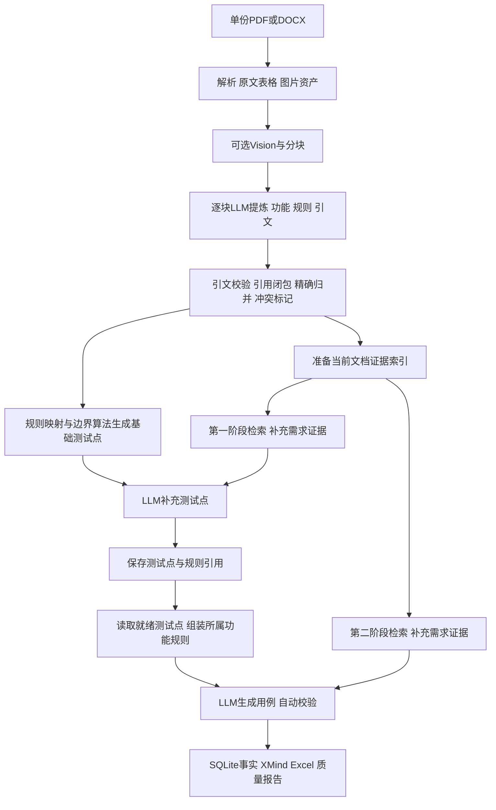

# tc_rag 架构评审与企业落地调优方案

版本：讨论稿 v1.0  
日期：2026-11-17  
范围：现有需求文档生成主线、独立知识库检索及评测工程。  
状态：静态代码审查与实施建议，尚未实施本文改造；不是生产验收报告。

## 1. 结论先行

当前主线不是“从知识库检索出测试点，再根据测试点检索出用例”。实际是：逐块提炼需求中的功能与规则，基于规则规划测试点，两阶段分别检索需求证据补充上下文，再由程序与模型生成结果。当前索引不包含一套已审核的历史测试点或用例库。

“功能→规则→测试点→用例”的追溯结构已经存在，方向可以保留；不足主要在功能的跨块组织、规则遗漏修复、查询构造、上下文选择和业务验收。再平行添加一个“功能点生成层”，不能自动解决这些问题，反而可能增加模型调用和误差传递。

本次判断：具备可继续改造的工程基础，适合受控试点；现有证据不足以认定已经达到企业无人值守交付标准。离线测试通过、引用闭包合法、文件成功导出，均不能证明业务规则完整或用例正确。

优先顺序：先确定真实测试设计任务及证据口径，再处理功能组织和遗漏规则，再验证查询/上下文策略。不要继续以增加事实问答数量、扩大k或增加模型层数代替业务验证。

## 2. 本次审查方法与限制

核对了编排、领域对象、提炼校验/归并、规划器、提示词、两条检索路径、知识库回答、bootstrap和评测脚本。相关代码定位见第13节。未读取或回显本地密钥，未运行真实模型、重新入库或改动已发布索引。

本次未新增运行测试，不将此前的878/889项离线回归计为本次新验证；前序结果仅支持对应代码修改的回归结论。本文区分：代码已实现、静态识别的风险、需要实测的假设和建议增加的能力。

## 3. 当前架构：实际做了什么



注意：图中F是逻辑索引资源，代码在points/cases阶段都会prepare。已有缓存与完整性校验，不能因调用两次prepare便断言付费embedding必然重复两次；需从实际缓存命中、请求次数和耗时核对。

### 3.1 当前对象的职责

| 对象 | 现有职责 | 不能据此推断的能力 |
|---|---|---|
| DocumentBlock / Chunk | 保留原文、来源及字符区间 | 结构解析完整不等于需求语义完整 |
| Feature | 名称、描述、证据集合 | 不是已完成的跨章节业务功能目录 |
| RequirementRule | 功能归属、要求、证据、约束及状态 | needs_review不等于人工确认 |
| TestPoint | 规则引用、检查目标、方法、数据变体、状态 | ready是技术可生成状态，不是业务批准 |
| TestCase / TestStep | 前置条件、步骤、预期及引用 | validated不等于实际执行通过或业务语义正确 |

### 3.2 当前两次检索的区别

| 阶段 | 实际查询 | 检索对象 | 原有上下文 | 主要输出 |
|---|---|---|---|---|
| 测试点规划 | 用户指令＋一批规则statement | 当前文档的EvidenceSpan及来源切片 | 本批规则、直接证据、已有测试点 | 程序基础点＋LLM补充点 |
| 用例生成 | 一批测试点objective的拼接 | 同一文档的需求证据 | 测试点及其所属功能的相关规则/证据 | 用例步骤与预期 |

第二阶段并未查询历史用例。测试点本身不需要改成粗粒度功能名：具体目标用于精确断言，所属功能与明确场景用于补齐业务范围。

## 4. 静态审查发现的主要问题

| 编号 | 代码事实或现象 | 实际风险 | 优先级 |
|---|---|---|---|
| A1 功能跨块组织不足 | reconcile的功能键包含名称、description和证据Block范围 | 同一业务功能在不同块中可能仍是多个Feature，后续按feature_id取上下文不一定得到完整功能 | P0 |
| A2 批次未以功能为主要边界 | 规划规则和生成测试点按数量连续切片 | 同一批可能混入多个功能；单功能也可能被无业务意义地拆开，查询语义分散 | P0 |
| A3 规则遗漏缺少修复闭环 | 逐块提炼后固定有效规则，规划补充只允许引用当前批次规则ID | 原文虽被检索到，遗漏的独立规则仍可能无法产生合法测试点；仅提高检索Recall不一定修复最终覆盖 | P0 |
| A4 规则到基础点偏逐条映射 | 规划器主要按rule.kind选择方法，objective常由statement派生 | 单规则正常/边界点较直接，多规则组合、角色×状态、前后操作关联缺少系统性保障 | P1 |
| A5 用例上下文可能过宽 | _generate_batch补齐所属Feature的全部相关规则 | 大Feature可能带来过多核心证据；核心超预算时拆测试点批次也可能仍保留同一大Feature，不能无限拆批解决 | P1 |
| A6 查询缺少明确业务范围 | 查询字符串没有显式结构化的功能范围、角色、状态和操作槽位 | 同名字段、通用操作文字容易干扰；单纯拼接更多文字也可能稀释目标 | P1 |
| A7 生成与KB评测不等价 | 生成检索EvidenceSpan，KB检索Chunk；输入、索引范围及组装方式不同 | KB实验指标不能直接作为原生成流程的真实检索质量 | P0 |
| A8 实验与生产装配有差距 | 正式两入口仍装配KeywordIndex；SearchService重排仍使用完整chunk.text；BM25/正文投影主要在实验入口 | 实验中向量＋BM25、正文输入＋同分保序的收益未自动落地到生产 | P0 |
| A9 作废语义只部分修复 | 新解析保留直接删除线，新分块排除；旧快照未重建，提炼request仍携带完整Block | 旧索引仍可能返回作废文字；模型读取完整Block时仍可能受其影响，引用校验不等于输入已清洁 | P0 |
| A10 评分仍有固定实验假设 | score_rerank.py校验150个片段 | 不能直接给新463片段实验评分，应从协议和完整金标读取范围 | P0 |

A1～A6是需要验证影响程度的结构性风险，不意味着每道题必然出错。A9不得通过抹掉原文解决：原始资料应保留，但面向模型的有效文本和可引用范围需要统一处理。

现有优点应保留：引用闭包、版本检查、预算预检、失败停止、派生产物与SQLite事实分离、双阶段生成、单文档默认范围及来源追溯。暂不建议更换整套框架或引入多个自治Agent。

## 5. 是否需要增加“功能→测试点”这一层

需要加强这一职责，但不需要增加第二套Feature实体，也不应默认增加一次全文LLM调用。

推荐目标：

```text
原文与有效文本
    ↓
功能目录及边界 ← 逐块功能候选与章节结构
    ↓
按功能聚合、验证的规则集 ← 受控遗漏规则修复
    ↓
功能任务上下文与测试设计矩阵
    ↓
有规则依据的测试点
    ↓
按场景补充证据并生成用例
```

### 5.1 功能目录的最小实现

- 保留原Feature ID与原始归属记录，新增可回溯的“功能候选→规范功能”映射；规范目录是对现有事实的组织，不回写原文。
- 先按文档版本、章节路径、业务对象和操作范围组织候选；名称相同不自动合并，名称不同也不自动判为不同功能。
- 合并需保留证据和适用条件，冲突记为问题；不跨文档版本凭语义相似度合并事实。
- 简单排版差异先通过确定性规则处理；模糊项可由模型提出候选或人工维护映射，但未确认不能冒充业务关系。
- 不要求树上每个功能只能属于一个章节；跨章节功能需显式来源集合。暂不引入图数据库。

### 5.2 从功能到测试点的职责

功能任务应明确操作、前置状态、角色和预期覆盖范围。测试设计矩阵从已有规则中组织：正常路径、异常/边界、权限、状态变更、已明确的组合条件。矩阵不代表每个格子都必须生成用例；缺依据的格子记录不适用或待澄清，不编造产品行为。

批次先按规范功能/场景分组，再按token预算切片；不能只把同一大Feature全部规则复制到每次请求。一个测试点可以引用多条明确相关的规则；程序基础点保留，再做有依据的组合补充和去重。

### 5.3 必须补的遗漏规则修复

在规划之前增加有界的功能证据核查：对照功能范围和已有规则，检索可能缺失的正文条件或例外。发现独立新规则时，先走同一提炼、引用核验、归并与冲突检查，再更新规则集和版本。

该流程不是允许生成模型直接把补充文字当新规则。需要可配置的补充轮数/调用预算和终止条件；未能确认的内容进入待确认项，达到预算后不得继续无界循环。初期只做可观测的候选与缺口报告，再用实测决定是否启用自动修复。

这解释了为何“细规则漏提炼”与“检索漏召回”必须分开：前者需要修复规则事实，后者需要修复检索或上下文。仅追加功能名称无法同时解决两者。

## 6. 两阶段RAG怎么调，而不是怎么堆层数

### 6.1 第一阶段：围绕功能任务规划

查询应组合：功能名称/描述＋当前操作与场景＋本批规则的必要关键词。附带文档版本、功能范围和来源过滤，不能只有“生成测试点”或过于笼统的模块名。

先把规则绑定的核心证据放入上下文，再用检索补充原文条件与例外。核心与补充的贡献分别记录。已知规则本来就是生产输入，可以参与查询；评测不得把尚未知晓的金标答案额外拼进查询提高命中。

### 6.2 第二阶段：保留测试点精度，补齐场景

查询使用功能背景＋测试点目标＋明确的状态/角色/操作条件。核心证据优先包括目标点引用规则及其必要前提，不无条件装入整个大Feature。

不需要每点启动一个独立模型请求：同功能且共享前提的点可批量处理，但需保证每点的规则、证据和结果映射。跨功能端到端场景应显式建立任务，不靠任意相邻批次“碰巧组合”。

### 6.3 分块与召回单位

优先保持可检索的小证据单元，同时允许有来源的父章节/表头/邻近条件补齐。表格行与字段名、条件与例外不能在最终上下文中失联。补齐必须经过版本、作废范围、权限和预算约束。

生成索引现有引文与来源切片可能覆盖同一原文；需要按原文区间去重或记录覆盖关系，防止重复证据占满上下文。不能为了统一评测随意删除不同语义的来源片段。

只有实验证明父级补齐有帮助后才扩大实施；不先重建全部463片段或重复识别图片。新增功能摘要也必须保留原始依据，摘要不是独立事实。

### 6.4 BM25、重排及k

- 为正式装配增加显式的关键词算法选择，复用现有BM25实现；TF保留兼容默认及历史基线。分词和标点清洗独立版本化。
- 实验采用40候选重排，不等于生产会重排40条。默认配置中vector_top_k=20、rerank_top_n=6；本次未读取私有local.yaml，不能据此断言用户当前运行值。采集必须记录实际生效值。
- 正文输入投影与input_order同分策略是两个变量：前者主要在实验工具，后者已接入适配器且默认provider_order。分别登记，不能以“开启rerank”概括全部差异。
- 先固定候选预算和最终上下文预算，比较k=5/10/20的证据完整度与噪声。功能任务可能需要更多证据，但不存在适用于所有功能的企业通用返回条数。
- 分数阈值按用户要求继续暂缓。同分保序只解决精确同分的次序，不解决远端模型区分度、遗漏规则或证据错误。

## 7. 知识库评测怎样与RAG主线对齐

### 7.1 先明确三个不同的目标

| 目标 | 查询/输入 | 产物 | 结论范围 |
|---|---|---|---|
| 通用KB检索能力 | 自然语言问题，固定文档范围 | 最终检索候选 | 当前快照上的问答证据检索 |
| 测试设计证据能力【本项目主线】 | 功能任务或真实测试点任务 | 生成模型实际接收到的有效证据 | 对规划/用例阶段的需求证据支持 |
| 测试生成效果 | 同一任务及证据 | 测试点、步骤、预期 | 业务覆盖、正确性、可执行性 |

三者复用能力但不能混合评分。KB评测不应成为每次业务运行必经的收费LLM步骤；应以旁路记录、离线回放和显式实验执行。

### 7.2 主评分位置固定，中间轨迹保留

主评分挂在Pipeline._supplement完成裁剪以后、调用生成模型以前，同时捕获核心evidence和最终supplemental_evidence；规划、用例两个阶段分别统计。独立KB检索主表取最终返回；KB问答主表如评证据，应取AnswerService实际发送且可能截断后的文本，不能只按search返回ID记命中。

记录：原文存在→有效规则提炼→允许范围→候选召回→融合/重排→去重/补齐→预算后上下文→最终输出引用。主报告无需把每一步都当独立竞赛，但必须能定位证据首次丢失的环节。

其中直接证据不需要经召回才能保留，故应分开报告：

1. 输入原有核心证据的覆盖；
2. 检索补充的新增覆盖；
3. 最终有效上下文的总覆盖；
4. 最终测试点/用例实际使用并正确表达的规则。

不能把第一项全部算为检索收益。也不应恢复正式无检索生成分支来做对照；可离线按证据记录核算增量贡献。

### 7.3 金标采用任务、规则、来源三层

最小字段：task_id、task_type、功能范围、实际输入、文档/解析/快照版本、允许范围、必要规则清单、可替代的原文来源组、适用条件、片段相关性、审核状态和歧义。辅助登记旧题/旧证据重叠、直接证据已知状态和相关集合完整性。

片段标签用于检索P/R，必要规则用于业务覆盖；两者并存，不互相替代。未完整审查的相关集合不得计算正式Recall。允许明确未知，不将“没列为正例”自动变成负例。

官方手册核对业务含义与版本，PRD及实际入库范围决定可回答性。手册未提到的细则不自动判错；手册独有的新能力不得要求旧知识库回答。助手标注经用户采纳后再发布，不能伪装独立双人标注。

旧5/30题归为规则问答诊断基线；新10题目前也是事实/功能概述问答，仍为pending，不直接发布为测试设计主评测集。保留其来源整理成果，将可用规则作为后续功能任务的候选证据，重新核对任务范围。

### 7.4 指标只保留能解释业务的部分

| 指标 | 计算与作用 | 注意事项 |
|---|---|---|
| P/R/F1及宏微平均 | 在固定且完整审核的同一证据单元全集上，按TP/FP/FN/TN计算 | 不把原KB Chunk与生成EvidenceSpan当同一单位；实际文本被裁剪后需按来源区间回查 |
| 必要规则覆盖率 | 最终证据支持的去重必要规则数/必要规则总数 | 单独报告，不与片段P混成标准F1 |
| 关键规则完整率 | 所有关键规则均有有效依据的任务比例 | 关键等级必须预先标注，不能看结果后改 |
| MRR | 第一条相关证据是否靠前 | 多规则任务中只能辅助，第一条靠前不代表完整 |
| 无依据断言、测试点/步骤规则覆盖 | 评价生成结果是否正确表达原文 | 不能只检查引用ID存在；同义正确表达可认可 |
| 成功率、成本及人工修改量 | 是否能持续交付、节约人工 | 服务失败单列；零分母或未知为null；报真实token/费用依据 |

宏平均以任务等权；微平均汇总同单位计数。功能含多个任务时另按功能分层，避免某一功能因为问题多而主导结论。准确率可附录展示，但大量TN下不能作为检索好坏主标准。

分块改变时，保留原文事实/区间金标并重新映射片段相关性；映射和语义复核未通过，不直接比较不同全集的P/R/F1。必要规则覆盖可辅助跨分块比较，但也须保持相同规则定义和文本支持标准。

## 8. 最小可执行实验，而不是继续堆对照

### E0：先确定输入与提炼有没有丢规则

从六份PRD选少量边界明确的功能进行试标，至少包含字段约束、状态/权限及多规则组合。这个小样本用于验证标注规范和观测链路，不宣称统计充分。逐功能对照原文必要规则与提炼规则，分出解析遗漏、作废污染、提炼遗漏及功能拆散。

若E0大量缺规则，优先整改，不先调rerank。已有原文仍在索引也不能证明这些规则会通过引用闭包进入规划。

### E1：比较现行编排与功能信息增强编排

固定同一功能任务、规则金标、文档范围、模型、提示词版本和预算。先仅对比同一组已提炼规则下的查询/分组策略；功能归并和遗漏规则修复若同时改变，需作为另一个显式配置版本报告，不把整个组合差异都归因于“加功能名”。

主评分取实际生成上下文；观察关键规则完整率、规则覆盖、P/R/F1和成本，并逐题记录此升彼降。使用同一有效样本集合，失败不能丢弃后只报成功题。

### E2：只在上下文确有缺口时测试补齐策略

对照无父级补齐与有来源的表头/父章节补齐，固定匹配候选和上下文预算。若只是把更多内容塞入模型，需说明预算增加，不能冒充算法收益。规则覆盖改善但噪声、延迟、费用增加时，给出业务取舍，而非只宣称Recall提高。

开发集用于决定配置；按功能/规则族和共享正例隔离新的留出任务，在最终策略冻结后运行。旧19题已参与补充分析，不再视为新策略的独立留出集。题目改写或换文档名不足以保证独立。

同一快照的新功能任务验证仍是已见语料中的新任务表现，不能称为未见文档泛化。需要证明后者时，应引入未用于调参的文档及独立版本核对，并单独报告。

## 9. 企业落地的边界和验收

### 9.1 部署模式先区分

- 单团队、可信工作区、CLI内部试点：可以保留SQLite、现有离线索引和当前导出形式，先解决业务质量与恢复能力。
- 多用户知识服务：不能将调用方传来的document_ids当作授权。需可信身份、服务端文档ACL/租户过滤、权限变更后的检索/缓存处理及审计；当前仅见文档范围过滤，未完成此项安全验收。
- 外部模型处理内部PRD：需按企业实际数据分级和允许的端点确定可发送内容、日志脱敏、保留期限及访问控制。本文不认定配置好api_key就完成安全落地。

### 9.2 必须守住的硬约束

以下为拟定验收门槛，不是声称已全部通过：越权证据和跨版本误用应阻断；非法引用与作废规则不得被当成确定业务依据发布；索引/模型故障不得伪装为成功或正确拒答；可恢复运行不能换指令、配置或文档后继续绑定旧事实。

生成仍连续完成，不恢复中间review命令或虚假批准记录。最终用于执行/发布的用例需要业务验收机制，初期可由用户抽检与最终交付审核承担；这是结果验收，不是把每个中间阶段重新变成人工关卡。

语义准确率、关键规则覆盖、可接受人工修改量、时延与费用上限由业务方在正式留出实验前确定。不能临时规定一个“企业通用90%”再拿结果凑通过。验证样本不足或置信区间宽时，明确报告局限。

### 9.3 运维与成本

保留原文、有效文本、解析版本、提示词版本、配置指纹及实际上下文；敏感正文保存在受控运行空间，不默认进入公共报告。升级快照保留旧版可回滚，记录发布冲突和失败状态。

同时记录冷/热启动、缓存命中、模型实际次数、重试、并发、输入/输出token、阶段耗时和人工改动。当前FAISS受限查询每次构建Flat索引、KB检索每次加载索引及重建关键词结构，是后续服务化性能问题；本轮性能按用户要求暂缓，当前463片段不足以证明扩容表现。

不为了缩短首次入库牺牲证据来源、默认跳过图片或重复发起未计费检查的模型任务。Vision质量/复核策略另有质量与成本对照，不与本次功能分组改造同时改变。

## 10. 分阶段改造清单

| 阶段 | 具体产出 | 不包含 | 完成条件 |
|---|---|---|---|
| P0 任务与现状冻结 | 功能任务样例、必要规则表、当前链路基线、版本/实际配置清单 | 新模型选型、阈值、全量重入库 | 用户确认任务边界；Fake原入口基线可复跑；未审核项明确 |
| P1 有效证据与功能组织 | 原文/有效视图统一、保守功能映射、按功能分组和预算切批 | 自动语义合并所有Feature、大型知识图谱 | 跨块规则可追溯；无作废引文；跨功能误合并测试通过 |
| P2 遗漏规则候选与上下文 | 有界缺口检测、候选再提炼、可观测增量；核心/补充区分 | 无限自循环、无证据补规则 | 原文规则→有效规则→测试点链路可核对；冲突进入待澄清 |
| P3 评测接入生产路径 | 实际上下文适配器、来源单位归一、全集大小参数化、E0/E1报告 | 用实验算法替代生产而不登记差异 | 评分复算一致；裁剪/降级/错误可归因；固定金标后运行 |
| P4 显式策略与留出验收 | BM25装配选择、正文输入策略、同分配置、冻结策略的新留出结果 | 同时更换所有配置、复用旧test调参 | 得到真实业务与成本结论；未达到门槛不自动切默认 |
| P5 受控企业试点 | 固定功能范围、交付责任、访问边界、运行/恢复说明 | 宣称无人值守、多租户已安全、规模化已验证 | 业务方认可实际产物、人工修改成本及失败处理 |

顺序可细化但不能跨过语义与证据门槛。P0小功能试标先完成，不应一开始就要求人工审核上万条全库标签；可以先冻结较小的授权检索范围，或由助手完整预标再集中审核争议项，但报告必须如实声明范围与审核方式。

## 11. 代码落点与兼容要求

以下是拟议落点，不表示文件已创建：

- `application/services/`：功能映射、功能/场景分批、有效证据投影与上下文组装。抽取明确职责，避免继续向1327行Pipeline集中所有策略。
- `domain/`：只增加必要的纯契约/约束；已有Feature、Rule、Point保留，不另造平行事实体系。
- `application/ports/`：若接入跨文档KB，新增显式范围的证据检索契约；原入口单文档默认不变。
- `infrastructure/`和`bootstrap.py`：复用现有BM25、向量及重排实现，配置实际装配与运行记录同步；依赖方向不改变。
- `application/kb/`或独立评测适配：读取实际请求的有效证据；`eval/kb/`继续做薄入口，不复制算法。
- `prompts/<stage>/<version>.md`：功能/场景输入契约变化时新增版本，保留指纹，不将提示词内嵌业务代码。
- `docs/kb-evaluation/`维护设计与脱敏结果；私有证据和标注放`workdir/kb/evaluation/`，原生成事实仍放原命名空间。

共享组件每次修改前后比较原Fake基线，包括分块/区间、引用、检索和结构化用例；配置新增默认保持当前行为，激活新策略才改变输出。不得重新创建无检索生成路线，也不直接把六文档KB范围扩大到原生成入口。

引入多文档检索时先明确版本/来源授权、跨文档冲突、证据身份和可回答性；不把不同产品时期的六份PRD当作自动一致的需求全集。

## 12. 当前不建议做什么

1. 不重写整套框架，不因两个阶段都用了RAG就认定架构错误。
2. 不默认再加一次“生成全部功能”的LLM调用；先规范已有Feature。
3. 不把测试点全部粗化为功能名，不用扩大相关集合制造精确率提升。
4. 不把当前PRD知识库说成历史用例库。未来若加入历史测试资产，需单独授权、来源、版本及适用性管理，历史预期不得覆盖当前PRD事实。
5. 不只报最终P/R、同时删除中间轨迹，也不把中间检索好看当成业务生成合格。
6. 不把规则覆盖、片段Recall、用例覆盖和真实缺陷发现混称“准确率”。
7. 不用固定小样本的100%给企业承诺，不让同一验证集承担无限选型。

## 13. 本次代码证据定位

相对路径均以仓库根目录为基准；以下是2026-11-17审查位置，后续改动后行号可能变化。

| 关注点 | 代码位置 |
|---|---|
| Feature/Rule/TestPoint已存在 | `src/tc_rag/domain/models.py:118`、`:135`、`:153` |
| 全文逐块提炼，而非先检索测试点 | `src/tc_rag/application/orchestration/pipeline.py:403`、`:433` |
| 索引及规则基础点 | 同上`:438`、`:465` |
| 规划输入、查询及连续规则分批 | 同上`:491`、`:508`、`:526` |
| 连续生成正式入口 | 同上`:637` |
| 用例测试点连续分批 | 同上`:950` |
| 最终补充上下文与预算记录 | 同上`:1179`～`:1226` |
| 原文切片补入索引 | 同上`:1230` |
| 用例核心规则扩展、目标查询 | 同上`:1264`、`:1296` |
| 功能归并键 | `src/tc_rag/application/services/design/extraction.py:237`～`:258` |
| 规则到基础点映射 | `src/tc_rag/application/services/design/planning.py:50`～`:106` |
| 正式TF装配与重排 | `src/tc_rag/bootstrap.py:310`、`:486`～`:515` |
| KB范围、检索、重排全文 | `src/tc_rag/application/kb/search.py:74`～`:135` |
| KB回答实际裁剪文本 | `src/tc_rag/application/kb/answer.py:34`～`:58` |
| 固定150片段评分限制 | `eval/kb/score_rerank.py:48` |

## 14. 公开参考及借鉴边界

- [LangSmith：Evaluate a RAG application](https://docs.langchain.com/langsmith/evaluate-rag-tutorial)：区分检索相关性、回答正确性、依据一致性，可借鉴端到端结果与组件诊断并存。不能据此直接采用LLM裁判分数替代人工业务验收。
- [LlamaIndex：Auto Merging Retriever](https://developers.llamaindex.ai/python/framework/integrations/retrievers/auto_merging_retriever/)：从叶节点检索后沿父子关系合并上下文，可借鉴有来源的局部匹配与上下文补齐。不是本项目已实现能力，也不保证改进。
- [RAGTAG工业研究](https://arxiv.org/abs/2404.12772)：在工业需求场景中评价生成测试场景的相关性、覆盖、正确性、连贯性、可行性。可借鉴任务级评价，不能据此认定每个项目必须使用同一功能层或调用链。
- [Ragas：Context Recall](https://docs.ragas.io/en/stable/concepts/metrics/available_metrics/context_recall/)：参考主张能否由上下文支持，可作为业务证据覆盖的参考；其口径不等于标准片段TP/FN，不应混算F1。

最终决策依据应是当前企业需求、真实任务上的可追溯证据、输出质量和成本，而不是工具名称、论文中的单项最好结果或演示界面。
