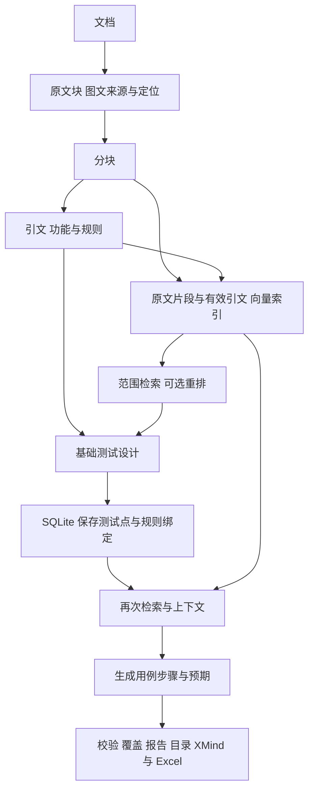

# 术语与数据流

| 名称 | 通俗理解 | 例子 |
|---|---|---|
| Document | 有内容指纹的需求版本 | 上传的 DOCX |
| DocumentBlock | 原文的结构块，带位置 | 段落、标题、表格或图片 |
| Chunk / ChunkSource | 处理片段及原文区间 | 来自哪些 Block、各取哪段字符 |
| EvidenceSpan | 能回查原文的引文 | “每次最多 300 个”及位置 |
| Feature / RequirementRule | 功能分组与独立要求 | 批量删除 / 一次不能超过 300 个 |
| TestPoint | 检查什么 | 检查 301 个时的限制 |
| PointTree | 全部保存测试点及状态的目录树 | 运行、文档版本、默认模块/维度/功能分组、状态标签与 point_id |
| TestCase / TestStep | 如何操作与预期 | 选择 301 个执行，核对是否按规则拒绝 |
| Issue / CoverageLink | 问题与步骤级关联 | 文案待确认 / 这步验证了哪条规则 |
| Run / StageSnapshot | 一次运行及阶段事实 | 失败位置、输入、配置及输出 |
| Embedding / Space | 文字向量及其兼容范围 | 模型、维度、归一化与模板版本 |
| Metric / Index | 打分方式及向量查询结构 | 余弦、平方 L2 / NumPy 或 FAISS |
| RAG | 检索证据补充生成输入 | 找回相关条件和例外，再规划或生成 |

Block 是来源，Chunk 是处理单位，不能丢掉定位。测试点说“测什么”，用例说“怎么测”。检索命中只表示可能相关，不能证明业务依赖或预期正确。

299/300/301 只有在整数计数和上限依据明确时才自动生成。301 是测试输入，没有新增业务上限；需求没写精确提示文案，就不能编一个作为预期。图片解释带不确定性，不能悄悄当成已确认事实。

[返回学习导航](README.md)
