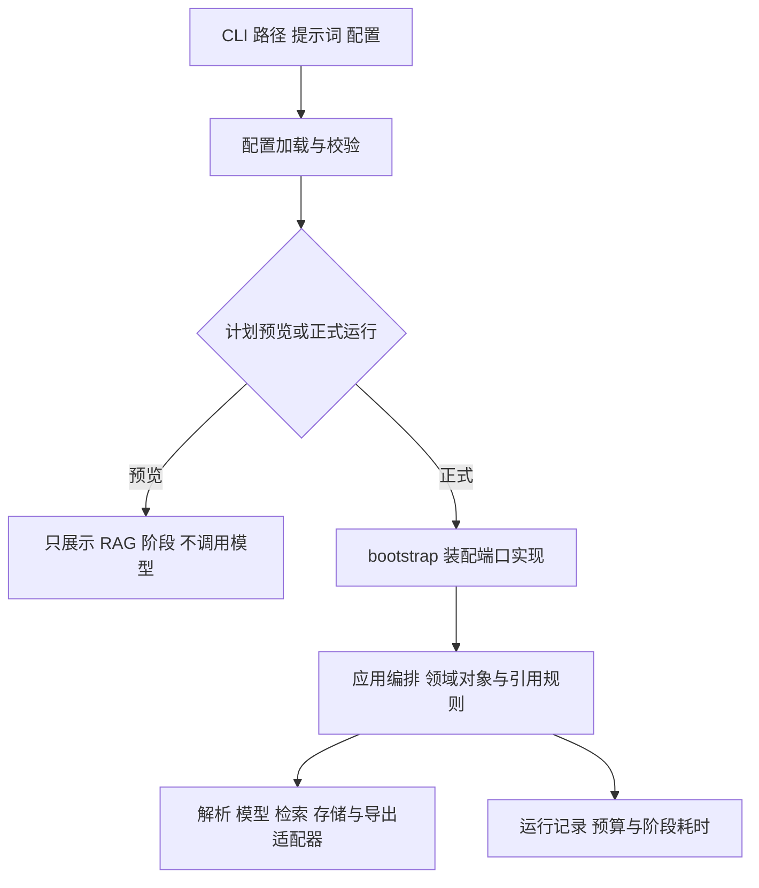

# P0 基础：功能、代码架构与流程

[返回 P0 导航](README.md) · [当前完整 RAG 流程](../P2/README.md)

## 1. P0 解决什么问题

P0 为后续流程统一“数据怎么表示、配置怎么传入、外部能力怎么替换、耗时怎么统计”。这些能力现在仍被 RAG 主线使用；本章讲基础组件，完整启动与联合导出命令统一看 P2 总览。

可以先记住：Block 是原文，Chunk 是处理片段，EvidenceSpan 是引文，Rule 是要求，TestPoint 是检查目标，TestCase 是操作和预期。RAG 找补充依据，不替需求增加事实。

## 2. 基础架构



| 入口（相对项目根目录） | 用途 |
|---|---|
| `src/tc_rag/core/config.py` | 配置结构、默认值、合并和变量展开 |
| `src/tc_rag/domain/models.py` | 文档、证据、规则、点、用例、消耗等契约 |
| `src/tc_rag/domain/identity.py` | 对象 ID 与内容指纹 |
| `src/tc_rag/domain/review.py` | 测试点树契约（旧审核模型仅兼容历史数据） |
| `src/tc_rag/application/ports/contracts.py` | 可替换模型、解析器、仓库、向量检索等协议 |
| `src/tc_rag/infrastructure/providers/fakes.py` | 离线预设响应和向量替身 |
| `src/tc_rag/infrastructure/runtime/timer.py` | 通用计时收集器与装饰器 |
| `src/tc_rag/bootstrap.py` | 基础替身容器与正式 Pipeline 装配入口 |
| `config/`、`requirements/`、`AGENTS.md` | 公共配置、依赖用途、仓库协作约定 |

interfaces → application → domain；infrastructure 实现 ports。更换模型或向量后端时替换适配器，领域对象和应用规则继续复用。

## 3. 配置怎样生效

CLI 先选择配置文件：显式 `--config` → `workdir/local.yaml` → `config/defaults.yaml`。选定后合并顺序为内置默认 → YAML → 环境变量 → CLI 覆盖。最后展开仍存在的 `${VAR}`，再交给 Pydantic 校验。

```python
from tc_rag.core.config import load_config

# 教学示例：只读取公共模板，不创建客户端、不发请求。
cfg = load_config("config/defaults.yaml", environ={})
assert cfg.retrieval.backend == "numpy"
assert cfg.models.embedding.concurrency == 2
```

嵌套环境变量如 `TC_RAG_RETRIEVAL__VECTOR_TOP_K=10` 覆盖对应字段。未知字段或非法组合报错，不能静默忽略。

密钥可直接填在私有配置 `models.<role>.api_key`；非空值优先，留空时兼容 `api_key_env` 环境变量。SecretStr 避免意外显示，字段 `exclude=True` 确保配置序列化、运行快照和导出不包含它；只有创建客户端时取出实际值。私有配置留在 Git 忽略的 `workdir/`，公共模板不含真实密钥。

正式运行还会检查模型是否已配置、密钥是否存在及所需可选依赖是否可用。配置校验通过不等于远端服务可访问。生成和 embedding 必须配置；vision/rerank 按需启用。

## 4. 领域契约为何重要

同一条事实要从提炼一直流到用例和报告，不能每步换一种无约束字典。对象的 `schema_version=1.0` 是结构版本，与需求文件内容版本不同。未知字段拒绝；字段合法后，还要检查 ID 是否存在、引文是否属于本次输入。

```python
from tc_rag.domain.models import ChunkSource

# 表示 block_demo 内从第 0 个字符开始、到第 8 个字符之前的原文。
source = ChunkSource(block_id="block_demo", start_char=0, end_char=8)
assert source.end_char > source.start_char
```

这个对象只能检查区间顺序，不能凭空证明原文有 8 个字符。应用层要加载对应 Block 检查区间、引文和定位。完整引用链为：

```text
Document → Block → ChunkSource → EvidenceSpan
                                   ↓
                              Feature → Rule
                                         ↓
                                   TestPoint → TestStep
```

最大 300 且整数精度明确时，测试边界是 299/300/301；精度不明时不猜测。权限、提示文案、单位、业务状态缺失同样进入待确认项。

`status=validated` 只说明自动检查通过，不证明业务语义正确；当前不设置人工批准步骤。详见 [契约参考](../../reference/contracts.md)。

## 5. ID 和指纹分别解决什么

`new_id()` 给对象生成带前缀的 UUID4，回答“这条记录是谁”。`fingerprint()` 对调用方选定的数据生成 SHA-256，回答“这些内容是否变化”。它不是对业务文本做语义归一化。

```python
from tc_rag.domain.identity import fingerprint, new_id

rule_id = new_id("rule")
assert fingerprint({"a": 1, "b": 2}) == fingerprint({"b": 2, "a": 1})
```

规范 JSON 排序字典键、保留列表顺序与 Unicode/空白，拒绝 NaN。调用方决定是否包含 ID 等字段，不能指望指纹函数自动排除它们。文件完整性另用文件字节校验和。

## 6. 计时怎样使用

`@timed` 包装同步或异步函数；通过 `Timer.bind()` 或 `Timer.wall()` 绑定当前收集器。未绑定时正常执行，不生成记录。

```python
from tc_rag.infrastructure.runtime.timer import Timer, timed

@timed(stage="demo", name="calculate")
def calculate():
    return sum(range(100))

timer = Timer("run_demo")
with timer.wall(stage="run", name="total"):
    result = calculate()
summary = timer.summary()
```

每次调用记录耗时和成功状态，异常/取消继续传播；不采集函数参数和返回内容。并发子调用的耗时累加通常大于实际经过的墙钟时间，不能混用。

通用 Timer 为内存组件；当前 Pipeline 另外保存阶段/模型调用耗时，RagContext 保存每次匹配各环节耗时，不应宣称所有指标都自动来自装饰器。例子和统计口径见 [计时参考](../../reference/timing.md)。

## 7. 离线替身与样例做什么

FakeLLM 返回测试提前指定的响应，未预设时不凭空生成业务结果；FakeEmbedder 给出确定性数值，用于验证接口、缓存、索引和流程。它们不能证明真实模型理解需求或检索质量合格。

测试中的虚构 DOCX/PDF 和人工标注用于检查顺序、规则引用、边界和事实引用约束。JSONL 一行一个对象便于程序流式读取；人工学习与审核应查看格式化视图或报告，不要求直接阅读一长行数据。

真实资料、人工金标及运行产物留在 `workdir/`，不能复制进 docs 或测试夹具。`scripts/convert_gold.py` 用于已有标注格式转换，脚本存在不代表真实业务金标已验收。

## 8. 如何审核基础是否可靠

| 检查内容 | 对应测试 |
|---|---|
| 配置覆盖、未知字段和变量 | `tests/unit/test_config.py` |
| 序列化、区间、来源、ID/指纹和领域导入边界 | `tests/unit/test_domain.py` |
| 同步/异步、异常/取消、并发隔离、墙钟和百分位 | `tests/unit/test_timer.py` |
| 替身、金标格式、CLI 计划与非法参数 | `test_fakes.py`、`test_gold.py`、`test_cli.py`，均在 `tests/unit/` |

人工先看字段和引用是否讲得清，再核对最大 300 的边界、未知信息处理、计时口径和替身边界。完整 RAG 的真实效果与 XMind/Excel 兼容性另行验收，不由 P0 单元测试推导。

继续阅读 [P1 基础模块](../P1/README.md) 了解证据与测试设计，再到 [P2 总览](../P2/README.md) 沿唯一流程运行。
