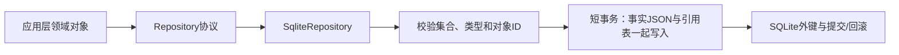

# P1.1 SQLite 存储与迁移

SqliteRepository 把领域对象、引用和阶段事实保存到本地数据库，已由 bootstrap 装配到正式 CLI 和连续 RAG 流程。

## 文件与架构

| 文件 | 职责与审核重点 |
|---|---|
| `src/tc_rag/infrastructure/storage/sqlite.py` | 迁移执行、模型校验、参数化读写、批量事务、连接关闭 |
| `src/tc_rag/infrastructure/storage/migrations/001_initial.sql` | 十二张核心表、七张引用关联表及索引 |
| `src/tc_rag/application/ports/contracts.py` | Repository 定义批量保存和删除等存储协议 |
| `pyproject.toml` | 打包时包含 SQL 文件，避免安装后迁移资源缺失 |
| `tests/integration/test_sqlite.py` | 临时真实文件数据库的往返、回滚、外键、并发、迁移校验测试 |



## 表结构为什么超过十二张

核心表：documents、document_blocks、chunks、evidence_spans、features、
requirement_rules、test_points、test_cases、coverage_links、issues、runs、model_invocations。

schema_migrations 保存迁移编号与指纹。
七张关联表为 chunk_blocks、feature_evidence、rule_evidence、point_rules、case_points、
case_rules、case_evidence。它们避免引用仅藏在 JSON 中、数据库无法执行外键检查的问题。
001 迁移完成后共二十张表；002 增加资产表，003 增加阶段、审核与实体表。关联表的 position 保留来源或引用顺序；步骤具体归属仍以 steps JSON 为准。

payload 保存完整领域 JSON；Chunk.sources 与 TestCase.steps 还保存为
`{"schema_version": "1.0", "items": [...]}` 结构的独立 JSON 列。
适配器在同一事务写入 JSON 与关联表，当前不允许绕过适配器分别修改。

## 迁移与事务

1. 构造仓库时创建父目录，按数字顺序读取 SQL 文件。
2. 启用 WAL；每条新连接显式启用 foreign_keys。
3. BEGIN IMMEDIATE 取得 SQLite 写锁，创建/检查迁移记录。
4. 已执行迁移校验指纹，修改旧文件或数据库版本超过代码时拒绝继续。
5. 逐条执行 SQL 与记录版本，整体提交；失败整体回滚。

不使用会隐式提交的 executescript，确保迁移记录和DDL处于同一事务。
当前迁移已到 006，包含 RAG、向量 ID 和需求集。后续改表新增迁移，不能修改任何已应用 SQL。

save_many先完成模型和ID校验，再在一次事务里写入全部记录。
调用方按依赖顺序传入，例如先文档、后Block，再证据、功能、规则和测试点。
一条引用失败，整批回滚。写入使用UPSERT而非REPLACE，避免替换父记录时触发意外删除。
同一ID代表更新，历史版本不可变性需要后续应用服务通过新ID和快照策略保证。

连接按操作创建并关闭。SQLite写锁串行协调不同线程/仓库实例的提交，超时10秒后失败，
不提供无限重试，不跨外部网络调用持有事务；本步不开放任意长事务上下文。

## 最小使用示例（虚构数据）

```python
from tc_rag.domain.models import Run
from tc_rag.infrastructure.storage.sqlite import SqliteRepository

repo = SqliteRepository("workdir/data.sqlite")
run = Run(run_id="demo", config_snapshot={}, status="queued")
repo.save("runs", run.run_id, run)
assert repo.get("runs", "demo", Run) == run
repo.delete("runs", "demo")
```

CoverageLink没有独立ID，使用 `object_key(link)` 获得由case_id/step_no/rule_id/point_id计算的稳定键。
删除被引用事实会失败；删除所有者会清理自己的关联行，不自动级联删除整条业务链。
当前仓库不支持 `:memory:`，因为每次操作使用独立短连接。

## 当前边界

- 外键保证对象存在，不证明证据语义、步骤与规则的业务匹配，也不证明覆盖步骤号没有超出用例长度。
- issues.object_ids 是异构引用，以 JSON 保存，不能只靠外键证明有效。
- 资产、阶段快照、审核、向量及需求集由后续编号迁移维护；同一 ID 的 UPSERT 不能代替版本控制。
- 事实写库和文件发布没有跨介质共同事务；完整任务恢复与资产清理仍待扩展。

## 验证和审核

`tests/integration/test_sqlite.py` 使用临时真实数据库验证模型往返、迁移幂等与指纹、外键保护、批量回滚和并发写入。当前连续编排中的持久化另见 `test_pipeline.py`、`test_rag.py`。

审核时检查事实和引用是否同事务、迁移是否新增、快照是否含密钥，并区分外键存在性与业务正确性。

[返回 P1 导航](README.md) · [完整 RAG 流程](../P2/README.md)
