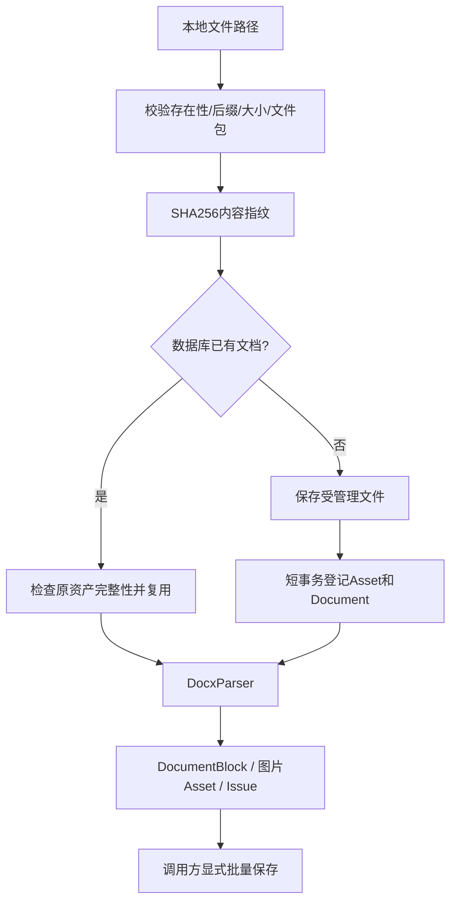

# P1.2 文件接入与 DOCX 解析

正式 CLI 通过接入服务登记文件资产和文档版本，再按格式选择解析器。本章聚焦 DOCX 的图文与结构读取；提炼和向量检索由后续编排接续。

## 修改文件与审核重点

| 文件 | 变化 |
|---|---|
| `application/services/ingest.py` | 路径/大小/格式校验、内容去重、文件与文档登记 |
| `infrastructure/storage/files.py` | 受管理路径、临时文件发布、文件校验和检查 |
| `infrastructure/parsing/docx.py` | 主文档顺序、标题路径、二维表格、图片提取和未解析报告 |
| `infrastructure/storage/migrations/002_assets.sql` | assets表和文档内容哈希索引 |
| `infrastructure/storage/sqlite.py` | 资产读写和按内容指纹查文档 |
| `application/ports/contracts.py` | ParsedDocument增加assets，Repository增加find_document |
| `domain/models.py` | Issue增加unparsed类型 |
| `tests/integration/test_docx.py` | 动态创建虚构DOCX和图片验证解析，不提交真实资料 |

## 数据流程



输入默认上限25MiB，DOCX包解压声明大小上限128MiB；校验关键包文件和CRC。
PDF只校验文件头，正文有效性由 PdfParser 检查。
同内容改名仍复用原Document，文档名称保留首次登记名称。
原件保存在 `assets/<hash>/original.docx`，图片保存在同目录的 `images/` 下。
这些路径相对于ArtifactStore的根目录，通常为workdir。

文件先发布、后提交数据库，二者无共同事务；数据库写入失败可能留下未登记文件，
下一次相同内容可复用文件。当前尚无资产垃圾清理器。
新增assets表没有给历史Document.asset_id强加外键，应用接入负责配对登记。

## 最小调用示例

```python
from pathlib import Path
from tc_rag.application.services.ingest import ingest_document
from tc_rag.infrastructure.storage.files import LocalArtifactStore
from tc_rag.infrastructure.storage.sqlite import SqliteRepository
from tc_rag.infrastructure.parsing.docx import DocxParser

store = LocalArtifactStore("workdir")
repo = SqliteRepository("workdir/data.sqlite")
ingested = ingest_document(Path("你的文件.docx"), store, repo)
parsed = DocxParser(store).parse(ingested.asset)
repo.save_many(
    [("assets", a.asset_id, a) for a in parsed.assets]
    + [("document_blocks", b.block_id, b) for b in parsed.blocks]
    + [("issues", i.issue_id, i) for i in parsed.issues]
)
```

上述代码会把所选文档保存到本地管理目录，仅应在用户授权后操作。
私有资料放在Git忽略的workdir，不复制到fixtures或docs。

## 解析边界

- 主文档按XML顺序输出；Heading N样式恢复标题路径，自定义标题样式尚不自动识别。
- 文本保留否定词、单位、制表符和换行；同一段落内按图片锚点拆成文字/图片/文字。
- DOCX无可靠固定页码，使用段落、表格、单元格索引；order为块序号。
- 表格content保存带schema_version的二维rows；合并单元格可能重复显示，明确记录Issue。
- 表格单元格图片携带行列定位，在整个表格块后提取；不承诺恢复复杂单元格内所有布局顺序。
- 本解析器仅提取和登记图片，并记录未解析范围。Pipeline 可按配置接入视觉解释，来源和不确定性见 [P2 图片证据](../P2/07_图片证据.md)；未启用时不能视为已理解。
- 嵌套表格、文本框、嵌入对象、页眉页脚及脚注等会报告局限，不静默认定全部解析成功。
- 损坏的DOCX可能在包校验或实际解析阶段失败；不生成伪造块来填补。
- 反复解析使用基于文档指纹与顺序的稳定块ID；解析器变更后的历史隔离留待版本编排完善。

## 验证和审核

`tests/integration/test_docx.py` 动态创建虚构 DOCX 和图片，检查去重、顺序、标题、表格、图片字节/位置、持久化及坏文件、超限、路径越界等失败路径。

人工抽查复杂表格、图文顺序和未解析清单；能读取文件不等于已理解所有内容。

[返回 P1 导航](README.md) · [PDF 解析](04_PDF解析.md)
