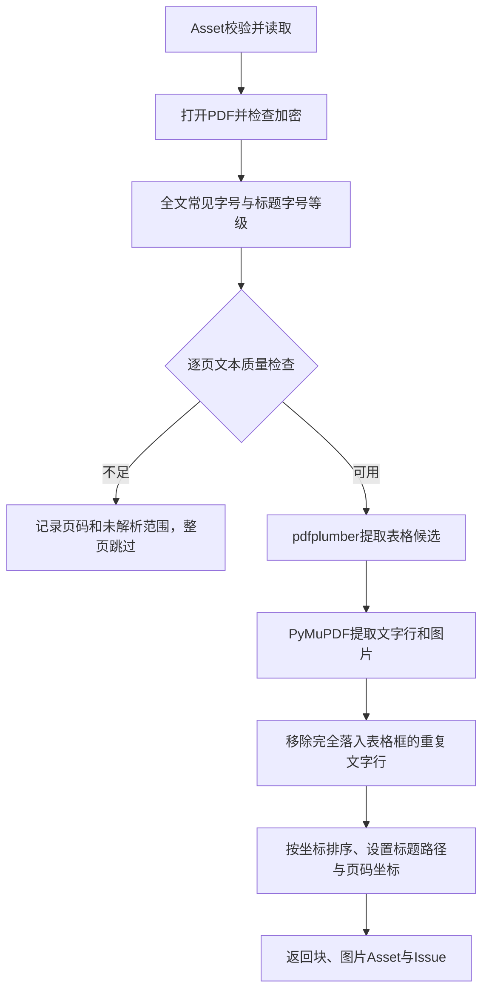

# P1.3 PDF 解析

`src/tc_rag/infrastructure/parsing/pdf.py` 实现 DocumentParser.parse(asset) 契约，返回 DocumentBlock、图片资产和 Issue，已接入正式 CLI。解析器不调用模型；可选图片解释由后续 Pipeline 负责。

## 流程与审核重点



- 页码从1开始，坐标为PDF页面坐标单位，顺序为页内从上到下、同高度从左到右。
- 正文字号按文字数量加权选取最常见值，大于其1.2倍的字号作为标题候选；
  全文标题字号从大到小确定层级，标题路径可跨页延续。
- 每页非空白字符默认少于20个，或可打印且非替换字符比例小于85%，视为低质量页；
  零宽空格等 Unicode 格式字符（Cf）不计入统计，避免正常页面被误判。
  输出含准确页码的unparsed Issue，不产生该页业务文字块；这可能跳过只有短标题的正常页面，
  阈值可在PdfParser构造时调整，尚未接入YAML字段。
- 图片解释统一走解析后的 Vision 服务，不设置独立 OCR 扫描选项；低文字量页只报告未解析文字范围。
- 表格content为带schema_version的二维rows，并标记candidate=true；
  单元格可包含None，不能把它自动解释为业务空值或补造内容。
- 图片保存到管理目录的assets/hash/images下，保留页码和坐标；
  解析器不解读图片文字，会生成未解析 Issue；已提取图片可交给可选视觉服务。
  图片提取与文字质量无关：低质量页上的局部插图仍会提取并生成块；
  只有"无正文且图片覆盖率不低于80%"的整页扫描图才跳过，不把整页图交给 Vision；这类输入需提供可读取文字的 PDF/DOCX。
- 表格库打开或提取失败会记录问题，正文仍继续处理；加密或损坏PDF会明确失败。
- 旋转页面当前跳过表格候选并报告，正文坐标采用PyMuPDF返回值；
  不承诺所有工具的旋转页面坐标都可直接互换。

## 使用示例

```python
from pathlib import Path
from tc_rag.application.services.ingest import ingest_document
from tc_rag.infrastructure.storage.files import LocalArtifactStore
from tc_rag.infrastructure.storage.sqlite import SqliteRepository
from tc_rag.infrastructure.parsing.pdf import PdfParser

store = LocalArtifactStore("workdir")
repo = SqliteRepository("workdir/data.sqlite")
ingested = ingest_document(Path("你的文件.pdf"), store, repo)
parsed = PdfParser(store).parse(ingested.asset)
for block in parsed.blocks:
    print(block.kind, block.locator.page, block.locator.bbox, block.heading_path)
for issue in parsed.issues:
    print(issue.description)
```

此示例会把指定文件存到本地管理目录，应在用户授权后运行。
解析结果不自动写库；可按P1.2说明由调用方统一提交assets、blocks和issues。

## 必须保留的局限

字号和坐标排序只是启发式，不证明标题语义或多栏阅读顺序正确。
当前不合并跨页表格、不恢复复杂合并单元格语义；无边框表格可能无法识别。
解析器不自动去除所有页眉页脚或重复段落；分块和核验见 [P1.4](05_清洗分块与引文校验.md)，也不承诺任意版式都能清洗。
正文按文字行输出，后续分块需恢复可读上下文，不能把每行当独立规则。
文档块稳定ID依赖当前解析输出顺序，解析算法版本隔离仍需后续编排完善。

## 验证和审核

`tests/integration/test_pdf.py` 动态生成虚构 PDF，覆盖文字/标题、表格去重、图片、页码坐标、扫描页/空白页报告、阈值、零宽字符质量判定、整页扫描图跳过与局部插图保留、加密/损坏文件和表格库失败降级。

人工检查多栏阅读顺序、跨页条件、表格语义和遗漏页面；测试通过不代表所有 PDF 版式可正确恢复。

[返回 P1 导航](README.md) · [图片证据](../P2/07_图片证据.md)
