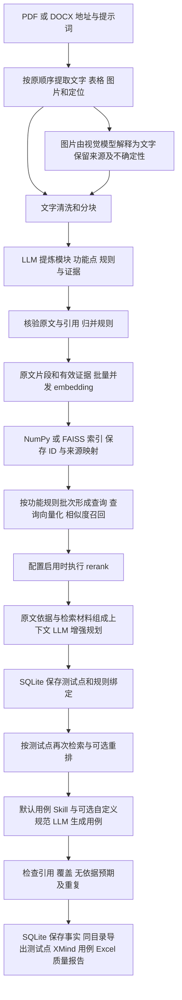

# RAG 主线：功能、架构、流程与审核

[返回学习导航](../README.md)

## 一条流程完成什么

输入需求文档路径和提示词，经过解析、提炼、向量检索和增强规划测试点，
随即结合用例 Skill 与 RAG 上下文生成用例，同目录输出 XMind 和 Excel。
中间无需人工审核；XMind 展示策略处理后保存的全部测试点，默认按模块/章节、业务维度和功能分组，点状态以标签保留，不包含用例步骤和预期；Excel 展示实际生成的详细用例。
所有正式生成共用下面的流程。阶段是开发顺序，不能当作独立运行方案。
输入只保留需求 PDF/DOCX；原文、表格及图片解释参与证据与检索，不再读取代码仓库或建立代码参考索引。



图片解释按配置启用；未启用或无法可靠读取的图片进入问题清单，不能默认为已理解。
规则绑定的原文证据始终保留，RAG 召回的是补充材料；相似不等于业务依赖已经成立。
检索发现的疑似新规则必须经提炼或人工确认，不能在生成时悄悄变成需求。

## 与原始截图逐项对应

| 原始能力 | 当前实现与代码 | 使用边界 |
|---|---|---|
| PDF、Word 路径读取，图文分离 | `infrastructure/parsing/pdf.py`、`docx.py` | 支持文本 PDF、DOCX；保留图片资产、段落和表格位置 |
| 图片内容转文字、减少噪声 | `providers/vision.py`、`application/services/vision.py`、`prompts/vision/v1.md` | 配置启用后处理已提取图片；保留 vision 来源和不确定性，低文字量或扫描页报告未解析，不自动渲染整页图片 |
| 通用对话 LLM，提炼模块/功能与增强 | `providers/openai_sdk.py`、`prompts/extract/`、`plan_points/`、`generate/` | OpenAI 兼容协议已实现，可接 DeepSeek；LangChain、Claude SDK 仅有配置声明/扩展位置，尚无可用适配器 |
| 批量、并发调用向量模型 | `providers/embedding.py`、`bootstrap.py` | 支持批量、并发、响应顺序校验、维度校验和缓存；生成与向量请求共用预算 |
| 向量库、ID 与功能/原文映射 | `retrieval/context.py`、`index.py`、`faiss_index.py`、SQLite | 默认 NumPy，可选 FAISS；有效证据和原文区间入索引，功能经规则和证据引用追溯，不另造一套事实文件 |
| 查找相关功能上下文 | `Pipeline._supplement()`、`RagContext.retrieve()` | 遍历功能对应的规则批次和测试点批次；查询向量化后召回相关证据，业务关系图仍待后续确认 |
| rerank 模型 | `providers/rerank.py` | HTTP 重排能力保留；按 `models.rerank.enabled` 启用，失败有降级记录；是否有业务增益须评估 |
| 距离、余弦、math/NumPy 批量算法 | `retrieval/metrics.py`、`scripts/bench_similarity.py` | 保留 math/NumPy 余弦、平方 L2、内积，以及排序方向与跨后端验证 |
| 通用耗时装饰器与每次匹配耗时 | `infrastructure/runtime/timer.py`、`retrieval/context.py` | 保留同步/异步计时；每次查询记录向量化、搜索、重排及上下文耗时 |
| 框架化、配置化 | `application/ports/`、`core/config.py`、`bootstrap.py` | 端口替换外部实现；模块开关只调整同一 RAG 流程 |
| XMind、Skill 与用例文档 | `interfaces/workflow.py`、`exporters/`、`prompts/case_skill/` | 默认用例 Skill，可追加 Markdown 规范；XMind 只作输出目录视图 |

上表是实际能力核对，不能把扩展类型、自动业务关系推断或多 SDK 名称写成已完成。图片处理只保留 Vision 主线，不规划独立 OCR 扫描路线。

## 只需配置哪些内容

个人配置：`workdir/local.yaml`。公共模板：`config/defaults.yaml`。
实际模型、地址和维度由使用者配置；模板中的空值不能直接用于正式运行。

| 必需项 | 配置位置 |
|---|---|
| 生成模型与协议 | `models.llm`：model、base_url、api_mode、response_format、api_key |
| 向量模型 | `models.embedding`：model、base_url、api_key、batch_size、concurrency |
| 模型真实维度 | `retrieval.embedding_dimension`，必须与返回维度一致 |
| 索引、距离和候选量 | `retrieval.backend`、metric、vector_top_k |
| 输入与请求预算 | `runtime.max_context_tokens`、budget.max_calls；输入含定位元数据和 Schema |
| 图片和重排 | 按需配置 `parsing.vision_enabled`、`models.vision`、`models.rerank` |

密钥直接填在本地配置各模型的 `api_key`，不进入快照/导出；留空时才使用 `api_key_env` 引用的环境变量。
智谱 embedding-3 与 rerank 的完整示例见 [向量模型配置](02_向量空间与缓存.md)。不要把生成模型当作向量模型使用。
本机向量模型名称或地址若仍为空，需要填写实际服务后才能正式启动。

旧配置迁移与错误排查见 [终端交互与调试](../P1/13_终端交互与调试.md)。

## 一次执行

在项目根目录输入：

```powershell
.\.venv\Scripts\python.exe -m tc_rag.interfaces.cli start
```

交互入口只输入路径，使用默认生成目标；自定义目标通过 `run -i` 指定：

```powershell
.\.venv\Scripts\python.exe -m tc_rag.interfaces.cli run "需求.docx" -i "覆盖正常、异常和边界，依据需求生成测试用例" --config workdir/local.yaml --output-dir workdir/output
```

产物默认在 `workdir/output/运行ID/`，可指定 `--output-dir`：

```text
运行ID/
├─ testpoints_需求名.xmind  全部保存点；默认模块/维度/功能，状态标签保留
├─ testcases_需求名.xlsx    十一列详细用例，以及测试点、规则、覆盖和问题附表
├─ testcases.json        可选结构化产物
├─ report.md             可选可读报告
├─ manifest.json         配置、提示词/Skill 指纹与调用统计
└─ reports/              质量及耗时报告
```

XMind 与 Excel 始终输出；`export.formats` 控制额外的 JSON/Markdown。
未生成用例的点仍保留在目录脑图、Excel 测试点表和问题清单；没有就绪点时用例表可能仅有表头。
XMind 编辑不反向改变 SQLite 事实，也不作为用例生成输入。

默认使用 `prompts/case_skill/v1.md`，按上传的 testcase Skill 整理命名、粒度和优先级，
保留框架的独立边界用例及十一列 Excel。可在 `start`、`run` 后增加
`--skill-file "规范文件.md"`，或配置 `generation.skill_file`；CLI 参数优先。
自定义文件需为非空 UTF-8 Markdown，最大 256 KiB；引用内容需整理在同一文件中。
框架将规范加入生成请求并记录指纹，仍由本地 Schema、引用和覆盖校验控制结果。

用例阶段失败后，可从已保存测试点重试：

```powershell
.\.venv\Scripts\python.exe -m tc_rag.interfaces.cli cases RUN_ID -i "生成用例" --config workdir/local.yaml --output-dir workdir/output
```

保持生成测试点时的配置；使用 CLI 指定过 Skill 时重试也携带相同 `--skill-file`。
第一次交付在运行目录；已有成功交付后重新生成会创建 `batch_*` 子目录，两份文件仍共同放置。

已完成运行可做只读质检：

```powershell
.\.venv\Scripts\python.exe -m tc_rag.interfaces.cli quality RUN_ID --config workdir/local.yaml
```

输出 `reports/quality_check.json` 和 `.md`，逐阶段列出 pass/warn/fail/not_applicable；
`fail` 退出码 2，`--strict` 时 warn 也退出 2。只读快照，不调用模型，
自动检查不替代人工语义结论。

`doctor` 只做离线检查；`doctor --live` 用独立虚构需求验证首轮 RAG，最多 8 次生成与向量请求，
不验证完整用例生成或真实业务质量。实际请求可能产生费用，仅在显式执行时发送。

## 代码与审核顺序

1. `src/tc_rag/core/config.py`、`src/tc_rag/bootstrap.py`：无路线开关，生成与向量端点必需，检索器必需注入。
2. `src/tc_rag/application/orchestration/pipeline.py`：提炼后必建索引，规划/用例请求检索增强，失败停止。
3. `src/tc_rag/infrastructure/retrieval/context.py`：范围隔离、向量缓存、索引发布、可选重排和计时。
4. `src/tc_rag/interfaces/workflow.py`：一次执行、Skill 输入和结果路径；终端提示不泄露密钥和原始响应。
5. `tests/integration/test_pipeline.py`、`test_rag.py`、`test_rag_cli.py`：虚构需求覆盖全流程，检索故障不得绕过。

人工审核重点：图片是否遗漏，模块与规则是否忠于原文，相关条件/例外是否召回，
rerank 是否有帮助，299/300/301 是否正确，撤销与撤回是否区分，测试点到用例是否可追溯。
离线测试只能证明工程行为；实际模型语义、业务覆盖、速度与 XMind/Excel 客户端仍需验收。

离线验证覆盖连续 RAG、联合导出、Skill 输入、失败恢复及密钥排除；测试夹具不代表真实业务质量。

## 按模块继续读

| 指南步骤 | 讲解 |
|---|---|
| 2.1 | [相似度与基准](01_相似度度量与基准.md) |
| 2.2 | [向量空间、批量与缓存](02_向量空间与缓存.md) |
| 2.3 | [索引构建与发布](03_索引构建与发布.md) |
| 2.4 | [需求范围与检索](04_需求集与检索.md) |
| 2.5 | [重排与降级](05_重排适配与降级.md) |
| 2.6 | [上下文与生成](06_上下文与生成.md) |
| 2.7 | [图片证据](07_图片证据.md) |
| 2.8 | [Excel 导出](08_Excel导出.md) |
| 2.9 | [质量评估与验收](09_评估与验收.md) |
