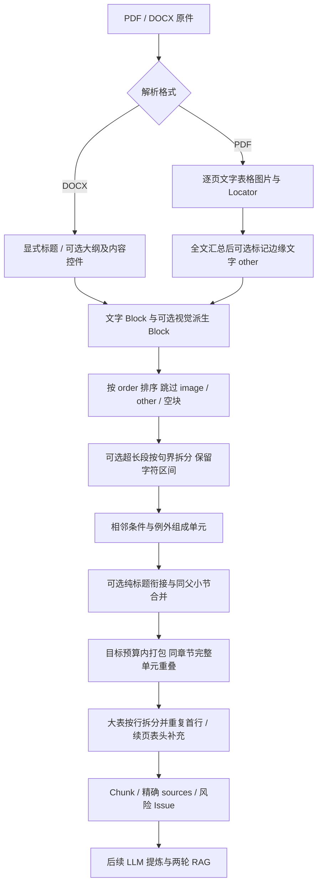

# 分块与解析结构优化：逻辑、实测与统一验收

本轮完成离线统计、标题衔接、小节合并、DOCX 扩展结构、PDF 边缘文字隔离、超长段按句拆分及文档同步。没有新增依赖、领域字段或数据库列，没有修改提示词，没有调用真实模型。

所有新策略默认保留旧行为，`workdir/local.yaml` 未被修改。指南同时提出“标题合并建议默认开启”和“默认输出兼容旧版”，本轮优先兼容；请先审核对照，再决定启用项。

## 1. 先看哪里

已生成的私有验收入口：

```text
workdir/dev/benchmarks/chunk-structure-20261103/acceptance/README.md
```

该页按文档列出 defaults、headings、minimum200、sentences、combined 五组对照。每组包含：

- `review.md`：原分块和试分块的完整文字、章节、来源 ID、字符区间与问题，可逐块阅读。
- `comparison.json`：原始 Block、改前/改后 Chunk、策略参数及 Issue，供程序复核。
- 文档级 `parse_review.md` / `parse_comparison.json`：重新读取原件的解析开关对照。
- 总入口旁 `summary.json`：所有实测统计，包括布局诊断。

试分块使用历史保存的 Block，因此保留历史视觉文字；解析对照重新读取原件，不调用视觉模型，两者不能混为端到端生成结果。原件预览副本和提取图片仅写在验收目录的 `preview_assets/`，主库、原资产目录和历史快照保持原位。

## 2. 当前处理顺序



独立统计与试分块在 M 为止，绝不进入 N。

## 3. 每个开关做什么

只把要启用的字段合并到已有私有配置，不要覆盖整个配置或密钥。

```yaml
parsing:
  docx_extended: false
  pdf_running_text: keep
chunking:
  attach_headings: false
  min_tokens: 0
  split_long_paragraphs: false
```

| 选项 | 开启后的规则 | 保守边界 |
|---|---|---|
| `attach_headings=true` | 待输出内容全是标题时，带入下一单元；末尾无正文的标题仍输出 | 不是删除标题；遇到大表，标题仅作为首组前缀，各组重复表头 |
| `min_tokens=200` | 当前块小于阈值，下一单元是同父小节或当前章节的下级，且合并不超 target 时继续打包 | 不跨一级章节；0 关闭；必须满足 `0 <= min_tokens < target_tokens` |
| `split_long_paragraphs=true` | 超目标预算的 paragraph 按换行和句末标点分组，包括 vision 来源 | 不按字符硬截；小数点保守处理；无法切开的长句和条件例外组整块保留并警告 |
| `docx_extended=true` | Heading N 优先；其次段落/样式继承的大纲 0–8，再次中文标题样式；按序展开正文内容控件 | 大纲 9 不作为标题；目录控件跳过并记 info；不支持结构继续报问题；排版推断仍由独立 infer_docx_headings 控制 |
| `pdf_running_text=isolate` | 真实页高顶部/底部各 8% 内，数字归一化去空白后在至少 `max(3, ceil(文字页数×50%))` 页重复的文字行标为 other；纯页码仅需满足位置 | 不删除原文；保留 ID/Locator；正文区重复文字不隔离；处理在全部页面汇总后进行，包含检查点恢复页 |

目标 900 是配置计数器得到的近似 token 数，不等于固定字数或字节数。不同语言、标点和 JSON 表格的换算不同。

小节合并只在边界决定是否继续打包，**不是强行补足最小长度**；最后一节可能仍小于 200。超长句、条件例外组和续表补入的表头可能导致超目标预算，必须有 Issue，不能通过丢字让数字好看。

## 4. 如何保证原文可追溯

Block 是原始资料；Chunk 是发送给模型的处理单元。拆分不改写 Block，来源仍使用原 Block 的 `block_id`、Locator、origin。

每个 ChunkSource 使用左闭右开字符区间 `[start_char,end_char)`，不是 UTF-8 字节偏移。可以用下面的等式检查每块：

```python
chunk.text == "\n".join(
    blocks[source.block_id].content[source.start_char:source.end_char]
    for source in chunk.sources
)
```

同一段内连续区间合在一个 Chunk 时先合并区间，避免插入原文没有的换行。测试检查每个应处理的非空 Block 至少被引用一次、段落字符完整覆盖、来源区间不越界、同输入 Chunk ID 稳定。

表格沿用既有规则：引用 JSON 中每个完整行的真实字符范围；JSON 包装字段、逗号和外层括号不必进入 Chunk，整表原文仍保留在 Block。表头可能重复，这是上下文衔接，不是新增需求。按句拆段的条件例外尽量保持原子单元，仍需人工检查跨句含义。

DOCX 扩展 Locator 的 paragraph_index/table_index 按展开后的正文 XML 阅读序从 0 编号；包含内容控件，不包含跳过的目录。`python-docx.Document.paragraphs` 不能直接作为该模式的定位表，因为它不展开内容控件。PDF 页码从 1 开始，坐标和真实页高来自 PDF 页面。

## 5. 改动前后实测

测量时间：2026-11-03；均为离线解析/打包，生成调用数为 0。使用各运行保存的 target=900、overlap=100 和历史计数器，不改变原文或模型提示词。

| 样本 / 策略 | 分块数 | 纯标题块 | 超预算块 |
|---|---:|---:|---:|
| 六图 Word 原快照 / defaults | 10 | 2 | 0 |
| Word headings：仅标题衔接 | 8 | 0 | 0 |
| Word minimum200：标题衔接＋小节合并 | 7 | 0 | 0 |
| Word sentences：标题衔接＋按句拆长段 | 8 | 0 | 0 |
| Word combined：三项全开 | 7 | 0 | 0 |
| 大 PDF 原快照 / defaults | 122 | 34 | 9 |
| PDF headings | 89 | 0 | 9 |
| PDF minimum200 | 76 | 0 | 9 |
| PDF sentences | 91 | 0 | 4 |
| PDF combined | 78 | 0 | 4 |

Word 对应 `run_a188817f8471418991fa3d3556b77e39`，PDF 对应 `run_ee9660935a704e74b081554e27d55e41`。两份 defaults 重新打包与各自已保存的全部 Chunk（包括 ID 和来源）完全相同。

原 Word token 最小/中位/P90/最大为 5 / 197.5 / 878 / 894，不足 100、200 token 块均为 5/10；原 PDF 为 7 / 310 / 872 / 1096，不足 100 为 54/122、不足 200 为 58/122。P90 使用最近秩 `ceil(0.9×n)`，空样本为 null。

PDF combined 剩余 4 个超预算块均含续表补入来源，最大 1042 token；不是通过吞掉文本来消除超限。应在对照中检查这些表头和正文是否衔接正确；本轮不扩大到修改续表识别业务规则。

实际资产是 **49 页**，与先前口头称呼的 48 页不同，以原件诊断为准。Word 有 22 个直接声明 numPr 的段落、无正文顶层内容控件、无直接声明大纲的段落；开启扩展前后仍为 46 Block、7 个标题。PDF 隔离命中 0，前后仍为 237 Block、70 个标题，未凭“应该有页眉”强行隔离。多栏启发式候选为第 2、3、5 页，可能只是表格，需看原件确认。

这些数字只证明分块结构变化，**不能证明提炼准确率提高、用例质量提高或端到端耗时降低**。真实质量与费用需另行授权后做固定配置对照。

## 6. 如何自己复验

已激活虚拟环境时，先做只读统计或试分块：

```powershell
rag chunk-stats run_a188817f8471418991fa3d3556b77e39
rag chunk-stats run_a188817f8471418991fa3d3556b77e39 --compare
rag chunk-stats run_ee9660935a704e74b081554e27d55e41 --compare --min-tokens 200 --split-long-paragraphs
```

`--compare` 默认开启标题衔接；可用 `--keep-headings` 关闭它。该命令不修改正式配置。`--docx "原件路径.docx"` 可额外诊断 numPr、大纲、内容控件和文本框；统计写在每次唯一的子目录，不覆盖上次材料。PDF 直接从运行登记的受管理原件读取布局。

统计优先使用快照已记录的 token；视觉文字补充计数仅在本地编码缓存可用时计算。缓存缺失时普通统计将其留空，试分块则明确失败，绝不联网下载或偷偷换另一种算法。

重新生成本轮完整的私有审核包：

```powershell
$env:PYTHONPATH = 'src'
python scripts/history/chunk_structure_diagnostics.py run_a188817f8471418991fa3d3556b77e39 run_ee9660935a704e74b081554e27d55e41 --output-dir workdir/dev/benchmarks/chunk-structure-20261103/acceptance-recheck
```

审核包含真实需求文字和原件副本，仅保留在被 Git 忽略的 workdir，勿作为公共 fixture 提交。

## 7. 统一审核清单与建议

1. 先看 headings：标题是否仍出现在正确正文之前，特别是小节首尾、末尾只有标题和大表首组。
2. 再看 minimum200：合并小节是否属于同一业务根模块，是否存在不应共用上下文的兄弟章节。200 是对照值，不是已验证最优参数。
3. 看 sentences/combined：句子有没有断开，条件和例外是否仍连贯，区间是否逐字对应；重点核对视觉长列表和剩余超预算告警。
4. 看 parse_review：Word 内容控件的定位方式是否可接受；PDF 被标 other 的文字是否确实为页眉/页脚，本次实际样本没有命中。
5. 分块结构验收后，再决定正式开启哪些参数，以及是否授权真实提炼/生成对照。建议先单独试用标题衔接，再决定是否引入小节合并和长段拆分。

自动编号生成、多栏重排、PDF 文字行合并为段落均未实现。numPr 数量说明存在自动编号，但不证明编号承载业务含义；需要人工确认后才能单独设计，避免错误编号污染原文。

## 8. 缓存与回滚

默认新增字段从配置快照省略，兼容已有默认形状。启用值写入快照，恢复运行需要配置一致。改变分块文本/来源会改变 Chunk 指纹和 ID，**受影响的提炼缓存失效**；不要将旧提炼结果强行绑定新 Chunk。

原历史快照、RAG 记录和视觉缓存不会因离线对照而被删改。后续新运行的提炼、索引及生成可能产生费用，尚未授权调用。解析扩展改变 Block 顺序/章节时，部分图文缓存的具体上下文也可能变化，不能承诺所有缓存一定命中。

回滚新策略只需恢复五个默认值或删除这些新增私有配置项，然后新建运行；不需要删库、移动资产或迁移字段。历史对照目录属于派生产物，可保留审计。旧快照不能通过修改参数原地变成新策略结果。

## 9. 改动文件与验证

| 层 / 文件 | 本轮用途 |
|---|---|
| `core/config.py` | 五项策略、预算关系校验、默认快照兼容 |
| `application/services/chunking.py` | 标题衔接、小节合并、句界拆段、表格前缀与来源区间 |
| `application/services/chunk_stats.py` | 纯统计：分位数、小块比例、超限原因、章节与视觉分布 |
| `application/services/quality/chunk_checks.py` | other 不纳入应分块覆盖集合；原 quality.py 已按职责拆包 |
| `application/orchestration/pipeline.py` | 传递分块配置、全文 PDF 后处理 |
| `application/ports/contracts.py` | 分页会话明确声明 finalize 后处理接口，编排不依赖具体解析实现 |
| `infrastructure/parsing/docx.py` / `pdf.py` | 扩展结构、边缘文字隔离及分页汇总 |
| `infrastructure/parsing/layout_diagnostics.py` | 只读布局诊断、数字归一化、保守隔离 |
| `infrastructure/runtime/tokens.py` | 严格离线计数器，缺缓存不联网 |
| `interfaces/chunk_stats.py` / `cli.py` | 只读统计与 Markdown / JSON 对照命令 |
| `bootstrap.py` / `interfaces/workflow.py` | 正式运行和 estimate 统一装配策略 |
| `scripts/history/chunk_structure_diagnostics.py` | 多策略与原件解析离线审核包 |
| `tests/unit/test_chunk_structure.py` | 默认回归、来源守恒、原子句、配置及离线失败路径 |
| `tests/integration/test_parsing_structure.py` / `test_chunk_stats_cli.py` | SDT、大纲、PDF 隔离及只读 CLI 行为 |
| `tests/fixtures/chunking_legacy.json` | 改动前合成文档的精确分块快照，不含真实资料 |
| `config/defaults.yaml` / `example.yaml`、README、P1 三章与契约 | 参数、行为、定位与缓存说明同步 |

最终完整离线测试：**708 passed、2 skipped**；`ruff check .` 通过，`mypy src` 通过（66 个源码文件）。诊断终端补全后另运行 CLI 回归，2 passed；`chunk-stats --help` 正常。合成测试覆盖 4 模块×2 小节从 12 块到 8 块、标题加大表、正文/视觉长段、坏预算、缺编码缓存、内容控件顺序、目录跳过、非标准标题、不同页高、边缘重复与正文重复区别，以及分页序列化恢复后的隔离一致性。

```powershell
python -m pytest -q --basetemp=workdir/dev/tests/chunk-structure-final
python -m ruff check .
python -m mypy src
python -m tc_rag.interfaces.cli chunk-stats --help
```

未验证：真实模型提炼/生成质量、最终用例覆盖增益、开启策略后的端到端耗时与费用。这些不能由离线结构测试代替。
