# 完整运行过程：需求文档 → 两轮 RAG → 测试点 XMind 与用例 Excel

[参考导航](README.md) · [项目 README](../../README.md) · [交互图集](../diagrams/index.html) · [领域契约](contracts.md) · [目录职责](directory_structure.md)

更新日期：2026-10-29。本文依据当前实现，框架只以 PDF/DOCX 需求文档为输入，连续完成提炼、检索、规划、生成、校验和联合导出。项目代码读取与 UI 参考支路已删除。
历史运行保留在文末，与当前流程、模型配置及验收结果分开阅读。

## 1. 启动与配置

在项目根目录、虚拟环境已激活的 PowerShell 中执行：

```powershell
rag
```

输入 PDF/DOCX 路径，可以粘贴带成对引号的文件地址。确认后默认目标为：**根据需求文档生成功能测试点和测试用例，保留原文依据**。交互入口不再额外询问提示词，不等待中间人工审核。

```powershell
# 指定本地配置和输出位置
rag start --config workdir/local.yaml --output-dir workdir/output

# 直接提供文件和自定义业务目标，执行完整流程
rag run 'D:\需求\订单.docx' -i '依据需求覆盖正常、异常、权限、状态和明确边界；缺失规则列为待确认' --config workdir/local.yaml --output-dir workdir/output

# 只查看计划，不解析正文或调用模型
rag run 'D:\需求\订单.docx' --preview --config workdir/local.yaml
```

`rag` 与 `tc-rag` 是同一个 CLI。PowerShell 不能把 `run` 子命令当作独立程序执行。
非交互环境不带子命令只显示帮助；`rag run` 缺少 `-i` 时也只预览。
若当前环境找不到入口，执行 `python -m tc_rag.interfaces.cli start`，或先 `python -m pip install -e . --no-deps`。

CLI 先选择一份配置：显式 `--config` → `workdir/local.yaml` → `config/defaults.yaml` → 内置默认；选中文件后按“默认值 → YAML → 环境变量 → CLI 覆盖”合并并校验，不依次加载全部文件。
日常只维护 `workdir/local.yaml`。非空 `models.<role>.api_key` 优先，否则读取 `api_key_env`；密钥从序列化、运行快照和导出中排除。

代码开关 `--with-code/--no-code` 和 `sources` 配置已移除，正常命令直接使用 `rag`。
本机配置已清理；若另用旧 YAML 或设置过 `TC_RAG_SOURCES__*`，按终端提示删除旧字段或变量后再启动，不会静默启用旧支路。

## 2. 模型分工与调用边界

模型名称、服务地址、密钥、并发和超时以本次有效配置为准，本文不固化某一私有服务的名称或地址。

| 工作 | 配置角色 | 实际实现与说明 |
|---|---|---|
| PDF / DOCX 解析、分块 | 不调用模型 | PyMuPDF / pdfplumber、python-docx、本地结构分块 |
| 图片转文字解释 | `models.vision`，按开关 | OpenAICompatVision；统一解释解析器已提取的图片，低文字量扫描页仍报告未解析 |
| 功能、规则、逐字证据提炼 | `models.llm` | OpenAIStructuredLLM，输出 Extraction |
| 证据和原文片段向量化 | `models.embedding` | OpenAIEmbedder，按 batch_size / concurrency 批量请求 |
| 两轮查询向量化 | `models.embedding` | 与需求索引使用同一向量空间；合规缓存可复用 |
| 候选重排 | `models.rerank`，按开关 | HttpReranker；失败记录 fallback，沿用召回顺序 |
| 第一轮检索后的测试点规划 | `models.llm` | 在程序基础点上补充测试意图，输出 PointBatch |
| 第二轮检索与 Skill 之后生成用例 | `models.llm` | 输出 CaseBatch；同提炼、规划共用一个生成端点配置 |
| 引用核验、覆盖、导出 | 不调用模型 | 本地领域与应用逻辑；导出器负责 XMind / Excel / 报告 |

生成与 embedding 是主线必需能力，视觉和重排按配置启用。索引或检索失败就停止，不切换为无检索生成。
配置声明和自动校验不证明供应商效果、业务语义或账户可用性；真实模型验收须单独授权。

## 3. 架构与全流程视图

### 3.1 分层架构



[Mermaid 源码](../diagrams/01_architecture.mmd)。交互放大、切图和可编辑 Draw.io 见[图集](../diagrams/README.md)。

- `interfaces`：CLI、配置覆盖、输入与终端进度。
- `application`：Pipeline 连续编排、分块与测试设计、视觉证据后处理、评估及外部能力协议。
- `domain`：对象、枚举、引用、来源、ID、指纹及纯业务逻辑。
- `infrastructure`：实现解析、模型、检索、存储、导出和计时能力。
- `bootstrap.py`：创建具体实现并通过 ports 注入应用流程。

依赖方向为 `interfaces → application → domain`；基础设施实现 `application.ports`。领域层不访问 SDK、数据库或文件。
SQLite 是结构化事实源；原件和图片为资产，向量索引及导出文件是派生产物。

### 3.2 一次执行的完整路径



图中的步骤号用于阅读，不等于终端实际阶段编号。默认无图片解释的连续主线有 **10 个可见阶段**；启用图片解释增加 1 个。`index` 在规划和生成之前各出现一次，`points_ready/completed` 是衔接与完成事件，不计为工作阶段。

| 执行顺序 | CLI 阶段键 | 输入 → 输出 | 模型 |
|---|---|---|---|
| 1 | `ingest` | 路径 → 原件 Asset、Document、指纹与 input 快照 | 无 |
| 2 | `parse` | 原件 → 文本/表格/图片 Block、定位和解析问题 | 无 |
| 可选 | `vision` | 图片 → 带模型、版本与不确定性的文字解释 | Vision |
| 3 | `chunk` | Block → Chunk / ChunkSource 字符区间 | 无 |
| 4 | `extract` | 分块 → 功能、规则、证据、实体和问题，随后核验与归并 | LLM |
| 5 | `index` | 有效证据 + 原文区间 → 当前需求范围的可查询索引 | Embedding |
| 6 | `plan_points` | 本地基础点 + 第一轮 RAG → 全部测试点与 PointTree | Embedding / 可选 Rerank / LLM |
| 7 | `index` | 核验并准备第二轮检索输入；符合条件时复用 | Embedding 缺失时 |
| 8 | `generate` | 就绪点 + 第二轮 RAG + Skill → 用例批次 | Embedding / 可选 Rerank / LLM |
| 9 | `validate` | 引用、步骤、边界、风险校验 → 有效用例、覆盖和问题 | 无 |
| 10 | `export_cases` | SQLite 事实 → 联合 XMind / Excel 及报告 | 无 |

Pipeline.generate 调用 `points(publish=False)` 保存测试点事实后直接进入 `cases()`，不从 XMind 回读，也不生成批准记录。

## 4. 解析、提炼与测试设计

PDF 保留页码、坐标和图片资产；当前按页解析并保存检查点。DOCX 保留段落、表格、行列顺序及图片。复杂版式、合并单元格、低质量内容等局限记录为 Issue。图片统一交给 Vision 解释，不设置独立 OCR 扫描路线；低文字量或扫描页仍记录未解析范围，当前不会自动渲染整页图片，需提供可读取文字的 PDF/DOCX。

Vision 仅处理已提取图片。缓存命中不重复请求，失败图片记未解析问题后继续其他图片；解释保留 `origin=vision`、模型和版本，并强制不确定性标记，不冒充已确认的原文文字。

原始 Block 不被清洗结果覆盖。ChunkSource 保留 Block 内 `[start_char,end_char)` 区间；提炼只引用当前输入区间中的文字，heading_path 仅给章节范围。
程序核对 block_id、Locator、区间、最短引文及引用闭包；引文比对兼容受限的排版空白和全半角差异，不擅自改写需求含义。
同功能、同来源及同约束的精确重复才保守归并，条件不同、冲突和缺漏保留为问题。

边界点由本地 `boundary_values()` 推导：明确“整数个数最多 300”时分别生成 **299 / 300 / 301**，不合成一个点或一条边界用例。
缺少可靠精度、单位或适用条件时不猜测。模型补充的 boundary 点不代替程序边界；其他补点仍需核验规则范围和数量上限。
仅文案或实现细节未明确时，不必一律阻断为待澄清；真正缺少可执行点所必需的参数时记录缺口，按当前规划提示词处理。

## 5. 事实流转与两轮 RAG

### 5.1 可追溯证据链



`Asset / Document → DocumentBlock + Locator → ChunkSource → EvidenceSpan → Feature / Rule → TestPoint → TestCase / Step → CoverageLink / Issue`。
规则引用功能和证据，测试点引用规则，用例引用测试点，每个步骤引用规则与证据；覆盖记录关联具体用例、步骤、规则和点。
PDF 页码、覆盖步骤号从 1 开始；DOCX 结构索引、块顺序及字符偏移从 0 开始。

### 5.2 索引和查询



需求索引包含有效引文，以及每个 Chunk 对应的原文区间。原文区间使用 `source_*` ID；这是需求资料来源，不是代码仓库或新增规则。
同一文本去重向量化，再保存各自的业务 ID 映射。向量空间绑定服务、模型、实际维度、归一化与模板版本；缓存须匹配空间、文本及内容指纹，禁止混用不同空间。

索引后端默认 NumPy，可选 FAISS Flat 精确索引。先写文件、回读校验，再发布 manifest 与活动绑定；业务字符串 ID 由 SQLite 分配唯一 int64，不截断 UUID。
两次 prepare 不代表重复请求全部向量；按缓存和输入核验复用，仍检查 manifest、空间和文件，不无条件跳过损坏检查。

| 度量 | 含义 | 排序方向 |
|---|---|---|
| `cosine` | 余弦相似度，保留 math 基准及 NumPy 批量实现 | 大到小 |
| `dot` | 内积，归一化由空间配置控制 | 大到小 |
| `euclidean` | 平方 L2 距离，不开方 | 小到大 |

非零单位向量下 dot 与 cosine 相等，平方 L2 为 `2 - 2 × cosine`，理想排序等价；不能把不同独立生成运行的用例差异只归因于度量。

```powershell
rag start --metric cosine --normalize --output-dir workdir/output/compare/cosine
rag start --metric euclidean --normalize --output-dir workdir/output/compare/euclidean
rag start --metric dot --normalize --output-dir workdir/output/compare/dot
```

第一轮用 **用户目标 + 当前规则陈述** 查询，帮助规划检查条件、例外与相关描述。
第二轮用 **当前就绪测试点目标** 查询，帮助生成可执行步骤与预期；共享索引不能替代第二轮查询。
检索限定当前文档内容版本，不自动查询全库历史需求。

通用顺序：查询向量 / 缓存 → 向量 TopK → 可选关键词召回及 RRF → 可选重排 → 补充上下文。
Rerank 只重排前 `rerank_top_n` 个候选，其余接在后面；失败记录 fallback 并沿用召回顺序。开启不等于效果已改善，仍需相关性评估。

### 5.3 依据优先和预算

规则绑定的直接证据按 ID 加载，不依赖检索命中。生成阶段还加载同功能的关联规则和证据，保留条件与例外。
检索命中去除直接证据重复项后进入 `supplemental_evidence`，只能帮助理解和暴露歧义，不能新增可引用规则或把未确认解释变成业务断言。

完整输入预算包含请求元数据、提示词、Schema 和资料。补充内容超预算时从尾部裁剪并审计采用 / 省略 ID，不静默删除核心依据。
用例批次在基础输入超预算或输出截断时可二分，子批在该工人内依次执行；单点仍超限则失败。提炼、规划没有同样的自动二分机制。

## 6. 提示词、Skill 与 ID 契约

### 6.1 资源装配与 Skill

<a id="26-内置-v1-提示词修订记录"></a>

六阶段统一装载 `prompts/<stage>/v1.md`：`extract`、`plan_points`、`generate`、`rag_context`、`vision`、`case_skill`。
用户此前授权的 v1 精简、空值与最短引文规范保留；运行 manifest 记录实际组合文本指纹，仅看 v1 名称不能判断输入一致。
版本修订记录见[提示词参考](prompt_versions.md)。

`bootstrap.py` 将 rag_context 追加到规划与生成，将 case_skill 追加到生成。`--skill-file` 或 `generation.skill_file` 可追加非空 UTF-8 Markdown，最大 256 KiB。
Skill 只约束命名、步骤、粒度、优先级和内容表达，不执行脚本，不自行构造 Excel，不能覆盖原文事实、引用规则或 Schema。

### 6.2 ID 与结构修复

1. Extraction 中同类型对象 ID 必须唯一；跨类型同号允许，按“运行 + Chunk + 类型 + 原 ID”分别命名空间化。
2. 引用按字段类型同步改写；原始 block_id 不跟随业务对象改号。无类型 Issue.object_ids 有歧义时不猜测。
3. 用例生成将当前批次允许的 point_id 绑定为字符串枚举，错误引用在缓存写入前触发 Schema 修复，不自动猜测或改号。
4. 修复请求只含过滤后的字段路径、类型、允许枚举和固定约束，不回放错误正文；耗尽预算仍明确失败。
5. Schema 合法后还核验原文、规则 / 证据、数量、独立边界与业务风险；并非所有业务失败都会进入结构修复。

历史欧氏距离归一化运行出现过不属于本次运行的测试点引用，已由批次枚举契约覆盖；该错误不是距离计算失败，离线回归不能保证真实模型一定修复成功。

## 7. 并发、超时、重试与缓存



阶段按依赖连续执行；提炼、规划和生成在各自阶段内使用 `min(models.llm.concurrency, 批次数)` 个固定工人，结果按输入顺序归并。
提炼批内部不检索；规划 / 生成批内部依次检索、重排、调用 LLM，不能把并发 8 理解为整个文档所有阶段同时执行。
致命批次错误会取消并等待其他工人；提炼单块失败若配置 skip 则登记问题继续，不伪造该块规则。

| 能力 | 并发与失败策略 |
|---|---|
| LLM | 批次工人 + 端点信号量；单次请求 timeout，HTTP 重试与 Schema 修复各有上限 |
| Vision | 独立图片工人 + 端点信号量 + 最小间隔；限流冷却；单图失败记问题后继续 |
| Embedding | 按 batch_size 切批，端点 concurrency 限流；按 index 恢复顺序，校验数量、维度和有限数 |
| Rerank | 随上层批次并发；当前无独立重试循环 / 信号量；失败保留召回排名 |

`runtime.max_attempts` 包含首次网络尝试；仅临时网络和可重试 HTTP 错误退避重试，遵守 Retry-After。鉴权等错误直接失败。
`generation.schema_repair_attempts` 是成功 HTTP 返回不合规 JSON / Schema 后追加完整结构请求的次数。
用例 Schema 同时绑定当前批次的 point_ids 与 generation.max_cases_per_point；请求明确携带单点上限。
例如一批五个点、共十五条用例，若同一个点关联八条而上限为六，即使总数未达三十也超限。
超限进入有界结构修复，合格后才缓存；耗尽仍停止，不静默删用例或抬高上限。
安全诊断只含契约字段路径、错误类型与固定约束，完整内容可用
`rag inspect RUN_ID --stage invocations` 查看 validation_errors 映射，旧调用记录结构不变。
每次真实尝试计入 `runtime.budget.max_calls`；单次 180 秒超时不代表整个阶段最多 180 秒。
`max_cost` 缺少价格表支撑，不能据此声称精确费用控制。

| 缓存 | 绑定与边界 |
|---|---|
| LLM | 完整请求、输出 Schema、生成配置指纹；合规输出才写入，父运行缓存仅允许提炼复用 |
| Vision | 图片 checksum、模型 / 预处理 / 提示词身份、章节上下文 |
| Embedding | 空间 + 文本指纹，读取仍核验向量内容；不同空间不复用 |
| 索引 | 空间、范围、版本、backend、manifest 及文件校验；复用不能跳过完整性验证 |
| PDF 页 | 原件和解析版本、已完成页面与 ParseState；支持解析中断后续跑 |

<a id="25-如何阅读阶段进度"></a>

终端展示阶段、批次、图片、缓存、重试、修复、检索和重排状态，普通进度与心跳共享约 20 秒间隔；
完成、失败和结构修复即时展示，不展示模型私有思考链。
在途请求计数主要统计 LLM / Vision，预计剩余是进度估算，尾部重试时可上升。
阶段墙钟与模型请求耗时累计不同，并发请求的时间不能直接相加当作总耗时。

## 8. 输出和数量解释

`parsing.infer_docx_headings` 默认 false：启用后补认整段大字号粗体短标题，保留显式 Heading 父层级，
推断会记录提醒，不修改原文和定位。`export.point_tree_layout` 默认 feature，chapter 在状态/业务维度与
功能之间补充共同章节；跨章与未定位情况单列，仍输出所有点，包括待澄清点。
启用影响解析或目录的开关后应新建运行。Excel 仍以十一列主表展示实际用例，新增“用例追溯”与
“质量说明”附表，区分自身具体风险、共享需求问题及通用语义复核提醒。
本轮变更、兼容边界与审核清单见 [更新采纳记录](main_updates_20261031.md)。

```text
workdir/
├─ local.yaml                       唯一默认本地配置
├─ data.sqlite                      结构化事实、运行和阶段快照
├─ assets/<文件指纹>/                原件及提取图片
├─ indexes/<索引版本>/               派生检索文件
└─ output/<run_id>/
   ├─ testpoints_<需求名称>.xmind
   ├─ testcases_<需求名称>.xlsx
   ├─ testcases.json
   ├─ report.md
   ├─ manifest.json
   └─ reports/quality.md、metrics.json
```

XMind / Excel 联合导出；JSON / Markdown 按 export.formats 控制。质量报告、manifest 和 metrics 另行写入。
文件名取登记的文档名并去除非法字符、限制长度；同内容复用首次文档登记时可能沿用原名称。
已有成功 cases_output 后再次生成使用 `<run_id>/batch_.../`；此前导出中途失败时不保证自动另建目录。

- **XMind**：全部规划点，按“状态 → 业务维度 → 功能 → 目标”组织，含待澄清 / 不适用，叶子绑定 point_id，不包含完整步骤，不回读。
- **Excel**：实际保留的用例。主表“模版”十一列及测试点、规则、覆盖、问题附表由导出器排版，不由模型写文件。
- **四类计数**：points_total 是全部点；points_ready 同时 ready/applicable；points_with_cases 是有效用例覆盖的去重点数；cases 是实际用例数。不能相互当作百分之百覆盖。
- 没有就绪点或全部用例被校验拒绝时，仍可能导出 XMind 与仅表头 Excel，并登记缺口；有 Issue 可标记 partial_failed，文件存在不代表业务验收通过。

## 9. 查询、恢复和离线重导

```powershell
$runId = 'run_替换为实际ID'
rag status $runId --config workdir/local.yaml
rag inspect $runId --stage failure --config workdir/local.yaml
rag inspect $runId --stage issues --config workdir/local.yaml
```

常用快照：input/progress、chunk/pdf_page:1、extract/rules、index/retrieval、plan_points/issues、generation_request/skill、cases/cases_output、invocations/manifest、failure。
它们可能包含需求正文，应在本机按需查看；不是每个函数的事件日志。旧 failure 可能在后续成功后仍保留，结合当前阶段判断。

```powershell
# 同一配置、指令、文档内容下，从提炼或规划创建新运行恢复
rag run 'D:\需求\订单.docx' -i '与原运行完全相同的指令' --resume $runId --from-stage extract --config workdir/local.yaml
rag run 'D:\需求\订单.docx' -i '与原运行完全相同的指令' --resume $runId --from-stage plan_points --config workdir/local.yaml

# 当前配置契约下，复用已保存测试点生成：仍会检索并调用模型
rag cases $runId --config workdir/local.yaml

# 已有 cases 事实，仅重建一种派生文件：不调用模型
rag inspect $runId --stage cases --format xlsx --output workdir/output/$runId/reexport.xlsx --config workdir/local.yaml
rag inspect $runId --stage cases --format json --output workdir/output/$runId/reexport.json --config workdir/local.yaml
rag inspect $runId --stage cases --format markdown --config workdir/local.yaml
```

恢复仅支持 extract / plan_points；需检查配置快照、指令和内容指纹。配置比较不含密钥，但模型、并发等非密钥配置变化会阻断恢复。
不是任意 DAG 节点恢复；程序或提示词改变后，不能只凭配置相同认定旧提炼事实仍适配。
cases 复用原 run_id，要求原配置及点 / 规则 / 树一致，不读 XMind，也不是离线导出。
inspect 的 xlsx 只适用于 cases 快照；未给 `--output` 时写入 `<run_id>/reexport.xlsx|md`，
json 直接打印到终端。重建不重做业务校验、不改变状态，不自动补齐整套 XMind / 报告；同格式再次执行会覆盖同名重导文件。

**此次移除支路不改写旧 SQLite、原件、索引或输出。** 旧记录仍可 status / inspect，已有用例可离线重建派生文件。
旧运行配置含已移除字段时，cases / resume 不强行兼容，应使用 `rag` 新建运行；历史 ContextPayload 审计字段仅供读取并排除新序列化，不重新启用旧功能。

## 10. 其他命令

```powershell
rag --help
rag start --help
rag run --help
rag estimate 'D:\需求\订单.docx' --config workdir/local.yaml
rag quality RUN_ID --config workdir/local.yaml
rag doctor --config workdir/local.yaml
```

estimate 本地解析、分块并估算调用，不估精确费用或最终用例数量。
quality 只读运行快照，逐阶段输出 `reports/quality_check.json` 和 `.md`；不调用模型，
自动检查不替代人工语义结论；`--strict` 时 warn 也返回退出码 2。
doctor 默认检查当前进程配置；`--live` 才发起付费模型请求，使用虚构材料和独立诊断数据库，主动关闭视觉 / 重排、缓存、重试和结构修复，不能当作完整业务验收。
evaluate 需要人工规则 / 相关性标注，默认不调用模型；具体参数查 `rag evaluate --help`。

## 11. 验收和当前边界

1. 核对角色模型、超时、输出上限、并发和提示词指纹，用小型虚构或授权文档验收。
2. 检查文字、表格、图片及 Locator，视觉解释逐项核实，不把未解析图片当成已覆盖。
3. 检查规则是否保留条件、例外与适用范围，明确整数边界应独立覆盖 299/300/301。
4. 两轮检索应都有审计，查 scope、空间、命中、重排降级与采用 / 省略项；不得为运行成功绕过检索。
5. XMind 应展示全部点和状态，Excel 只含实际生成用例；核对步骤引用、可观察预期、覆盖缺口、空表和重复风险。
6. 性能比较固定模型、文档、缓存、并发及输入事实；归一化相似度算法对比不能用多次随机生成结果直接评判。

低文字量或扫描页仍需提供可读取文字的 PDF/DOCX；当前未实现完整多文档需求集和通用任意阶段可靠恢复。真实业务质量、供应商效果与桌面应用兼容性需独立验收。
自动校验、validated、覆盖关联或文件交付都不等于人工确认了业务语义。

## 12. 验证与代码入口

2026-10-29 本轮默认离线检查：**390 passed，2 skipped**；`ruff check .` 通过，`mypy src` 通过（54 个源文件）。
两项跳过均未计为通过。验证覆盖需求两轮 RAG、联合导出、旧配置拒绝、历史查询及离线重导；未调用真实模型。
五张 Mermaid 已重新生成 SVG / Draw.io，离线浏览器切图、缩放、源码展示和图形结构检查通过；未在 Boardmix 账号内验证导入。

| 代码 | 阅读重点 |
|---|---|
| [workflow.py](../../src/tc_rag/interfaces/workflow.py) / [progress.py](../../src/tc_rag/interfaces/progress.py) | CLI、阶段编号、错误与进度 |
| [bootstrap.py](../../src/tc_rag/bootstrap.py) / [config.py](../../src/tc_rag/core/config.py) | 装配、角色、Prompt / Skill、配置校验 |
| [pipeline.py](../../src/tc_rag/application/orchestration/pipeline.py) | 连续 points → cases、预算、批次、缓存及校验导出 |
| [design.py](../../src/tc_rag/application/services/design.py) | 引文、约束、边界点、重复及依据风险 |
| [context.py](../../src/tc_rag/infrastructure/retrieval/context.py) | 空间、向量缓存、索引准备、召回与重排 |
| [openai_sdk.py](../../src/tc_rag/infrastructure/providers/openai_sdk.py) | HTTP 重试与安全结构修复 |
| [领域契约](contracts.md) | 字段、引用、来源、批次 point_id 和历史读取边界 |

## 附录 A：2026-10-27 历史真实运行与离线补导

本附录保留历史事实，不作为当前模型、XMind 规则、文件命名或最新测试数量的说明。

### A.1 输入与模型组合

运行 `run_b1603017bce04de6834328f5c7869f07`：用户称 48 页的 PDF 实际为 49 页。
原件位于 `workdir/assets/50b1887f0b84e3b6245d12f82e79172faa4934d9622028fa57ed2c65e3d50546/original.pdf`。
指令沿用历史运行的输入，不复制正文。

当时生成与视觉均为 `deepseek-flash`、并发 8；向量为 `embedding-3`、2048 维、每批 16、并发 2；
NumPy/cosine，持久缓存关闭，关键词和 Rerank 关闭。
专用验收脚本受用户授权并设置北京时间 21:00 截止，该保护不属于普通 CLI。

### A.2 耗时与问题

| 阶段 | 历史墙钟 |
|---|---:|
| 接入 | 0.061 秒 |
| 解析及视觉 | 122.540 秒 |
| 分块 | 0.289 秒 |
| 提炼 | 371.916 秒 |
| 两次索引准备累计 | 28.933 秒 |
| 规划测试点 | 105.863 秒 |
| 生成用例 | 255.998 秒 |
| 校验 | 0.850 秒 |
| 总执行，含其他处理与失败导出 | **889.305 秒，约 14 分 49 秒** |

未达到 10 分钟目标。52 张图片中 51 成功、1 张不完整；136 个提炼块发起 171 次请求，包含 35 次结构错误。
86 个规划批次与 119 个生成批次合计 205 次检索；279 次向量请求为 74 次建库批次 + 205 次查询。
模型请求共 713 次，最终在 Excel 导出时因 3 条问题说明中的 5 个 `U+0001` 控制字符失败。

用户另行授权修复展示层后，于 20:40:08 离线补导成功，用时 3.926 秒，新增模型请求 0。
原 SQLite 事实与失败状态保留；不能写成“单次真实全流程成功”。

### A.3 旧产物与数量

旧目录 `workdir/output/run_b1603017bce04de6834328f5c7869f07/` 使用当时的固定名称
`testpoints.xmind`、`testcases.xlsx`，以及 JSON、报告、manifest、metrics 和专用 `reports/reexport.json`。
当时规划点 887、XMind 只列已对应用例的 573 点、用例 656 条；这是旧导出语义，当前 XMind 已改为展示全部点。
另有 428 条规则、1116 条覆盖关联、3240 条问题；638 条用例需核实、18 条自动 validated，未完成业务语义验收。
当时离线导出修复检查为 303 通过、2 跳过，不能代表当前代码的检查结果。

本机 `workdir/dev/benchmarks/` 保留的历史证据包括：

- `authorized-acceptance-20261027.json`：时间、配置摘要和原始失败。
- `authorized-acceptance-audit-20261027.json`：调用、检索和已保存事实统计。
- `illegal-excel-characters-20261027.json`：控制字符位置类别，不含问题正文。
- `offline-reexport-audit-20261027.json`：补导、事实校验和与零新增调用证明。

### A.4 重复 ID 失败的历史记录

`run_a225fd828bbc466f8b466692dc7ba92a` 在提炼阶段失败：9 次响应通过当时的 JSON/Schema 检查，另有 6 次结构错误；
最终在后续命名空间转换发现重复 ID，没有进入该项修复。
原始响应未保存，不能确认具体同类重复还是跨类型同号。现行处理见第 6.2 节，修复不会自动改变旧运行状态。

继续按模块学习见[学习导航](../learn/README.md)，计时口径见[计时与指标](timing.md)，开发规划见[开发指南](../design/dev_guide.md)。
