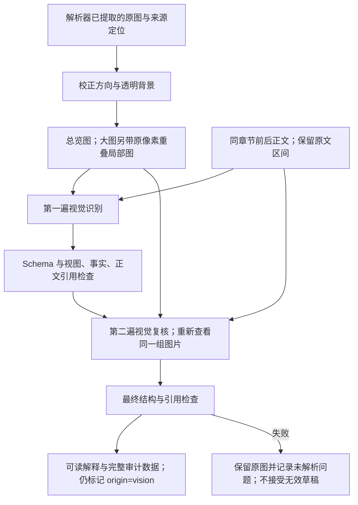

# 图片转文字：质量优化与独立验收

本次只调整已提取图片的解释，不调整规则提炼、两轮 RAG、测试点、用例或导出规则，不恢复 OCR 扫描。工程检查通过与真实识别准确是两件事；当前真实效果仍待逐图验收。

## 1. 现在如何处理一张图片



1. **保留细节**：旧正式装配使用最长边 1600 像素的单图。现在总览最长边默认 2048；大图再提供原像素局部图，边长 1536、重叠 192。总览与全部局部在同一次多图请求中提供，避免单独识别后拼接时丢失关系。小图不放大，不伪造清晰度。
2. **带上正文**：同文档、同章节，默认读取图片前后各 2 个原文块；总计最多 6000 字符，平均分配，按原顺序提供。每段带 Block、Locator、字符范围、截断标记。跨章节停止，其他图片解释不作为原文背景。
3. **分类识别**：界面关注字段、必填标记、可见约束、按钮和状态；流程图关注节点、箭头、分支、条件和回路；表格关注表头、行列及合并关系。只描述可见或正文明确支撑的信息。
4. **分开保存**：可见事实 `facts`、图中关系 `relations`、表格 `tables`、正文关联 `context_links`、不确定项 `uncertainties`。每项关联具体视图或已有事实；正文关联另引用正文 ID，不能冒充图片文字。
5. **再次看图核对**：默认再调用一次视觉模型，核对数字、否定词、分支、遗漏与无依据推断。第一遍 JSON 不合法也允许在这次复核重建；最终仍不合法就失败，不无限修复。
6. **保留审计与缓存边界**：保存草稿、最终结构、视图坐标、正文和复核标记。图片、上下文、模型、处理参数、两份提示词任一变化都会影响缓存身份；旧缓存不删除，也不会被当作新版本结果命中。

静态界面不能证明点击后的结果、角色独占权限、隐藏校验或后台行为。例如可见 `0/300` 不能自行认定为“最多 300 个汉字”。这类缺口必须保留为疑点，不能为了“业务逻辑丰富”补造事实。模型复核也可能重复第一遍的错误。

## 2. 配置与请求成本

保留 `workdir/local.yaml` 原有 `models.vision`、`parsing.vision_enabled` 和运行限流配置。如需显式调整，把以下内容**合并到已有 parsing 节点中**，不要添加第二个同名节点：

```yaml
parsing:
  vision:
    max_edge: 2048        # 总览最长边；小图不放大
    tile_edge: 1536       # 大图原像素局部边长
    tile_overlap: 192     # 局部图重叠；必须小于 tile_edge 的一半
    max_tiles: 16         # 局部图最多数量；不含总览
    detail: high         # 传给兼容多图接口的图像细节参数
    context_blocks: 2    # 同章节前、后各取多少个原文块
    context_chars: 6000  # 正文总字符预算，不是 token
    verify: true        # 默认进行第二次视觉复核
```

这些是程序默认值，不需要为了生效重复填写。正式流程已装配新版；LLM、embedding、rerank 的配置不因此改变。`models.vision` 必须支持 Chat Completions 多图输入，不能只支持单图或纯文本。

正常无重试时每张图 **2 次请求**，6 张图约 12 次请求；两次都发送图片和上下文，所以输入、输出成本都会增加。局部图不是各自一轮请求，但会增加多图输入量。两遍都受原有并发、间隔、限流冷却、超时、重试和调用预算约束；重试额外计数。没有实际定价与账单时费用保持 `null`。

局部图超过 `max_tiles` 时报告 `IMAGE_VIEW_BUDGET`，不会只取前几块而漏掉图尾。可在确认服务商多图数量/像素限制后调整参数，或提供拆分清晰图片；默认最多 16 张局部加 1 张总览。若接口拒绝多图，不自动退回低质量单图。扫描页仍沿用现有未解析告警；本功能不渲染整页或新增 OCR。

## 3. 独立验收：只跑图片转文字

虚拟环境已激活、当前目录在仓库根目录时使用以下命令。`rag` 与 `tc-rag` 等价；未安装入口时可用 `python -m tc_rag.interfaces.cli` 替换 `rag`。

### 第一步：免费离线准备

```powershell
rag vision --run-id run_a188817f8471418991fa3d3556b77e39 --limit 6 --output-dir workdir/diagnostics/vision
```

该运行对应之前的《CW-流程审批全过程可评论_文字版.docx》，复用已保存的原图及 `chunk` 快照，不重新解析文档。更换材料时换成已有且包含图片与快照的运行 ID。

默认不创建模型客户端、不发送图文、不运行规则提炼/向量化/重排/测试点/用例生成。它会验证资产校验和、生成实际将发送的总览与局部图，展示正文、原图和历史解释。没有 `chunk` 快照或没有图片会明确失败。离线“本轮解释”为空是正常现象。

### 第二步：确认付费后先测一张

下面命令是**真实调用**，会把所选图片及邻近正文发送到当前 `models.vision` 的服务地址。只有决定付费验证时执行；本次开发没有替你执行。

```powershell
rag vision --run-id run_a188817f8471418991fa3d3556b77e39 --limit 1 --live --output-dir workdir/diagnostics/vision
```

先检查接口是否支持多图、是否截断输出、两遍是否完成。确认后，将 `--limit 1` 改为 `--limit 6` 测完六张；去掉 `--limit` 才会处理该运行全部图片。每次命令生成独立目录，不覆盖上一轮结果。独立验收不共享主运行的视觉缓存，因此重复执行 `--live` 会再次产生费用。

### 第三步：打开页面逐图核对

命令打印 `.../vision_check_<id>/review.html`。用浏览器打开，对照原图、历史解释、本轮解释，展开结构化数据检查来源；选择“通过/需调整”，填写具体错漏，最后点击“导出人工审核 JSON”。页面无外部脚本，不把标注上传。请导出 JSON 留档，不仅依赖浏览器本地缓存。

| 产物 | 用途 |
|---|---|
| `review.html` | 原图、历史/本轮解释、局部图链接、人工结论 |
| `results.json` | 参数、来源、模型调用数量、耗时、usage、每张图的结构与结果 |
| `images/001/...` | 原图副本、总览与全部局部图；可核对右侧和底部是否完整 |
| `vision.sqlite` | 仅真实验收时生成；独立调用记录与视觉结果，不写主业务库 |
| 浏览器下载的 `vision_review.json` | 人工结论及问题说明；未审核项与通过项分开 |

主库 `workdir/data.sqlite` 只读。验收输出留在私有 `workdir`，不要提交真实需求与图片。

## 4. 怎样判断质量改善

历史解释只作问题定位参考，不能当作严格对照实验：当时模型、配置、提示词可能不同。比较时固定原图、正文、模型及输出额度，并保存各轮 `results.json`；比较事实内容，不能用“文字更多”作为质量指标。

建议每张图按以下顺序核对，并记录分母及具体错误：

| 维度 | 核对方法 | 建议验收门槛（目标，不是已测结果） |
|---|---|---|
| 可见文字与数值 | 字段、标记、数字、单位、否定词逐项对照原图 | 关键数字、条件、否定词错误为 0 |
| 业务关系完整性 | 对照明确可见的流程边、条件、状态、表格行；正文关系单独核对 | 关键分支和约束遗漏为 0 |
| 无依据推断 | 查是否把静态按钮写成已发生行为、把一般权限写成独占权限 | 无依据确定断言为 0 |
| 来源可追溯 | 每个视图/事实/正文引用可定位；正文解释没有冒充图片原文 | 程序引用检查全通过，人工来源混淆为 0 |
| 不确定性 | 模糊文字、歧义连线、缺少条件是否明确标记 | 不用猜测替代“不确定” |
| 工程可靠性 | 局部图覆盖全图、超预算显式失败、有效结果才缓存 | 不静默漏图；失败有记录 |

如需量化：`关键事实覆盖率 = 正确识别的人工标记关键事实数 / 原图全部已标记关键事实数`；`断言准确率 = 人工认定有依据且正确的断言数 / 本轮全部待核对断言数`。没有标注分母时不填写百分比；不能把 Schema 成功率当业务准确率。未核对、看不清、存在争议的项单列，不能自动算正确。

可先填此表，一次审完六张：

| 图片 | 关键事实总数 | 正确覆盖数 | 错字/数字/否定错误 | 关键遗漏 | 无依据断言 | 来源混淆 | 结论 |
|---|---|---|---|---|---|---|---|
| 1～6（逐图填写） | 待填 | 待填 | 待填 | 待填 | 待填 | 待填 | 待审核 |

现有六张主要覆盖界面图；还应补充至少一张长流程图、一张密集表格和一张模糊/歧义图。合成像素测试只能证明切图不漏像素，不能证明真实模型识别出全部流程逻辑。

## 5. 数据与代码审核入口

正式运行仍使用原有 `rag_records` 的 `kind=vision` JSON 载荷；原有 `text/model/version` 保留，新增可选 `details` 包含草稿、结构化最终解释、正文、视图坐标、`draft_valid`、`model_verified`、`human_verified=false`。没有新增数据库列或依赖。

`document_blocks` 中派生文字仍是 `origin=vision`，保留图片 Locator、模型和版本，始终带不确定性。下游继续读取可读解释；没有修改下游 Schema、业务规则或导出格式。更丰富的视觉输入可能影响后续提炼数量与内容，这是需要后续验收的输入质量变化，不能声称与旧模型输出逐字相同。

关闭 `runtime.cache_enabled` 时不读取旧结果，但新版结构化视觉审计仍然保存，避免验收资料随缓存开关丢失；旧端口无结构化审计时保留原语义。

| 文件 | 本轮作用 |
|---|---|
| `src/tc_rag/core/config.py` | 类型化视觉质量配置与范围校验 |
| `src/tc_rag/domain/vision.py`、`domain/rag.py` | 视觉事实/关系/审计模型与已有缓存载荷兼容 |
| `src/tc_rag/application/ports/contracts.py` | 视觉结果可携带结构化审计数据 |
| `src/tc_rag/application/services/vision_content.py` | 相邻正文与可读解释组织 |
| `src/tc_rag/application/services/vision.py` | 上下文参与缓存、保留来源、保存审计 |
| `src/tc_rag/infrastructure/providers/vision_images.py` | 像素保真、重叠切图与覆盖限制 |
| `src/tc_rag/infrastructure/providers/vision.py` | 多图识别、视觉复核、最终校验及原有请求治理 |
| `src/tc_rag/bootstrap.py` | 正式流程与独立验收共用视觉装配 |
| `src/tc_rag/interfaces/vision_check.py`、`interfaces/cli.py` | `vision` 独立命令，默认离线 |
| `src/tc_rag/interfaces/progress.py` | 独立视觉流程可显示自己的阶段说明；原流程默认不变 |
| `src/tc_rag/infrastructure/exporters/vision_review.py` | 私有离线对照页面、JSON 与人工标记 |
| `prompts/vision/v2.md`、`prompts/vision_verify/v1.md` | 识别与复核各自版本化，不改其他阶段提示词 |
| `pyproject.toml` | 安装包包含两份新提示词；未新增依赖 |

新增离线验证覆盖：长宽图全像素覆盖与底部保留、透明背景、预算失败、正文边界与顺序、结构和引用拒绝、复核纠错、调用预算、缓存失效、历史载荷兼容、默认零模型调用、独立数据库与仅视觉调用、页面内容转义。相关测试在 `test_vision_quality.py`、`test_vision_quality_http.py`、`test_vision_check_cli.py`，并保留原适配器回归。

## 6. 审核与回滚

重点审核三件事：是否正确分开“图片可见”和“正文关联”；关键条件有没有漏或被补造；两遍调用的成本与延迟是否可接受。`model_verified=true` 只表示完成模型复核，不表示人工批准或语义已证实。

临时关闭 `parsing.vision.verify` 可以省第二遍费用，但属于质量与成本取舍，不是完整回滚。完整回滚应恢复本次视觉相关代码、默认装配与提示词资源，保持它们成套兼容；不能只把提示词改为自由文本 v1，却继续要求 v2 JSON。旧 v1 文件、历史事实与原图都保留。不要用 `git reset --hard` 覆盖工作区其他修改。

本次未改本地密钥、模型供应商、并发或业务数据库，也没有执行真实模型验收。真实质量、实际费用与真实延迟必须在上述独立验收后填写。

## 7. 本轮验证记录（2026-11-03）

- `python -m pytest -q --basetemp=workdir/dev/tests/vision-quality-verified-final`：652 通过，2 跳过，66.68 秒；默认离线。
- `python -m ruff check .`：通过；`python -m mypy src`：62 个源文件通过。
- `git diff --check`：通过；CLI 主帮助与 `vision --help` 可用；两份新提示词已列入安装资源且文件存在，未声称实际构建 wheel。
- 本机六图[离线对照页面](../../workdir/dev/benchmarks/vision-quality-20261103/vision_check_589761f8fd26421c902418515821e2f4/review.html)与同目录 `results.json` 已生成。该链接只适用于本工作区，产物不纳入 Git。
- 离线结果：6 张图，视图准备失败 0 张，模型调用 0 次；6 张均在总览尺寸内，每图 1 张视图，不需要局部切图。真实新解释尚为空，`business_accuracy=null`。

用户现在可先看该页面的原图、正文与视图计划，再按第三节显式执行一张的 `--live` 验收。真实调用后请审查全部关键文字和条件；本轮没有填写未经测量的质量增益。
